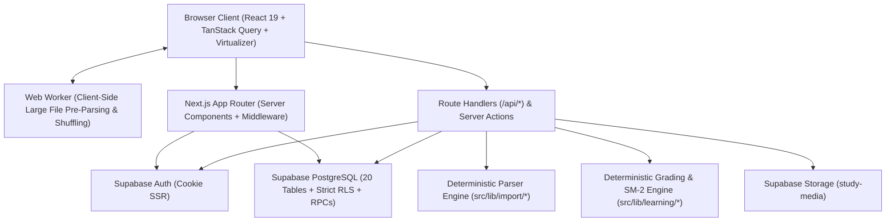

# StudyHub V1.0 — Full-Stack Architecture Specification

> **Stack:** Next.js App Router (TypeScript `strict: true`), React 19, Tailwind CSS, shadcn/ui, Lucide React, Motion (`motion/react`), React Hook Form + Zod, TanStack Query, TanStack Virtual, Recharts, Supabase (PostgreSQL + Auth + Storage + SSR SDK).
> **Core Principle:** 100% deterministic logic. Zero AI/LLM services, zero payment systems, zero mock data.

---

## 1. System Architecture Diagram



---

## 2. Canonical Directory Structure

```text
StudyHub/
├── AGENTS.md
├── README.md
├── package.json
├── tsconfig.json
├── next.config.ts
├── eslint.config.mjs
├── vitest.config.ts
├── playwright.config.ts
├── .env.example
├── docs/
│   ├── PRD.md
│   ├── ARCHITECTURE.md
│   ├── DATABASE.md
│   ├── DESIGN_SYSTEM.md
│   ├── IMPORT_FORMATS.md
│   ├── SECURITY.md
│   ├── TESTING.md
│   ├── DEPLOYMENT.md
│   ├── IMPLEMENTATION_PLAN.md
│   ├── SWARM_TASKS.md
│   ├── PROGRESS.md
│   └── SKILLS.md
├── supabase/
│   ├── config.toml
│   ├── migrations/
│   │   ├── 00001_initial_schema.sql
│   │   ├── 00002_indexes_and_triggers.sql
│   │   ├── 00003_rls_policies.sql
│   │   ├── 00004_exam_and_share_rpcs.sql
│   │   └── 00005_storage_bucket.sql
│   └── seed.sql (optional dev-only sample seed, never imported in app runtime)
├── src/
│   ├── middleware.ts                  # Supabase SSR session refresh + protected route guard
│   ├── app/
│   │   ├── layout.tsx                 # Root HTML (lang="vi", Inter font, skip link)
│   │   ├── globals.css                # Tailwind + Light/Dark CSS tokens + reduced motion
│   │   ├── providers.tsx              # ThemeProvider, QueryClientProvider, I18nProvider, MotionConfig, Toaster
│   │   ├── page.tsx                   # Public landing page (/)
│   │   ├── (auth)/
│   │   │   ├── login/page.tsx
│   │   │   ├── register/page.tsx
│   │   │   ├── forgot-password/page.tsx
│   │   │   └── reset-password/page.tsx
│   │   ├── auth/
│   │   │   └── callback/route.ts      # OAuth / Magic Link / Reset code exchange
│   │   ├── (app)/                     # Authenticated AppShell layout (Sidebar + Mobile Nav)
│   │   │   ├── layout.tsx
│   │   │   ├── dashboard/page.tsx
│   │   │   ├── library/page.tsx
│   │   │   ├── folders/[id]/page.tsx
│   │   │   ├── sets/
│   │   │   │   ├── new/page.tsx
│   │   │   │   └── [id]/
│   │   │   │       ├── page.tsx
│   │   │   │       ├── edit/page.tsx
│   │   │   │       ├── import/page.tsx
│   │   │   │       ├── flashcards/page.tsx
│   │   │   │       ├── learn/page.tsx
│   │   │   │       ├── practice/page.tsx
│   │   │   │       ├── write/page.tsx
│   │   │   │       ├── match/page.tsx
│   │   │   │       ├── test/page.tsx
│   │   │   │       └── results/[attemptId]/page.tsx
│   │   │   ├── review/page.tsx
│   │   │   ├── starred/page.tsx
│   │   │   ├── history/page.tsx
│   │   │   ├── statistics/page.tsx
│   │   │   ├── shared/page.tsx
│   │   │   ├── friends/page.tsx
│   │   │   ├── profile/page.tsx
│   │   │   └── settings/page.tsx
│   │   ├── share/[token]/page.tsx     # Public/Authenticated share link landing & redeem
│   │   └── api/
│   │       ├── health/route.ts
│   │       ├── folders/route.ts & [id]/route.ts
│   │       ├── sets/route.ts
│   │       ├── sets/[id]/route.ts
│   │       ├── sets/[id]/questions/route.ts
│   │       ├── sets/[id]/questions/bulk/route.ts
│   │       ├── sets/[id]/clone/route.ts
│   │       ├── sets/[id]/export/route.ts
│   │       ├── sets/[id]/members/route.ts
│   │       ├── sets/[id]/share-links/route.ts
│   │       ├── share-links/[token]/redeem/route.ts
│   │       ├── import/parse/route.ts
│   │       ├── import/commit/route.ts
│   │       ├── sessions/route.ts
│   │       ├── sessions/[id]/answer/route.ts
│   │       ├── sessions/[id]/complete/route.ts
│   │       ├── exams/route.ts
│   │       ├── exams/[attemptId]/route.ts
│   │       ├── exams/[attemptId]/answer/route.ts
│   │       ├── exams/[attemptId]/submit/route.ts
│   │       ├── progress/star/route.ts
│   │       ├── review/queue/route.ts
│   │       ├── statistics/route.ts
│   │       ├── friends/route.ts
│   │       ├── friends/[id]/route.ts
│   │       └── profile/route.ts
│   ├── components/
│   │   ├── ui/                        # shadcn/ui accessible primitives
│   │   ├── layout/                    # AppShell, Sidebar, MobileBottomNav, FocusModeShell, TopBar
│   │   ├── auth/                      # LoginForm, RegisterForm, ResetPasswordForm
│   │   ├── library/                   # StudySetCard, FolderTree, FilterBar, ShareDialog
│   │   ├── editor/                    # VirtualizedQuestionList, QuestionEditorForm, BulkTagBar
│   │   ├── import/                    # 6-Step ImportWizard, ColumnMapper, ConflictResolver, PreviewList
│   │   ├── learning/                  # FlashcardDeck, LearnEngineUI, PracticeUI, WriteUI, MatchBoard
│   │   ├── exam/                      # ExamConfigForm, ExamRunner, QuestionNavigatorGrid, ResultBreakdown
│   │   ├── analytics/                 # AccuracyChart, ActivityHeatmap, MasteryBreakdown (Recharts)
│   │   └── social/                    # FriendList, AddFriendDialog, SharedSetList
│   ├── lib/
│   │   ├── utils.ts                   # cn() and pure formatting helpers
│   │   ├── supabase/
│   │   │   ├── client.ts              # createBrowserClient<Database>()
│   │   │   ├── server.ts              # createServerClient<Database>() (cookies)
│   │   │   ├── admin.ts               # Server-only service_role client (import 'server-only')
│   │   │   └── middleware.ts          # Session update helper
│   │   ├── i18n/
│   │   │   ├── index.ts
│   │   │   ├── context.tsx
│   │   │   ├── vi.ts                  # Vietnamese dictionary (default)
│   │   │   └── en.ts                  # English dictionary
│   │   ├── validation/                # Zod schemas shared between API & forms
│   │   ├── security/                  # Rate limiter, magic-byte check, zip-bomb guard, text sanitizer
│   │   ├── import/                    # Pure deterministic parsers (EduQuiz, Word, OOXML DOCX, XLSX, CSV, TSV, JSON)
│   │   ├── export/                    # Deterministic exporters (JSON, CSV, XLSX, Printable HTML/PDF view)
│   │   └── learning/
│   │       ├── grading.ts             # Pure deterministic grading (UUID options + text normalization)
│   │       ├── sm2.ts                 # Pure deterministic SM-2 spaced repetition algorithm
│   │       ├── shuffle.ts             # Seeded Fisher-Yates shuffle
│   │       └── exam-snapshot.ts       # Snapshot builder & pre-submit sanitizer
│   └── types/
│       ├── database.ts                # Exact 20-table Supabase TypeScript schema
│       ├── domain.ts                  # Canonical application domain types
│       └── import.ts                  # Parser & 6-step import wizard types
└── tests/
    ├── unit/                          # Vitest unit tests (parsers, SM-2, grading, security)
    ├── integration/                   # API handler & RLS integration tests
    ├── fixtures/                      # Real sample files (.txt, .docx, .xlsx, .csv, .tsv, .json, stress 600 & 10k)
    └── e2e/                           # Playwright end-to-end test suite
```

---

## 3. Server Components vs. Client Components Strategy

| Layer | Default Component Type | Rationale |
| --- | --- | --- |
| Public Landing (`/`), Auth shells, App Layout shell | **Server Component** | Zero unnecessary client JS; verifies Supabase session on the server before streaming HTML. |
| Dashboard, Library, Folder Detail, Study Set Overview, History, Statistics, Friends, Profile | **Server Component** (initial data fetch + auth check) passing initial props to small interactive **Client Components** | Fast TTFB, SEO/clean SSR, prevents loading flashes while keeping filters/mutations snappy via TanStack Query. |
| Study Set Editor (`/sets/[id]/edit`) | **Client Component** wrapped by Server auth/access check | Requires React Hook Form, `@tanstack/react-virtual` for 10,000+ questions, dirty-state protection, and bulk mutations. |
| 6-Step Import Wizard (`/sets/[id]/import`) | **Client Component** + Server `/api/import/parse` & `/api/import/commit` | Handles drag-and-drop file validation, column mapping, virtualized preview, and chunked commits. |
| Active Study Modes (`flashcards`, `learn`, `practice`, `write`, `match`, `test`) | **Client Component** inside Focus-Mode Shell | Keyboard shortcuts (`Space`, `1-4`, `Arrows`, `Enter`), instant micro-interactions (`motion/react`), local autosave & optimistic UI, server-authoritative grading for exams. |

**Strict Rule:** Never pass `SUPABASE_SERVICE_ROLE_KEY`, `correct_option_ids` (for active exams), or unredacted secrets into any Client Component props. Mark `src/lib/supabase/admin.ts` with `import 'server-only'`.

---

## 4. REST Route Handler & Server Action API Contract

All JSON endpoints follow a uniform envelope:
- **Success:** `{ "data": T, "meta"?: { "total"?: number, "page"?: number, "pageSize"?: number } }`
- **Error:** `{ "error": { "code": string, "message": string, "details"?: unknown } }`

### Core Endpoints

| Method | Endpoint | Auth | Purpose & Key Contract |
| --- | --- | --- | --- |
| `GET` | `/api/health` | Public | Health check (`{ status: "ok", timestamp }`). |
| `GET` / `POST` | `/api/folders` | Required | List user's folders; create folder (`name`, `parent_id?`, `color?`, `icon?`). |
| `PATCH` / `DELETE` | `/api/folders/[id]` | Owner | Update folder or delete (sets child sets' `folder_id = NULL`). |
| `GET` / `POST` | `/api/sets` | Required | Paginated list of owned/shared sets (`search`, `folderId`, `type`, `sort`, `page`, `pageSize`); create new study set. |
| `GET` / `PATCH` / `DELETE` | `/api/sets/[id]` | Read / Edit / Owner | Fetch set metadata + chapter summary; update metadata; delete set. |
| `GET` / `POST` | `/api/sets/[id]/questions` | Read / Edit | Paginated/cursor-based question listing (`page`, `pageSize=100`, `chapter`, `search`, `tagId`, `difficulty`, `starredOnly`); create single question with options/accepted answers. |
| `POST` / `PATCH` / `DELETE` | `/api/sets/[id]/questions/bulk` | Edit | Bulk insert (chunked 500/batch), bulk update chapter/tags/difficulty, bulk delete by UUID array. |
| `POST` | `/api/sets/[id]/clone` | Read (`allow_clone`) | Deep-copies study set, questions, options, and accepted answers into caller's library. |
| `GET` | `/api/sets/[id]/export?format=json\|csv\|xlsx` | Read | Streams deterministic export file with `Content-Disposition: attachment`. |
| `GET` / `POST` / `PATCH` / `DELETE` | `/api/sets/[id]/members` | Owner (Read: Member) | Manage collaborator roles (`viewer`, `editor`) for friends. |
| `GET` / `POST` / `DELETE` | `/api/sets/[id]/share-links` | Owner | Create revocable share token (`permission`, `allow_clone`, `expires_at?`) or revoke (`revoked_at = now()`). |
| `POST` | `/api/share-links/[token]/redeem` | Required | Validates active non-expired token, grants membership or returns read-only preview. |
| `POST` | `/api/import/parse` | Required | Multipart upload or raw text -> runs security validation (MIME, magic bytes, zip-bomb guard) + deterministic parser -> returns `ImportPreviewResult` (capped preview or job ID). |
| `POST` | `/api/import/commit` | Required + Set Edit | Persists user-confirmed, validated `ParsedQuestion[]` in batched transactions (500 rows/chunk), logs `import_jobs` row. |
| `POST` | `/api/sessions` | Required + Set Read | Starts a study session (`flashcards`\|`learn`\|`practice`\|`write`\|`match`\|`review`). |
| `POST` | `/api/sessions/[id]/answer` | Owner | Records answer, grades deterministically, updates `user_question_progress` via SM-2. |
| `POST` | `/api/sessions/[id]/complete` | Owner | Finalizes `study_sessions` summary and `study_sets.last_studied_at`. |
| `POST` | `/api/exams` | Required + Set Read | Creates immutable `exam_attempts` + `exam_attempt_questions` snapshot. **Returns questions WITHOUT `correct_option_ids`, `accepted_answers_snapshot`, or `explanation_snapshot`.** |
| `GET` | `/api/exams/[attemptId]` | Owner | If `in_progress`: returns sanitized questions + saved answers + server `remainingSeconds`. If `submitted`/`expired`: returns full graded breakdown with correct answers & explanations. |
| `PUT` | `/api/exams/[attemptId]/answer` | Owner | Autosaves single answer (`attempt_question_id`, `selected_option_ids`, `typed_answer`, `is_flagged`). Rejects with `409 Conflict` if expired or already submitted. |
| `POST` | `/api/exams/[attemptId]/submit` | Owner | Calls atomic idempotent grading RPC (`submit_exam_attempt`), updates SM-2 progress, returns graded result. |
| `POST` | `/api/progress/star` | Required | Toggles `starred_questions` for `(user_id, question_id)`. |
| `GET` | `/api/review/queue` | Required | Returns SM-2 due questions (`next_review_at <= now()`) plus wrong/weak question queue. |
| `GET` | `/api/statistics` | Required | Aggregates study streak, daily activity (30/90 days), mastery distribution, exam score trend, weakest chapters. |
| `GET` / `POST` | `/api/friends` | Required | Lists friends/pending requests; sends friend request by exact `username` or `email` (no user-enumeration dump). |
| `PATCH` / `DELETE` | `/api/friends/[id]` | Participant | Accept, decline, block, or remove friendship. |
| `GET` / `PATCH` | `/api/profile` | Required | Reads/updates `profiles` and `user_preferences`. |

---

## 5. Shared TypeScript Domain Contracts

Canonical definitions live in `src/types/domain.ts`, `src/types/import.ts`, and `src/types/database.ts`. All workers MUST import from these modules rather than redefining types locally.

### Key Enums & Unions (`src/types/domain.ts`)
- `Locale = 'vi' | 'en'`
- `ThemePreference = 'light' | 'dark' | 'system'`
- `StudySetType = 'multiple_choice' | 'flashcards' | 'mixed'`
- `Visibility = 'private' | 'unlisted' | 'public' | 'shared'`
- `MemberRole = 'owner' | 'editor' | 'viewer'`
- `SharePermission = 'editor' | 'viewer'`
- `QuestionType = 'single_choice' | 'multiple_choice' | 'true_false' | 'flashcard' | 'short_answer'`
- `ExamQuestionType = Exclude<QuestionType, 'flashcard'>`
- `AnswerMatchMode = 'exact' | 'case_insensitive' | 'ignore_diacritics' | 'numeric'`
- `DifficultyLevel = 'easy' | 'medium' | 'hard'`
- `MasteryLevel = 'new' | 'learning' | 'familiar' | 'mastered'`
- `SelfRating = 'again' | 'hard' | 'good' | 'easy'`
- `StudyMode = 'flashcards' | 'learn' | 'practice' | 'write' | 'match' | 'review'`
- `SessionStatus = 'in_progress' | 'completed' | 'abandoned'`
- `ExamStatus = 'in_progress' | 'submitted' | 'expired'`
- `FriendshipStatus = 'pending' | 'accepted' | 'declined' | 'blocked'`
- `ImportJobStatus = 'pending' | 'parsing' | 'preview_ready' | 'importing' | 'completed' | 'failed'`

### Key Import Contracts (`src/types/import.ts`)
- `ImportFormat = 'eduquiz_txt' | 'word_answer_key' | 'docx_ooxml' | 'xlsx_wayground' | 'xlsx_generic' | 'quizlet_tsv' | 'csv' | 'json' | 'txt_generic'`
- `AnswerDetectionSource = 'asterisk_prefix' | 'inline_answer_key' | 'end_answer_key' | 'docx_bold' | 'docx_highlight' | 'docx_font_color' | 'docx_underline' | 'column_mapping' | 'json_explicit' | 'manual' | 'none'`
- `AnswerRuleMode = 'auto' | 'asterisk_prefix' | 'inline_answer_key' | 'end_answer_key' | 'docx_bold' | 'docx_highlight' | 'docx_font_color' | 'docx_underline'`
- `ImportIssueSeverity = 'error' | 'warning' | 'info'`
- `ImportValidationIssue`: `{ id: string; code: ImportValidationIssueCode; severity: ImportIssueSeverity; questionIndex?: number; optionIndex?: number; message: string; details?: string }`
- `ParsedOption`: `{ id: string; label: string; content: string; isCorrect: boolean; imageUrl?: string | null; detectedBy: AnswerDetectionSource[]; formatting?: OptionFormattingMeta }`
- `ParsedQuestion`: `{ tempId: string; index: number; chapter?: string | null; chapterIndex?: number; localQuestionNumber?: number | null; questionType: QuestionType; prompt: string; promptImageUrl?: string | null; backText?: string | null; backImageUrl?: string | null; explanation?: string | null; hint?: string | null; difficulty: DifficultyLevel; tags: string[]; options: ParsedOption[]; acceptedAnswers?: ParsedAcceptedAnswer[]; detectedBy: AnswerDetectionSource[]; rawSource?: string; isDuplicate?: boolean; excluded?: boolean; issues: ImportValidationIssue[] }`

---

## 6. Performance Strategy for 10,000+ Questions

StudyHub MUST handle study sets with **10,000+ questions** smoothly without freezing the browser tab or timing out API calls:

1. **Paginated & Filtered Server Queries:** `/api/sets/[id]/questions` uses keyset/offset pagination (default `pageSize=100`, max `500`) backed by composite index `(study_set_id, position)`.
2. **DOM Virtualization (`@tanstack/react-virtual`):**
   - Study Set Editor question list
   - Import Wizard Step 4 (Preview & Inline Fix)
   - Exam Navigator Grid (for 200+ question exams)
   - Question Bank Browser & Review Queue
   Only ~20–30 DOM rows are mounted at any moment regardless of total count.
3. **Chunked Bulk Database Commits:** `/api/import/commit` inserts `questions`, `question_options`, and `question_accepted_answers` in batches of **500 questions per batch** inside PostgreSQL transactions, reporting deterministic progress cleanly.
4. **Non-Blocking Parsing:**
   - Client-side text/TSV/CSV pre-parsing for files > 1 MB runs inside a dedicated Web Worker (or streamed server-side via `/api/import/parse` for binary `.docx`/`.xlsx`) so the main thread stays at 60 fps.
   - All regexes in `src/lib/import/*` are linear-time (no catastrophic backtracking / ReDoS).
- **TanStack Query Caching:**
  - `staleTime`: 60s for set metadata & folders, 0s for active exam state.
  - Optimistic updates for starring questions and toggling exam flags, with automatic rollback on network failure.
  - Prefetch next question batch during Practice/Learn pagination.

---

## 7. StudyHub V2.0–V3.0 Architecture Extensions (Complete Learning Edition)

StudyHub V3.0 extends the V1.0 baseline cleanly to **114 App Router routes** (`70` API Route Handlers + `3` `/auth/*` routes + `40` `page.tsx` + `/_not-found`) plus `src/proxy.ts` (Next.js 16 Proxy middleware) and **36 RLS-enabled PostgreSQL tables** (Migrations `0001`–`0016`):

### 7.1 New V2.0–V3.0 App Router Pages & APIs
- **Universal Multi-Subject Exams & Practice (V2.0):** `/exams`, `/exams/new`, `/exams/[attemptId]`, `/exams/[attemptId]/results`, `/practice`, `/folders`, `/import`, plus `/api/exams/{eligible,preview}`, `/api/exam-presets/*`, `/api/coverage-cycles/*`, `/api/practice/questions`, `/api/account/{data,restore}`, `/api/uploads/{image,signed-url}`.
- **V3.0 Complete Learning Routes:**
  - **Spell Mode:** `/sets/[id]/spell`
  - **Visual Diagram Mode:** `/sets/[id]/diagrams`, `/diagrams/[id]/edit`, `/diagrams/[id]/study` (`/api/diagrams`, `/api/diagrams/[id]`, `/api/sets/[id]/diagrams`)
  - **Offline PWA Hub:** `/offline` + `public/sw.js` + `src/app/manifest.ts` (`/manifest.webmanifest`)
  - **V3.0 REST APIs:** `/api/uploads/audio`, `/api/media`, `/api/media/[id]`, `/api/passages`, `/api/passages/[id]`, `/api/notes`, `/api/reports`, `/api/reports/[id]`, `/api/checkpoints`, `/api/checkpoints/[sessionKey]`, `/api/progress/reset`, `/api/search`, `/api/sync/events`, `/api/export/pdf`.

### 7.2 V3.0 Pure Core Modules & Bundle Isolation Rules
- **Pure Testable Modules (`src/lib/*`):** `richtext/` (TipTap AST v1 + KaTeX `trust: false`), `media/` (image/audio magic-byte & SHA-256 validation), `audio/` (`tts.ts` + `recorder.ts`), `diagram/` (`geometry.ts` normalized `[0,1]` hit-test + 6-mode `study-engine.ts`), `questions/` (13-type registry), `learning/` (12-type `exam-scoring.ts`, `confidence.ts`, `adaptive-learn.ts`, `spell.ts`, `checkpoints.ts`), `import/` (`docx-ooxml-parser.ts` multimedia + `pdf-parser.ts` `pdfjs-dist`), `export/` (`pdf-exporter.ts` `pdf-lib` + `NotoSans`), `offline/` (`db.ts`, `download-manager.ts`, `offline-session.ts`, `sync-queue.ts`), and `ui/` (`shortcuts.ts`).
- **Strict Bundle & Server-Only Hygiene (Verified in Wave 5B & Wave 6 `.next/static/`):**
  - `next.config.ts` declares `serverExternalPackages: ["pdfjs-dist"]` and `pdf-parser.ts` preloads `globalThis.pdfjsWorker` so server-side PDF parsing succeeds in Turbopack production builds (`V3-PERF-01`).
  - Zero server parser/PDF libraries (`pdfjs-dist`, `pdf-lib`, `@pdf-lib/fontkit`, `exceljs`, `jszip`, `fast-xml-parser`, `mammoth`, `papaparse`) exist in `.next/static/` (`0 B` leaked).
  - Read-only & public routes import leaf modules directly (`@/components/richtext/RichContentRenderer`, `@/components/pwa/PwaProvider`, `@/components/media/ImageLightbox`), keeping TipTap (`145 KB` gzip) strictly lazy-loaded (`next/dynamic`) and skipping `@supabase/supabase-js`/IndexedDB bootstrap on anonymous public routes (`V3-PERF-02`, `V3-PERF-03`).

### 7.3 Account-Partitioned Offline PWA & Sync Architecture
- **IndexedDB Partitioning:** Every authenticated user gets an isolated database `studyhub-offline-v3:${userId}` (`idb`) storing downloaded set snapshots, `media_blobs`, `sync_events`, and `checkpoints`. Logout clears the active user pointer and prevents cross-account leakage (`0` sets visible on Account A → B switch).
- **Service Worker Boundaries (`public/sw.js`):** Served with `Cache-Control: no-cache, no-store, must-revalidate`; caches only immutable static assets and public offline shell while strictly bypassing `/api/*`, `/auth/*`, `/share/*`, cross-origin Supabase requests, and authenticated HTML; gates `skipWaiting()` on explicit `APPLY_UPDATE` (never reloads mid-exam).
- **Deterministic Sync Protocol (`POST /api/sync/events` -> `sync_offline_learning_events()`):** Single atomic PgBouncer-safe SQL RPC returning per-event deterministic verdicts: `applied`, `duplicate_ignored` (by `event_id`), `ignored_stale_reset` (comparing `progress_generation`), `rejected_revoked`, `rejected_deleted`, `conflict` (lossless note merge returning `server_version` + `server_data`), or `invalid` (cross-user replay anti-oracle).

### 7.4 Production Vercel Hobby Architecture (`0017`, `d09a379`, `2537345` — `71` API Routes, `37` RLS Tables)
To operate reliably at `$0/month` on Vercel Hobby (`https://studyhub-three-mauve.vercel.app`, Node.js `24.x`, Next.js `16.4.6` Turbopack) without hitting Edge 4.5 MB limits, cold-start tracing drops, or stateless memory resets:
- **Direct-to-Storage Inbound Bypass (`> 3.5 MB` -> `study-temp`):** `src/lib/media/direct-upload.ts` routes files `> 3.5 MB` through `POST /api/storage/upload-url` -> browser direct `PUT` into private bucket `study-temp/{userId}/{purpose}/{uuid}.{ext}` (RLS-scoped per user in `0017`) -> finalize route (`consumeTempUploadBytes()` in `src/lib/supabase/temp-storage.ts`, deleting staged blobs inside `finally` on both success and failure). `POST /api/import/parse` offloads extracted DOCX media `> 1.5 MB` to `study-temp/{userId}/import-media/`, and `buildVercelSafeCommitChunks()` (`src/lib/import/commit-chunker.ts`) caps every `POST /api/import/commit` chunk to `<= 2.5 MB` / `<= 500` questions.
- **Chunked `ReadableStream` Outbound Streaming (`src/lib/security/stream-response.ts`):** `POST /api/export/pdf`, `GET /api/sets/[id]/export`, `GET /api/account/data`, and `> 2 MB` `POST /api/import/parse` responses stream in 64 KB chunks without `Content-Length`, bypassing Vercel's 4.5 MB buffered response ceiling (up to 20 MB streamed).
- **Serverless Linux Tracing & Runtime Configuration (`next.config.ts`):** `outputFileTracingIncludes` explicitly traces `./src/assets/fonts/NotoSans-*.ttf` on `/api/export/pdf` and `pdfjs-dist` (`legacy/build/*.mjs`, `standard_fonts`, `cmaps`, excluding `.mjs.map`) on `/api/import/parse`; `images: { unoptimized: true }` prevents Vercel Image Optimization quota consumption; all heavy routes export `runtime = "nodejs"` and `maxDuration = 60`.
- **Distributed PostgreSQL Rate Limiting (`0017`):** `public.api_rate_limits` (table #37, strict deny-all RLS) + `service_role`-only `check_and_increment_rate_limit()` enforces atomic sliding-window limits across stateless Vercel serverless isolates (`x-vercel-forwarded-for` IP priority). See [`docs/DEPLOYMENT.md`](./DEPLOYMENT.md), [`docs/PRODUCTION_RUNBOOK.md`](./PRODUCTION_RUNBOOK.md), and [`docs/FREE_TIER_LIMITATIONS.md`](./FREE_TIER_LIMITATIONS.md).
