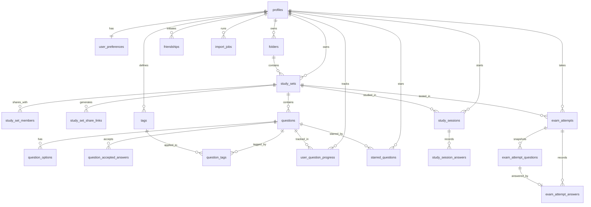

# StudyHub V1.0 — Database Schema & Row-Level Security Specification

> **Database Engine:** PostgreSQL 15+ on Supabase (`@supabase/supabase-js` + `@supabase/ssr`).
> **ORM Policy:** No Prisma, no Drizzle. Direct SQL migrations in `supabase/migrations/` and typed queries via `src/types/database.ts`.
> **Primary Keys:** UUID (`gen_random_uuid()`) across all 20 tables.
> **RLS Policy:** Enabled and enforced on **every single table** in the `public` schema. No table is publicly writable or readable without an explicit policy.
> **Type Alignment:** Every table, column, enum, and RPC below matches `src/types/database.ts`, `src/types/domain.ts`, and `src/types/import.ts` 1:1.

---

## 1. Entity Relationship Overview



---

## 2. Canonical Table Definitions (All 20 Tables)

All timestamps use `timestamptz NOT NULL DEFAULT now()`. All `updated_at` columns are automatically maintained via a shared `public.set_updated_at()` trigger function.

### 2.1 `profiles`
Mirrors authenticated users from `auth.users` via an `AFTER INSERT ON auth.users` trigger (`handle_new_user()`).

| Column | Type | Constraints | Notes |
| --- | --- | --- | --- |
| `id` | `uuid` | `PRIMARY KEY REFERENCES auth.users(id) ON DELETE CASCADE` | Matches Supabase Auth UID |
| `email` | `text` | `NOT NULL` | Synced from `auth.users.email` |
| `display_name` | `text` | `NOT NULL` | Default derived from metadata or email prefix |
| `username` | `text` | `UNIQUE CHECK (username ~ '^[a-z0-9_]{3,30}$')` | Optional friend-search handle |
| `avatar_url` | `text` | `NULL` | Safe HTTPS URL or Storage path |
| `bio` | `text` | `CHECK (char_length(bio) <= 300)` | Short student bio |
| `created_at` | `timestamptz` | `NOT NULL DEFAULT now()` | |
| `updated_at` | `timestamptz` | `NOT NULL DEFAULT now()` | Trigger-maintained |

### 2.2 `user_preferences`
Per-user UI, study, and accessibility preferences. Created automatically alongside `profiles` in `handle_new_user()`.

| Column | Type | Constraints | Notes |
| --- | --- | --- | --- |
| `user_id` | `uuid` | `PRIMARY KEY REFERENCES public.profiles(id) ON DELETE CASCADE` | 1:1 with `profiles` |
| `language` | `text` | `NOT NULL DEFAULT 'vi' CHECK (language IN ('vi', 'en'))` | Default Vietnamese |
| `theme` | `text` | `NOT NULL DEFAULT 'system' CHECK (theme IN ('light', 'dark', 'system'))` | Light / Dark / System |
| `daily_goal` | `integer` | `NOT NULL DEFAULT 20 CHECK (daily_goal BETWEEN 1 AND 500)` | Daily cards/questions target |
| `default_shuffle_questions` | `boolean` | `NOT NULL DEFAULT false` | |
| `default_shuffle_options` | `boolean` | `NOT NULL DEFAULT true` | |
| `show_instant_feedback` | `boolean` | `NOT NULL DEFAULT true` | Used in Learn/Practice |
| `sound_effects` | `boolean` | `NOT NULL DEFAULT false` | Opt-in audio cues |
| `reduced_motion` | `boolean` | `NOT NULL DEFAULT false` | App-level override in addition to OS preference |
| `updated_at` | `timestamptz` | `NOT NULL DEFAULT now()` | Trigger-maintained |

### 2.3 `folders`
Hierarchical organization of study sets (e.g., Semester -> Subject).

| Column | Type | Constraints | Notes |
| --- | --- | --- | --- |
| `id` | `uuid` | `PRIMARY KEY DEFAULT gen_random_uuid()` | |
| `owner_id` | `uuid` | `NOT NULL REFERENCES public.profiles(id) ON DELETE CASCADE` | |
| `parent_id` | `uuid` | `REFERENCES public.folders(id) ON DELETE SET NULL` | Optional nesting |
| `name` | `text` | `NOT NULL CHECK (char_length(trim(name)) BETWEEN 1 AND 120)` | |
| `description` | `text` | `CHECK (char_length(description) <= 500)` | |
| `color` | `text` | `NOT NULL DEFAULT 'indigo'` | Allowed palette token |
| `icon` | `text` | `NOT NULL DEFAULT 'folder'` | Lucide icon name |
| `sort_order` | `integer` | `NOT NULL DEFAULT 0` | Manual sorting |
| `created_at` | `timestamptz` | `NOT NULL DEFAULT now()` | |
| `updated_at` | `timestamptz` | `NOT NULL DEFAULT now()` | |

### 2.4 `study_sets`
Core container for questions and flashcards.

| Column | Type | Constraints | Notes |
| --- | --- | --- | --- |
| `id` | `uuid` | `PRIMARY KEY DEFAULT gen_random_uuid()` | |
| `owner_id` | `uuid` | `NOT NULL REFERENCES public.profiles(id) ON DELETE CASCADE` | |
| `folder_id` | `uuid` | `REFERENCES public.folders(id) ON DELETE SET NULL` | |
| `title` | `text` | `NOT NULL CHECK (char_length(trim(title)) BETWEEN 1 AND 200)` | |
| `description` | `text` | `CHECK (char_length(description) <= 2000)` | |
| `subject` | `text` | `CHECK (char_length(subject) <= 100)` | e.g., "Giải tích 1", "IELTS" |
| `set_type` | `text` | `NOT NULL DEFAULT 'multiple_choice' CHECK (set_type IN ('multiple_choice', 'flashcards', 'mixed'))` | |
| `visibility` | `text` | `NOT NULL DEFAULT 'private' CHECK (visibility IN ('private', 'unlisted', 'public', 'shared'))` | |
| `source_language` | `text` | `NOT NULL DEFAULT 'vi'` | Content language metadata (never auto-translated) |
| `question_count` | `integer` | `NOT NULL DEFAULT 0 CHECK (question_count >= 0)` | Maintained by trigger on `questions` |
| `default_exam_duration_minutes` | `integer` | `NOT NULL DEFAULT 45 CHECK (default_exam_duration_minutes BETWEEN 1 AND 300)` | |
| `default_pass_threshold` | `integer` | `NOT NULL DEFAULT 70 CHECK (default_pass_threshold BETWEEN 1 AND 100)` | Percentage |
| `is_archived` | `boolean` | `NOT NULL DEFAULT false` | Soft archive |
| `last_studied_at` | `timestamptz` | `NULL` | Updated on session/exam activity |
| `created_at` | `timestamptz` | `NOT NULL DEFAULT now()` | |
| `updated_at` | `timestamptz` | `NOT NULL DEFAULT now()` | |

### 2.5 `study_set_members`
Explicit friend/collaborator access control per study set.

| Column | Type | Constraints | Notes |
| --- | --- | --- | --- |
| `id` | `uuid` | `PRIMARY KEY DEFAULT gen_random_uuid()` | |
| `study_set_id` | `uuid` | `NOT NULL REFERENCES public.study_sets(id) ON DELETE CASCADE` | |
| `user_id` | `uuid` | `NOT NULL REFERENCES public.profiles(id) ON DELETE CASCADE` | |
| `role` | `text` | `NOT NULL DEFAULT 'viewer' CHECK (role IN ('owner', 'editor', 'viewer'))` | |
| `invited_by` | `uuid` | `REFERENCES public.profiles(id) ON DELETE SET NULL` | |
| `created_at` | `timestamptz` | `NOT NULL DEFAULT now()` | |

- **Unique Constraint:** `UNIQUE (study_set_id, user_id)`

### 2.6 `study_set_share_links`
Revocable share links with optional expiry and clone permissions.

| Column | Type | Constraints | Notes |
| --- | --- | --- | --- |
| `id` | `uuid` | `PRIMARY KEY DEFAULT gen_random_uuid()` | |
| `study_set_id` | `uuid` | `NOT NULL REFERENCES public.study_sets(id) ON DELETE CASCADE` | |
| `created_by` | `uuid` | `NOT NULL REFERENCES public.profiles(id) ON DELETE CASCADE` | |
| `token` | `text` | `NOT NULL UNIQUE CHECK (char_length(token) >= 16)` | Cryptographically random URL-safe token (>= 128-bit entropy) |
| `permission` | `text` | `NOT NULL DEFAULT 'viewer' CHECK (permission IN ('viewer', 'editor'))` | |
| `allow_clone` | `boolean` | `NOT NULL DEFAULT true` | |
| `expires_at` | `timestamptz` | `NULL` | `NULL` = no expiry |
| `revoked_at` | `timestamptz` | `NULL` | Non-NULL = revoked |
| `use_count` | `integer` | `NOT NULL DEFAULT 0 CHECK (use_count >= 0)` | Incremented on link redeem |
| `created_at` | `timestamptz` | `NOT NULL DEFAULT now()` | |

### 2.7 `questions`
Individual questions or flashcard items inside a `study_set`.

| Column | Type | Constraints | Notes |
| --- | --- | --- | --- |
| `id` | `uuid` | `PRIMARY KEY DEFAULT gen_random_uuid()` | |
| `study_set_id` | `uuid` | `NOT NULL REFERENCES public.study_sets(id) ON DELETE CASCADE` | |
| `question_type` | `text` | `NOT NULL DEFAULT 'single_choice' CHECK (question_type IN ('single_choice', 'multiple_choice', 'true_false', 'flashcard', 'short_answer'))` | |
| `position` | `integer` | `NOT NULL DEFAULT 0 CHECK (position >= 0)` | Ordering within set |
| `chapter` | `text` | `CHECK (char_length(chapter) <= 200)` | e.g., "Chương 1: Hàm số" |
| `prompt` | `text` | `NOT NULL CHECK (char_length(trim(prompt)) >= 1)` | Question stem / Flashcard front |
| `prompt_image_url` | `text` | `NULL` | Validated Supabase Storage path or safe URL |
| `back_text` | `text` | `NULL` | Flashcard back / definition |
| `back_image_url` | `text` | `NULL` | Flashcard back image |
| `explanation` | `text` | `NULL` | Detailed solution / rationale |
| `hint` | `text` | `NULL` | Optional learner hint |
| `difficulty` | `text` | `NOT NULL DEFAULT 'medium' CHECK (difficulty IN ('easy', 'medium', 'hard'))` | |
| `source_metadata` | `jsonb` | `NOT NULL DEFAULT '{}'::jsonb` | Deterministic import provenance |
| `created_at` | `timestamptz` | `NOT NULL DEFAULT now()` | |
| `updated_at` | `timestamptz` | `NOT NULL DEFAULT now()` | |

### 2.8 `question_options`
Choice items for `single_choice`, `multiple_choice`, and `true_false` questions.

| Column | Type | Constraints | Notes |
| --- | --- | --- | --- |
| `id` | `uuid` | `PRIMARY KEY DEFAULT gen_random_uuid()` | **Stable option UUID used for grading regardless of shuffle** |
| `question_id` | `uuid` | `NOT NULL REFERENCES public.questions(id) ON DELETE CASCADE` | |
| `study_set_id` | `uuid` | `NOT NULL REFERENCES public.study_sets(id) ON DELETE CASCADE` | Denormalized for fast RLS & bulk set fetches |
| `position` | `integer` | `NOT NULL DEFAULT 0 CHECK (position >= 0)` | Original option order (0=A, 1=B, ...) |
| `label` | `text` | `NOT NULL` | Original label (`A`, `B`, `C`, `D`, ...) |
| `content` | `text` | `NOT NULL` | Option body text |
| `image_url` | `text` | `NULL` | Optional option image |
| `is_correct` | `boolean` | `NOT NULL DEFAULT false` | Authoritative answer flag |
| `created_at` | `timestamptz` | `NOT NULL DEFAULT now()` | |

### 2.9 `question_accepted_answers`
Accepted deterministic text answers for `short_answer` and Write mode.

| Column | Type | Constraints | Notes |
| --- | --- | --- | --- |
| `id` | `uuid` | `PRIMARY KEY DEFAULT gen_random_uuid()` | |
| `question_id` | `uuid` | `NOT NULL REFERENCES public.questions(id) ON DELETE CASCADE` | |
| `study_set_id` | `uuid` | `NOT NULL REFERENCES public.study_sets(id) ON DELETE CASCADE` | Denormalized for fast RLS |
| `answer_text` | `text` | `NOT NULL CHECK (char_length(trim(answer_text)) >= 1)` | Display form |
| `normalized_answer` | `text` | `NOT NULL` | Pre-normalized string for O(1) deterministic comparison |
| `match_mode` | `text` | `NOT NULL DEFAULT 'case_insensitive' CHECK (match_mode IN ('exact', 'case_insensitive', 'ignore_diacritics', 'numeric'))` | |
| `created_at` | `timestamptz` | `NOT NULL DEFAULT now()` | |

### 2.10 `tags`
User-scoped tags for organizing and filtering questions.

| Column | Type | Constraints | Notes |
| --- | --- | --- | --- |
| `id` | `uuid` | `PRIMARY KEY DEFAULT gen_random_uuid()` | |
| `owner_id` | `uuid` | `NOT NULL REFERENCES public.profiles(id) ON DELETE CASCADE` | |
| `name` | `text` | `NOT NULL CHECK (char_length(trim(name)) BETWEEN 1 AND 50)` | |
| `slug` | `text` | `NOT NULL` | Normalized lowercase slug |
| `color` | `text` | `NOT NULL DEFAULT 'slate'` | Semantic badge color |
| `created_at` | `timestamptz` | `NOT NULL DEFAULT now()` | |

- **Unique Constraint:** `UNIQUE (owner_id, slug)`

### 2.11 `question_tags`
Many-to-many join between `questions` and `tags`.

| Column | Type | Constraints | Notes |
| --- | --- | --- | --- |
| `question_id` | `uuid` | `NOT NULL REFERENCES public.questions(id) ON DELETE CASCADE` | |
| `tag_id` | `uuid` | `NOT NULL REFERENCES public.tags(id) ON DELETE CASCADE` | |
| `study_set_id` | `uuid` | `NOT NULL REFERENCES public.study_sets(id) ON DELETE CASCADE` | Denormalized for fast set-level filtering |
| `created_at` | `timestamptz` | `NOT NULL DEFAULT now()` | |

- **Primary Key:** `PRIMARY KEY (question_id, tag_id)`

### 2.12 `user_question_progress`
Deterministic SM-2 spaced repetition & mastery tracking per `(user_id, question_id)`.

| Column | Type | Constraints | Notes |
| --- | --- | --- | --- |
| `id` | `uuid` | `PRIMARY KEY DEFAULT gen_random_uuid()` | |
| `user_id` | `uuid` | `NOT NULL REFERENCES public.profiles(id) ON DELETE CASCADE` | |
| `study_set_id` | `uuid` | `NOT NULL REFERENCES public.study_sets(id) ON DELETE CASCADE` | |
| `question_id` | `uuid` | `NOT NULL REFERENCES public.questions(id) ON DELETE CASCADE` | |
| `mastery_level` | `text` | `NOT NULL DEFAULT 'new' CHECK (mastery_level IN ('new', 'learning', 'familiar', 'mastered'))` | |
| `correct_count` | `integer` | `NOT NULL DEFAULT 0 CHECK (correct_count >= 0)` | Lifetime correct count |
| `wrong_count` | `integer` | `NOT NULL DEFAULT 0 CHECK (wrong_count >= 0)` | Lifetime wrong count |
| `consecutive_correct` | `integer` | `NOT NULL DEFAULT 0 CHECK (consecutive_correct >= 0)` | Reset to 0 on miss |
| `ease_factor` | `numeric(4,2)` | `NOT NULL DEFAULT 2.50 CHECK (ease_factor >= 1.30 AND ease_factor <= 4.00)` | SM-2 ease factor |
| `interval_days` | `integer` | `NOT NULL DEFAULT 0 CHECK (interval_days >= 0)` | Days until next review |
| `repetitions` | `integer` | `NOT NULL DEFAULT 0 CHECK (repetitions >= 0)` | Successful repetition streak |
| `last_reviewed_at` | `timestamptz` | `NULL` | |
| `next_review_at` | `timestamptz` | `NULL` | Indexed for `/review` due queue |
| `updated_at` | `timestamptz` | `NOT NULL DEFAULT now()` | |

- **Unique Constraint:** `UNIQUE (user_id, question_id)`

### 2.13 `starred_questions`
User-bookmarked questions for quick targeted review (`/starred`).

| Column | Type | Constraints | Notes |
| --- | --- | --- | --- |
| `user_id` | `uuid` | `NOT NULL REFERENCES public.profiles(id) ON DELETE CASCADE` | |
| `question_id` | `uuid` | `NOT NULL REFERENCES public.questions(id) ON DELETE CASCADE` | |
| `study_set_id` | `uuid` | `NOT NULL REFERENCES public.study_sets(id) ON DELETE CASCADE` | |
| `created_at` | `timestamptz` | `NOT NULL DEFAULT now()` | |

- **Primary Key:** `PRIMARY KEY (user_id, question_id)`

### 2.14 `study_sessions`
Tracks non-exam study runs across Flashcards, Learn, Practice, Write, Match, and Review.

| Column | Type | Constraints | Notes |
| --- | --- | --- | --- |
| `id` | `uuid` | `PRIMARY KEY DEFAULT gen_random_uuid()` | |
| `user_id` | `uuid` | `NOT NULL REFERENCES public.profiles(id) ON DELETE CASCADE` | |
| `study_set_id` | `uuid` | `NOT NULL REFERENCES public.study_sets(id) ON DELETE CASCADE` | |
| `mode` | `text` | `NOT NULL CHECK (mode IN ('flashcards', 'learn', 'practice', 'write', 'match', 'review'))` | |
| `status` | `text` | `NOT NULL DEFAULT 'in_progress' CHECK (status IN ('in_progress', 'completed', 'abandoned'))` | |
| `config` | `jsonb` | `NOT NULL DEFAULT '{}'::jsonb` | Mode options (chapter, shuffle, starred-only, batch size) |
| `total_items` | `integer` | `NOT NULL DEFAULT 0 CHECK (total_items >= 0)` | |
| `completed_items` | `integer` | `NOT NULL DEFAULT 0 CHECK (completed_items >= 0)` | |
| `correct_items` | `integer` | `NOT NULL DEFAULT 0 CHECK (correct_items >= 0)` | |
| `duration_seconds` | `integer` | `NOT NULL DEFAULT 0 CHECK (duration_seconds >= 0)` | |
| `started_at` | `timestamptz` | `NOT NULL DEFAULT now()` | |
| `completed_at` | `timestamptz` | `NULL` | |
| `created_at` | `timestamptz` | `NOT NULL DEFAULT now()` | |

### 2.15 `study_session_answers`
Per-item log within a study session (powers analytics, streaks, and mistake history).

| Column | Type | Constraints | Notes |
| --- | --- | --- | --- |
| `id` | `uuid` | `PRIMARY KEY DEFAULT gen_random_uuid()` | |
| `session_id` | `uuid` | `NOT NULL REFERENCES public.study_sessions(id) ON DELETE CASCADE` | |
| `user_id` | `uuid` | `NOT NULL REFERENCES public.profiles(id) ON DELETE CASCADE` | |
| `study_set_id` | `uuid` | `NOT NULL REFERENCES public.study_sets(id) ON DELETE CASCADE` | |
| `question_id` | `uuid` | `NOT NULL REFERENCES public.questions(id) ON DELETE CASCADE` | |
| `selected_option_ids` | `uuid[]` | `NOT NULL DEFAULT '{}'::uuid[]` | Stable option UUIDs |
| `typed_answer` | `text` | `NULL` | Used in Write mode |
| `is_correct` | `boolean` | `NOT NULL` | Deterministic grading result |
| `self_rating` | `text` | `CHECK (self_rating IN ('again', 'hard', 'good', 'easy'))` | Used in Flashcards / Review |
| `response_time_ms` | `integer` | `CHECK (response_time_ms >= 0)` | Telemetry for pace stats |
| `answered_at` | `timestamptz` | `NOT NULL DEFAULT now()` | |

### 2.16 `exam_attempts`
Timed or untimed mock exam attempts with server-enforced expiry and scoring.

| Column | Type | Constraints | Notes |
| --- | --- | --- | --- |
| `id` | `uuid` | `PRIMARY KEY DEFAULT gen_random_uuid()` | |
| `user_id` | `uuid` | `NOT NULL REFERENCES public.profiles(id) ON DELETE CASCADE` | |
| `study_set_id` | `uuid` | `REFERENCES public.study_sets(id) ON DELETE SET NULL` | Preserves history if set is later deleted |
| `study_set_title_snapshot` | `text` | `NOT NULL` | Immutable title at start time |
| `status` | `text` | `NOT NULL DEFAULT 'in_progress' CHECK (status IN ('in_progress', 'submitted', 'expired'))` | Transitions only once: `in_progress -> submitted \| expired` |
| `config` | `jsonb` | `NOT NULL DEFAULT '{}'::jsonb` | Selected chapters, shuffle flags, question count |
| `total_questions` | `integer` | `NOT NULL CHECK (total_questions > 0)` | |
| `answered_count` | `integer` | `NOT NULL DEFAULT 0 CHECK (answered_count >= 0)` | |
| `correct_count` | `integer` | `NOT NULL DEFAULT 0 CHECK (correct_count >= 0)` | Server-computed on submit |
| `wrong_count` | `integer` | `NOT NULL DEFAULT 0 CHECK (wrong_count >= 0)` | Server-computed on submit |
| `unanswered_count` | `integer` | `NOT NULL DEFAULT 0 CHECK (unanswered_count >= 0)` | Server-computed on submit |
| `score_percent` | `numeric(5,2)` | `NOT NULL DEFAULT 0.00 CHECK (score_percent >= 0 AND score_percent <= 100)` | Server-computed on submit |
| `pass_threshold` | `integer` | `NOT NULL DEFAULT 70 CHECK (pass_threshold BETWEEN 1 AND 100)` | |
| `passed` | `boolean` | `NOT NULL DEFAULT false` | Server-computed on submit |
| `duration_limit_seconds` | `integer` | `CHECK (duration_limit_seconds > 0)` | `NULL` = untimed |
| `time_spent_seconds` | `integer` | `NOT NULL DEFAULT 0 CHECK (time_spent_seconds >= 0)` | Computed from server timestamps on submit |
| `started_at` | `timestamptz` | `NOT NULL DEFAULT now()` | Server clock |
| `expires_at` | `timestamptz` | `NULL` | `started_at + duration_limit_seconds` (server clock) |
| `submitted_at` | `timestamptz` | `NULL` | Server clock |
| `created_at` | `timestamptz` | `NOT NULL DEFAULT now()` | |

### 2.17 `exam_attempt_questions`
**Immutable Question Snapshot** captured at exam creation time. Editing or deleting the original question in `questions`/`question_options` MUST NEVER mutate an existing `exam_attempt_questions` row.

| Column | Type | Constraints | Notes |
| --- | --- | --- | --- |
| `id` | `uuid` | `PRIMARY KEY DEFAULT gen_random_uuid()` | |
| `attempt_id` | `uuid` | `NOT NULL REFERENCES public.exam_attempts(id) ON DELETE CASCADE` | |
| `question_id` | `uuid` | `REFERENCES public.questions(id) ON DELETE SET NULL` | Reference for progress update; nullable on source delete |
| `position` | `integer` | `NOT NULL CHECK (position >= 0)` | Shuffled question index in this exam (0-based) |
| `question_type` | `text` | `NOT NULL CHECK (question_type IN ('single_choice', 'multiple_choice', 'true_false', 'short_answer'))` | |
| `chapter_snapshot` | `text` | `NULL` | |
| `prompt_snapshot` | `text` | `NOT NULL` | |
| `prompt_image_url_snapshot` | `text` | `NULL` | |
| `explanation_snapshot` | `text` | `NULL` | **Hidden until attempt submitted/expired** |
| `options_snapshot` | `jsonb` | `NOT NULL DEFAULT '[]'::jsonb` | Array of `{ id: uuid, label: string, content: string, image_url: string \| null, position: number }` — **NEVER contains `is_correct`** |
| `correct_option_ids` | `uuid[]` | `NOT NULL DEFAULT '{}'::uuid[]` | **Hidden until attempt submitted/expired** |
| `accepted_answers_snapshot` | `jsonb` | `NOT NULL DEFAULT '[]'::jsonb` | Array of `{ answer_text, normalized_answer, match_mode }` — **Hidden until submitted/expired** |
| `created_at` | `timestamptz` | `NOT NULL DEFAULT now()` | |

- **Unique Constraint:** `UNIQUE (attempt_id, position)`
- **Immutability Enforcement:** Database trigger `trg_prevent_exam_snapshot_update` rejects `UPDATE` on `exam_attempt_questions`.
- **Pre-Submit Anti-Leak Guarantee:** Direct `SELECT` on `correct_option_ids`, `accepted_answers_snapshot`, and `explanation_snapshot` is blocked for `authenticated` role via column-level `REVOKE`, and active exams are read exclusively through Next.js Route Handlers / `SECURITY DEFINER` RPCs that verify `auth.uid() = attempt.user_id` AND only return answers when `attempt.status IN ('submitted', 'expired')`.

### 2.18 `exam_attempt_answers`
User selections and flags during an exam attempt.

| Column | Type | Constraints | Notes |
| --- | --- | --- | --- |
| `id` | `uuid` | `PRIMARY KEY DEFAULT gen_random_uuid()` | |
| `attempt_id` | `uuid` | `NOT NULL REFERENCES public.exam_attempts(id) ON DELETE CASCADE` | |
| `attempt_question_id` | `uuid` | `NOT NULL REFERENCES public.exam_attempt_questions(id) ON DELETE CASCADE` | |
| `user_id` | `uuid` | `NOT NULL REFERENCES public.profiles(id) ON DELETE CASCADE` | |
| `selected_option_ids` | `uuid[]` | `NOT NULL DEFAULT '{}'::uuid[]` | Stable option UUIDs from `options_snapshot` |
| `typed_answer` | `text` | `NULL` | For `short_answer` |
| `is_flagged` | `boolean` | `NOT NULL DEFAULT false` | Question flag on navigator grid |
| `is_correct` | `boolean` | `NULL` | `NULL` while `in_progress`; populated atomically on server submit |
| `updated_at` | `timestamptz` | `NOT NULL DEFAULT now()` | |

- **Unique Constraint:** `UNIQUE (attempt_id, attempt_question_id)`

### 2.19 `friendships`
Bidirectional friend graph between registered users.

| Column | Type | Constraints | Notes |
| --- | --- | --- | --- |
| `id` | `uuid` | `PRIMARY KEY DEFAULT gen_random_uuid()` | |
| `requester_id` | `uuid` | `NOT NULL REFERENCES public.profiles(id) ON DELETE CASCADE` | User who sent request |
| `addressee_id` | `uuid` | `NOT NULL REFERENCES public.profiles(id) ON DELETE CASCADE` | User who received request |
| `status` | `text` | `NOT NULL DEFAULT 'pending' CHECK (status IN ('pending', 'accepted', 'declined', 'blocked'))` | |
| `created_at` | `timestamptz` | `NOT NULL DEFAULT now()` | |
| `updated_at` | `timestamptz` | `NOT NULL DEFAULT now()` | |

- **Check Constraint:** `CHECK (requester_id <> addressee_id)`
- **Unique Unordered Pair Index:** `CREATE UNIQUE INDEX friendships_pair_unique_idx ON public.friendships (LEAST(requester_id, addressee_id), GREATEST(requester_id, addressee_id));`

### 2.20 `import_jobs`
Audit log and status tracking for deterministic file imports.

| Column | Type | Constraints | Notes |
| --- | --- | --- | --- |
| `id` | `uuid` | `PRIMARY KEY DEFAULT gen_random_uuid()` | |
| `user_id` | `uuid` | `NOT NULL REFERENCES public.profiles(id) ON DELETE CASCADE` | |
| `study_set_id` | `uuid` | `REFERENCES public.study_sets(id) ON DELETE SET NULL` | Target study set |
| `source_format` | `text` | `NOT NULL CHECK (source_format IN ('eduquiz_txt', 'word_answer_key', 'docx_ooxml', 'xlsx_wayground', 'xlsx_generic', 'quizlet_tsv', 'csv', 'json', 'txt_generic'))` | |
| `file_name` | `text` | `NOT NULL` | Sanitized original filename |
| `file_size_bytes` | `integer` | `NOT NULL CHECK (file_size_bytes >= 0)` | |
| `status` | `text` | `NOT NULL DEFAULT 'pending' CHECK (status IN ('pending', 'parsing', 'preview_ready', 'importing', 'completed', 'failed'))` | |
| `total_detected` | `integer` | `NOT NULL DEFAULT 0 CHECK (total_detected >= 0)` | |
| `valid_count` | `integer` | `NOT NULL DEFAULT 0 CHECK (valid_count >= 0)` | |
| `warning_count` | `integer` | `NOT NULL DEFAULT 0 CHECK (warning_count >= 0)` | |
| `error_count` | `integer` | `NOT NULL DEFAULT 0 CHECK (error_count >= 0)` | |
| `imported_count` | `integer` | `NOT NULL DEFAULT 0 CHECK (imported_count >= 0)` | |
| `answer_rule` | `jsonb` | `NOT NULL DEFAULT '{}'::jsonb` | Applied deterministic rule config |
| `diagnostics` | `jsonb` | `NOT NULL DEFAULT '[]'::jsonb` | Summary of warnings/errors (capped size) |
| `created_at` | `timestamptz` | `NOT NULL DEFAULT now()` | |
| `completed_at` | `timestamptz` | `NULL` | |

---

## 3. Required Indexes

Every foreign key and hot query path (`owner_id`, `user_id`, `study_set_id`, `question_id`, `attempt_id`, `next_review_at`, `created_at`) MUST have an explicit index so sets with 10,000+ questions and heavy review queues remain sub-50ms:

```sql
-- Folders
CREATE INDEX idx_folders_owner_id ON public.folders (owner_id, sort_order);
CREATE INDEX idx_folders_parent_id ON public.folders (parent_id) WHERE parent_id IS NOT NULL;

-- Study Sets
CREATE INDEX idx_study_sets_owner_id ON public.study_sets (owner_id, updated_at DESC);
CREATE INDEX idx_study_sets_folder_id ON public.study_sets (folder_id) WHERE folder_id IS NOT NULL;
CREATE INDEX idx_study_sets_visibility ON public.study_sets (visibility, created_at DESC) WHERE visibility = 'public';
CREATE INDEX idx_study_sets_created_at ON public.study_sets (created_at DESC);

-- Study Set Members & Share Links
CREATE INDEX idx_study_set_members_user_id ON public.study_set_members (user_id);
CREATE INDEX idx_study_set_members_study_set_id ON public.study_set_members (study_set_id);
CREATE INDEX idx_study_set_share_links_study_set_id ON public.study_set_share_links (study_set_id);

-- Questions, Options & Accepted Answers
CREATE INDEX idx_questions_study_set_position ON public.questions (study_set_id, position);
CREATE INDEX idx_questions_study_set_chapter ON public.questions (study_set_id, chapter) WHERE chapter IS NOT NULL;
CREATE INDEX idx_questions_created_at ON public.questions (created_at DESC);
CREATE INDEX idx_question_options_question_id ON public.question_options (question_id, position);
CREATE INDEX idx_question_options_study_set_id ON public.question_options (study_set_id);
CREATE INDEX idx_question_accepted_answers_question_id ON public.question_accepted_answers (question_id);
CREATE INDEX idx_question_accepted_answers_study_set_id ON public.question_accepted_answers (study_set_id);

-- Tags
CREATE INDEX idx_tags_owner_id ON public.tags (owner_id);
CREATE INDEX idx_question_tags_tag_id ON public.question_tags (tag_id);
CREATE INDEX idx_question_tags_study_set_id ON public.question_tags (study_set_id);

-- Spaced Repetition Progress & Stars
CREATE INDEX idx_user_question_progress_user_due ON public.user_question_progress (user_id, next_review_at) WHERE next_review_at IS NOT NULL;
CREATE INDEX idx_user_question_progress_user_set ON public.user_question_progress (user_id, study_set_id, mastery_level);
CREATE INDEX idx_user_question_progress_question_id ON public.user_question_progress (question_id);
CREATE INDEX idx_starred_questions_user_created ON public.starred_questions (user_id, created_at DESC);
CREATE INDEX idx_starred_questions_study_set_id ON public.starred_questions (study_set_id);

-- Study Sessions
CREATE INDEX idx_study_sessions_user_created ON public.study_sessions (user_id, created_at DESC);
CREATE INDEX idx_study_sessions_study_set_id ON public.study_sessions (study_set_id);
CREATE INDEX idx_study_session_answers_session_id ON public.study_session_answers (session_id);
CREATE INDEX idx_study_session_answers_user_answered ON public.study_session_answers (user_id, answered_at DESC);
CREATE INDEX idx_study_session_answers_question_id ON public.study_session_answers (question_id);

-- Exam Attempts
CREATE INDEX idx_exam_attempts_user_created ON public.exam_attempts (user_id, created_at DESC);
CREATE INDEX idx_exam_attempts_study_set_id ON public.exam_attempts (study_set_id) WHERE study_set_id IS NOT NULL;
CREATE INDEX idx_exam_attempt_questions_attempt_id ON public.exam_attempt_questions (attempt_id, position);
CREATE INDEX idx_exam_attempt_questions_question_id ON public.exam_attempt_questions (question_id) WHERE question_id IS NOT NULL;
CREATE INDEX idx_exam_attempt_answers_attempt_id ON public.exam_attempt_answers (attempt_id);
CREATE INDEX idx_exam_attempt_answers_user_id ON public.exam_attempt_answers (user_id);

-- Friendships & Import Jobs
CREATE INDEX idx_friendships_requester_id ON public.friendships (requester_id, status);
CREATE INDEX idx_friendships_addressee_id ON public.friendships (addressee_id, status);
CREATE INDEX idx_import_jobs_user_created ON public.import_jobs (user_id, created_at DESC);
CREATE INDEX idx_import_jobs_study_set_id ON public.import_jobs (study_set_id) WHERE study_set_id IS NOT NULL;
```

---

## 4. Helper Functions & Triggers

### 4.1 Authorization Helper Functions (`SECURITY DEFINER`, `SET search_path = public`)
Prevents infinite RLS recursion between `study_sets` and `study_set_members`:

1. `public.can_read_study_set(p_set_id uuid, p_user_id uuid) RETURNS boolean`
2. `public.can_edit_study_set(p_set_id uuid, p_user_id uuid) RETURNS boolean`
3. `public.is_study_set_owner(p_set_id uuid, p_user_id uuid) RETURNS boolean`

### 4.2 Database Triggers
- `on_auth_user_created`: Inserts into `public.profiles` and `public.user_preferences`.
- `trg_set_updated_at_*`: Updates `updated_at = now()` on `profiles`, `user_preferences`, `folders`, `study_sets`, `questions`, `user_question_progress`, `exam_attempt_answers`, `friendships`.
- `trg_sync_study_set_question_count`: Automatically maintains `study_sets.question_count` on `INSERT`/`DELETE` of `public.questions`.
- `trg_prevent_exam_snapshot_update`: Raises exception if any `UPDATE` is attempted on `public.exam_attempt_questions`.

---

## 5. Exact Row-Level Security (RLS) Policy Matrix

**Rule:** `ALTER TABLE public.<table> ENABLE ROW LEVEL SECURITY;` on all 20 tables. Wrap `auth.uid()` as `(SELECT auth.uid())` for planner initPlan caching.

| # | Table | SELECT | INSERT | UPDATE | DELETE |
| --- | --- | --- | --- | --- | --- |
| 1 | `profiles` | Own profile, friends, co-members on shared sets; exact `username`/`email` lookup via dedicated RPC. | Trigger / `id = (SELECT auth.uid())` | `id = (SELECT auth.uid())` | Denied (cascade from `auth.users`) |
| 2 | `user_preferences` | `user_id = (SELECT auth.uid())` | `user_id = (SELECT auth.uid())` | `user_id = (SELECT auth.uid())` | `user_id = (SELECT auth.uid())` |
| 3 | `folders` | `owner_id = (SELECT auth.uid())` | `owner_id = (SELECT auth.uid())` | `owner_id = (SELECT auth.uid())` | `owner_id = (SELECT auth.uid())` |
| 4 | `study_sets` | `public.can_read_study_set(id, (SELECT auth.uid()))` | `owner_id = (SELECT auth.uid())` | `public.can_edit_study_set(id, (SELECT auth.uid()))` | `owner_id = (SELECT auth.uid())` |
| 5 | `study_set_members` | `user_id = (SELECT auth.uid()) OR public.is_study_set_owner(study_set_id, (SELECT auth.uid()))` | `public.is_study_set_owner(study_set_id, (SELECT auth.uid()))` | `public.is_study_set_owner(study_set_id, (SELECT auth.uid()))` | `public.is_study_set_owner(study_set_id, (SELECT auth.uid())) OR user_id = (SELECT auth.uid())` |
| 6 | `study_set_share_links` | `public.is_study_set_owner(study_set_id, (SELECT auth.uid()))` | `public.is_study_set_owner(study_set_id, (SELECT auth.uid()))` | `public.is_study_set_owner(study_set_id, (SELECT auth.uid()))` | `public.is_study_set_owner(study_set_id, (SELECT auth.uid()))` |
| 7 | `questions` | `public.can_read_study_set(study_set_id, (SELECT auth.uid()))` | `public.can_edit_study_set(study_set_id, (SELECT auth.uid()))` | `public.can_edit_study_set(study_set_id, (SELECT auth.uid()))` | `public.can_edit_study_set(study_set_id, (SELECT auth.uid()))` |
| 8 | `question_options` | `public.can_read_study_set(study_set_id, (SELECT auth.uid()))` | `public.can_edit_study_set(study_set_id, (SELECT auth.uid()))` | `public.can_edit_study_set(study_set_id, (SELECT auth.uid()))` | `public.can_edit_study_set(study_set_id, (SELECT auth.uid()))` |
| 9 | `question_accepted_answers` | `public.can_read_study_set(study_set_id, (SELECT auth.uid()))` | `public.can_edit_study_set(study_set_id, (SELECT auth.uid()))` | `public.can_edit_study_set(study_set_id, (SELECT auth.uid()))` | `public.can_edit_study_set(study_set_id, (SELECT auth.uid()))` |
| 10 | `tags` | `owner_id = (SELECT auth.uid())` | `owner_id = (SELECT auth.uid())` | `owner_id = (SELECT auth.uid())` | `owner_id = (SELECT auth.uid())` |
| 11 | `question_tags` | `public.can_read_study_set(study_set_id, (SELECT auth.uid()))` | `public.can_edit_study_set(study_set_id, (SELECT auth.uid()))` AND tag belongs to user | Denied | `public.can_edit_study_set(study_set_id, (SELECT auth.uid()))` |
| 12 | `user_question_progress` | `user_id = (SELECT auth.uid())` | `user_id = (SELECT auth.uid())` AND `public.can_read_study_set(study_set_id, (SELECT auth.uid()))` | `user_id = (SELECT auth.uid())` | `user_id = (SELECT auth.uid())` |
| 13 | `starred_questions` | `user_id = (SELECT auth.uid())` | `user_id = (SELECT auth.uid())` AND `public.can_read_study_set(study_set_id, (SELECT auth.uid()))` | Denied | `user_id = (SELECT auth.uid())` |
| 14 | `study_sessions` | `user_id = (SELECT auth.uid())` | `user_id = (SELECT auth.uid())` AND `public.can_read_study_set(study_set_id, (SELECT auth.uid()))` | `user_id = (SELECT auth.uid())` | `user_id = (SELECT auth.uid())` |
| 15 | `study_session_answers` | `user_id = (SELECT auth.uid())` | `user_id = (SELECT auth.uid())` AND session belongs to user | Denied (append-only) | `user_id = (SELECT auth.uid())` |
| 16 | `exam_attempts` | `user_id = (SELECT auth.uid())` | Server-only (Route Handler / RPC) | Server-only grading RPC | `user_id = (SELECT auth.uid())` |
| 17 | `exam_attempt_questions` | Attempt belongs to user — **column-level `REVOKE` blocks `correct_option_ids`, `accepted_answers_snapshot`, `explanation_snapshot` from direct client queries** | Server-only | Denied (immutable trigger) | Cascade from `exam_attempts` |
| 18 | `exam_attempt_answers` | `user_id = (SELECT auth.uid())` | `user_id = (SELECT auth.uid())` AND attempt is `in_progress` AND `(expires_at IS NULL OR now() <= expires_at)` AND `is_correct IS NULL` | Same as INSERT (cannot write `is_correct`) | Denied |
| 19 | `friendships` | `requester_id = (SELECT auth.uid()) OR addressee_id = (SELECT auth.uid())` | `requester_id = (SELECT auth.uid()) AND status = 'pending'` | `addressee_id = (SELECT auth.uid())` (accept/decline/block) OR `requester_id = (SELECT auth.uid())` (block) | `requester_id = (SELECT auth.uid()) OR addressee_id = (SELECT auth.uid())` |
| 20 | `import_jobs` | `user_id = (SELECT auth.uid())` | `user_id = (SELECT auth.uid())` | `user_id = (SELECT auth.uid())` | `user_id = (SELECT auth.uid())` |

---

## 6. Storage Buckets & Policies

- **Bucket:** `study-media` (private by default, authenticated read via RLS on `storage.objects`).
- **Path Convention:** `{owner_id}/{study_set_id}/{uuid}.{ext}` (and `avatars/{user_id}/{uuid}.{ext}`).
- **Allowed MIME Types:** `image/png`, `image/jpeg`, `image/webp`, `image/gif` (NO `image/svg+xml`).
- **Max File Size:** 5 MB per image.

---

## 7. Exam Submission Atomicity & Idempotency (`submit_exam_attempt`)

Executes inside a single PostgreSQL transaction via `public.submit_exam_attempt(p_attempt_id uuid)` (`SECURITY DEFINER`, `SET search_path = public`):
1. `SELECT * FROM public.exam_attempts WHERE id = p_attempt_id FOR UPDATE`.
2. Verify `attempt.user_id = auth.uid()`.
3. **Idempotency Check:** If `attempt.status IN ('submitted', 'expired')`, immediately return the already-graded summary without re-mutating `user_question_progress`.
4. Set `status = 'expired'` if `expires_at IS NOT NULL AND now() > expires_at`, else `'submitted'`.
5. Compute `time_spent_seconds` from server `now() - started_at`.
6. Grade every `exam_attempt_questions` row deterministically against `exam_attempt_answers` using `correct_option_ids` and `accepted_answers_snapshot`.
7. Update `exam_attempt_answers.is_correct` and `exam_attempts` (`answered_count`, `correct_count`, `wrong_count`, `unanswered_count`, `score_percent`, `passed`, `submitted_at`, `status`).
8. Upsert `user_question_progress` for each answered question where `question_id IS NOT NULL`.
9. Commit and return graded result (now safely including `correct_option_ids`, `accepted_answers_snapshot`, and `explanation_snapshot`).

---

## 8. StudyHub V2.0–V3.0 Additive Schema Extensions (Migrations `0005`–`0016` — 36 RLS Tables Live on PG 17.12)

Migrations `0001`–`0004` (20 V1.0 tables) and `0005`–`0012` (V2.0/V2.1) remain strictly frozen and immutable (`git diff v2.1-verified -- 0001..0012` empty). StudyHub V3.0 adds **10 new RLS-enabled tables** in `0013`–`0014`, upgraded 12-type/search/reset/sync RPCs in `0015`, and PG 17.12 live fixes in `0016` — totaling **36 public tables (36/36 RLS enabled, `0` Security Advisor errors, `0` `unindexed_foreign_keys`)**:

### 8.1 V2.0–V2.1 Extensions (`0005`–`0012`, +6 Tables = 26)
- **Tables:** `exam_presets`, `exam_preset_sources`, `exam_attempt_sources`, `coverage_cycles`, `coverage_cycle_questions`, `coverage_cycle_attempts`.
- **Hardening (`0006`–`0012`):** Moved `pg_trgm` to `extensions`; revoked default Supabase Cloud `anon` EXECUTE on 27 `SECURITY DEFINER` functions; fixed PG 17.12 RLS recursion (`0007` `is_folder_owner()`, `0009` `can_read_tag()`), MVCC `INSERT ... RETURNING *` (`0008`), window-in-aggregate in `clone_study_set()` (`0010`), FK `ON DELETE SET NULL` in `prevent_exam_snapshot_update()` (`0011`), and cascading account delete in `release_coverage_cycle_on_attempt_delete()` (`0012`).

### 8.2 V3.0 Complete Learning Tables (`0013`–`0014`, +10 Tables = 36)

| # | Table | Migration | Purpose & Key Constraints | RLS Policy Summary (`(SELECT auth.uid())`) |
| --- | --- | --- | --- | --- |
| 27 | `media_assets` | `0013` | Private uploaded images (`<=5 MB`) & audio (`<=10 MB`) w/ per-owner `sha256_hash` dedup, MIME CHECK (4 raster + 9 audio, zero SVG/HTML) | Owner + study-set readers + historical exam owners; `DELETE` owner/set-owner only |
| 28 | `content_media_relations` | `0013` | Polymorphic links (`question`, `question_option`, `diagram_set`, `shared_passage`, `exam_attempt_question`, `profile`) with **`ON DELETE RESTRICT`** on `media_id` + 6 polymorphic cleanup triggers | Scoped via owning entity / exam attempt; prevents deleting exam-referenced media (`23503`) |
| 29 | `shared_passages` | `0013` | Reusable rich-text / media reading passages linked by `reading_passage` questions | Inherits parent `study_set_id` read/edit RLS |
| 30 | `diagram_sets` | `0013` | Visual Diagram containers referencing base diagram `media_assets` & parent `study_set_id` | Inherits parent `study_set_id` read/edit RLS |
| 31 | `diagram_hotspots` | `0013` | Normalized `[0,1]` `point`, `rect`, and `polygon` hotspot definitions & labels | Inherits parent `diagram_set` / `study_set` read/edit RLS |
| 32 | `user_question_notes` | `0014` | Private per-user notes (`content_text`, `content_rich` AST v1, optimistic `version`) | **Strict self-only (`user_id = (SELECT auth.uid())`)** across all operations & search |
| 33 | `question_reports` | `0014` | 9-category student error reports (`open`/`resolved`/`dismissed`) | Set readers `INSERT`; reporter & set editors/owners `SELECT`; set editors/owners `UPDATE`; reporter/owner `DELETE` |
| 34 | `learning_session_checkpoints` | `0014` | Resumable mid-session checkpoints keyed by `(user_id, session_key)` | Strict `user_id = (SELECT auth.uid())` |
| 35 | `learning_confidence_events` | `0014` | Metacognitive calibration telemetry (`certain`/`unsure`/`guessing`) | Strict `user_id = (SELECT auth.uid())` |
| 36 | `learning_sync_events` | `0014` | Idempotent offline sync audit log keyed by `(user_id, event_id)` | `SELECT` self-only; `INSERT` strictly via `SECURITY DEFINER` `sync_offline_learning_events()` (direct client insert denied `42501`) |

### 8.3 V3.0 Upgraded Constraints, Storage & RPCs (`0013`, `0015`, `0016`)
- **`study-media` Bucket (`0013`):** Upgraded to `file_size_limit = 10485760` (`10 MB`), `public = false`, 4 raster + 9 audio MIMEs (zero SVG/HTML). `ALTER POLICY "study_media_select"` preserves read access to historical exam snapshot media even after source study-set share revocation.
- **Widened Core Tables (`0013`, `0016`):** `questions` widened to all 13 `question_type` values + `prompt_rich`, `explanation_rich`, `type_payload`, `passage_id`, `diagram_id`, `audio_media_id`, `audio_url` + image-only/audio-only prompt support (`0016` dropped PG 17 `btrim` legacy `questions_prompt_check`); `question_options` widened with `content_rich`, `media_asset_id`, and image-only options; `study_sessions.mode` widened with `'spell'`, `'diagram'`, `'custom_practice'`; `import_jobs.source_format` widened with `'pdf_text'`, `'docx_multimedia'`; `user_preferences` extended with `confidence_enabled`, `mode_preferences`, `progress_generation`; `user_question_progress` extended with `high_conf_wrong_count`, `guess_correct_count`, `low_confidence_count`, `independent_recall_count`, `consecutive_wrong`, `mistake_status`.
- **Exam Snapshot Anti-Leak (`0013`, `0015`):** Column-level `REVOKE` blocks `type_payload_snapshot` & `explanation_rich_snapshot` (alongside `correct_option_ids`, `accepted_answers_snapshot`, `explanation_snapshot`) with PG **`42501`**; `prevent_exam_snapshot_update()` freezes all V3 snapshot columns while keeping FK `ON DELETE SET NULL` intact.
- **V3.0 RPCs (`0015`, `0016` — all `SECURITY DEFINER`, `SET search_path = ''`, explicit `REVOKE ALL FROM PUBLIC, anon`):**
  - `point_in_hotspot()`, `sanitize_pre_submit_type_payload()`, `grade_v3_exam_answer()`
  - Upgraded `create_exam_attempt_v2()`, `save_exam_attempt_answers()`, `get_exam_attempt_detail()`, `submit_exam_attempt()` (12-type scoring, confidence-neutral exam scores, `-0.54`/`-0.59` SM-2 ease & `guessing`/`unsure`/`hint_used` mastery caps), and `clone_study_set()` (clones passages, diagrams, hotspots, JSONB IDs & option media relations)
  - New `reset_learning_progress()` (6 scopes, bumps `progress_generation`, preserves `exam_attempts`), `global_library_search()` (8 entity types, `pg_trgm`, LIKE escaping, private-note isolation), and `sync_offline_learning_events()` (PgBouncer-safe zero-temp-table CTEs).

See [`docs/audit/v3/DB_BACKEND_AUDIT.md`](audit/v3/DB_BACKEND_AUDIT.md) for live PG 17.12 verification (`16/16` live RPC tests PASS).
