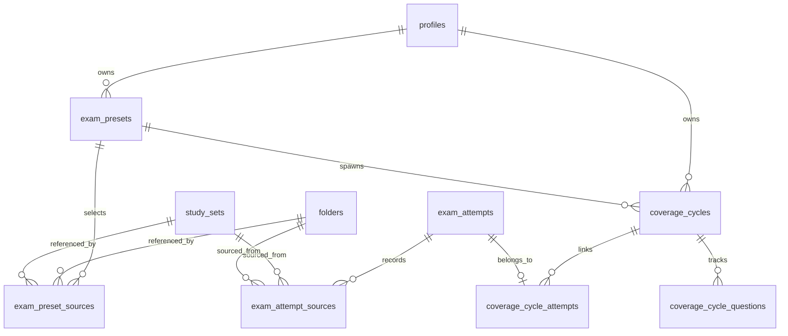

# StudyHub V2.0 — Database, RLS, Backend API Audit & V2.0 Schema/API Contract

> **Auditor:** Agent 6 (`db-backend-auditor`)
> **Audit Scope:** All 4 SQL migrations (`supabase/migrations/0001`–`0004`), `supabase/config.toml`, `src/types/database.ts`, `src/types/domain.ts`, `src/proxy.ts`, `src/lib/supabase/*`, `src/lib/validation/*`, `src/lib/security/*`, all **38 API route handlers** under `src/app/api/**` (+ 3 auth routes under `src/app/auth/**`), and all frontend API callers.
> **Applied Reference Skills:** Official Supabase Skill (`supabase/SKILL.md`) and Supabase Postgres Best Practices (`supabase-postgres-best-practices/SKILL.md` & `references/*`: RLS initPlan caching, least privilege, `SECURITY DEFINER` hardening, deadlock-safe lock ordering, N+1 elimination, cursor pagination, idempotent constraint migrations).
> **Immutability Rule:** Existing migrations `0001`–`0004` are **NEVER** modified. All V1.0 fixes and V2.0 features MUST ship in a new versioned migration: `supabase/migrations/0005_v2_custom_exams_and_coverage.sql`.

---

## 1. Executive Summary & Live Environment Blocker Status

### 1.1 Audit Verdict
While StudyHub V1.0 has a clean 20-table foundation with RLS enabled on all 20 tables and server-side exam RPCs, this deep audit uncovered **28 verified defects** (**7 P0**, **8 P1**, **7 P2**, **4 P3**, **2 P4**) — including critical production failures that unit tests with mocked clients did not catch:

- **Catastrophic PostgREST `max_rows = 1000` & `414 URI Too Long` failure on real banks > 250 questions (`P0-2`, `P2-1`):** Multiple core endpoints (`GET /api/sets/[id]/questions?pageSize=500`, `POST /api/exams`, `POST /api/sets/[id]/duplicate`, `GET /api/sets/[id]/export`, `GET /api/mistakes`, `GET /api/sets/[id]`) fetch unpaginated child rows (`question_options`) or pass 500–1,000 UUIDs inside `.in(...)` GET URLs. Under real Supabase PostgREST (`max_rows = 1000` in `supabase/config.toml:9` and Supabase Cloud default), sets with >250 multiple-choice questions lose options silently or fail with HTTP `414 URI Too Long`.
- **SQL Numeric Short-Answer Grading Bug (`P0-3`):** `public.normalize_short_answer()` (`0003:246`) runs `trim(trailing '0' FROM v_num::text)` without checking for a decimal point — turning `10` and `100` into `'1'`, and turning `0` into `''` (making `0` impossible to ever grade correct!).
- **Multi-Subject Exam Progress Corruption & V2.0 Incompatibility (`P0-1`, `P1-1`):** `submit_exam_attempt()` writes `v_attempt.study_set_id` for every question (corrupting `user_question_progress.study_set_id` for secondary sets and skipping ALL progress when `study_set_id IS NULL`), and `create_exam_attempt()` accepts raw client-supplied `p_questions` JSON directly from `authenticated` JWTs, enforces a 500-question ceiling, and crashes when `p_study_set_id IS NULL`.
- **RLS Owner Takeover Escalation on `study_sets` (`P0-4`) & Blocked-User Bypass on `friendships` (`P1-4`):** `study_sets_update_editable` allows an `editor` collaborator to bypass API checks via PostgREST and mutate `owner_id`, `visibility`, `folder_id`, or `is_archived`. `friendships` RLS allows a blocked user to delete or force-accept a `blocked` row.
- **Broken Frontend–Backend Contracts (`P0-5`, `P0-6`, `P1-8`, `P2-6`):** `StudySetHub` sends `pageSize=500` to `/api/starred` (`max(200)` -> always 400!), `exam_attempts.answered_count` is never updated while `in_progress` (always displays `0/N` on Resume/History), `ShareRedeemView` reads `study_set_title`/`permission` while RPC returns `title`/`role`, and `Dashboard` always displays `0` streak because `/api/dashboard` omits streak calculation.

### 1.2 Honest Live Supabase Environment Status (`BLOCKED` for Runtime DB Verification)

Checked directly on `d:\Code Web\StudyHub` during this audit:

| Dependency / Check | Observed Status | Evidence |
| --- | --- | --- |
| `.env.local` credentials | **MISSING** | Only `.env.example` (1,756 bytes) exists in workspace root. |
| Docker Desktop daemon | **STOPPED** | `docker info` -> `failed to connect to the docker API at npipe:////./pipe/dockerDesktopLinuxEngine: The system cannot find the file specified.` |
| Local Supabase CLI | **NOT INSTALLED** | `npx --no-install supabase --version` -> canceled (package `supabase` not installed locally). |
| Supabase MCP / Plugin OAuth | **NOT SIGNED IN** | `list_plugin_accounts` -> `No installed plugins declare account sign-ins.`; no live `supabase_mcp` SQL tools available in session. |

**Verification Boundary:**
- **Verified now (100% static code & SQL audit):** All 4 SQL migrations, all 20 tables & RLS policies, all triggers/RPCs, `supabase/config.toml`, all 38 API routes + 3 auth routes, Zod schemas, and frontend callers.
- **Blocked until live Supabase (Docker or hosted credentials) is available:** Executing `supabase db reset`, running `supabase db advisors`, collecting real `EXPLAIN (ANALYZE, BUFFERS)` plans on 10,000-question datasets, and running live 2-account negative RLS tests against PostgREST.

---

## 2. Deep Audit of Existing Migrations (`0001`–`0004`) & Exam RPCs

### 2.1 Specific Audit Checks on `0003_functions_and_triggers.sql`

| Audit Question | Verdict | Exact Evidence & Analysis |
| --- | --- | --- |
| **Unlimited time (`duration_limit_seconds IS NULL`)** | **PARTIALLY SAFE (1 edge case)** | `create_exam_attempt()` (`0003:577-581`) sets `expires_at = NULL` when `p_duration_limit_seconds IS NULL`. `POST /api/exams` (`route.ts:287-290`) preserves explicit `null` (`!== undefined`), only inheriting `default_exam_duration_minutes * 60` when omitted. `get_exam_attempt_detail()` (`0003:700-749`), `GET /api/exams/[attemptId]` (`route.ts:100-127`), `PUT /api/exams/[attemptId]/answers` (`route.ts:53`), and `submit_exam_attempt()` (`0003:332-342`) all guard `expires_at IS NOT NULL`. **Edge case:** Passing `p_duration_limit_seconds = 0` directly to `create_exam_attempt()` sets `v_expires_at = NULL` but then fails `exam_attempts` `CHECK (duration_limit_seconds IS NULL OR duration_limit_seconds > 0)` instead of normalizing `<= 0` to `NULL` or raising `22023`. |
| **Grading all 4 exam question types (`single_choice`, `multiple_choice`, `true_false`, `short_answer`)** | **BROKEN (`P0` numeric bug + TS/SQL drift)** | Choice types (`single_choice`, `multiple_choice`, `true_false`) grade by sorted `DISTINCT` UUID set equality (`0003:375-387`) — resilient to option shuffling. **However:** (1) `normalize_short_answer()` (`0003:246`) corrupts numeric answers (`10` -> `'1'`, `100` -> `'1'`, `0` -> `''` unmatchable!); (2) SQL `case_insensitive` does NOT strip punctuation while TS `write-grader.ts` DOES (`ignorePunctuation: true`), causing `ExamResultsClient` (`scoreExamAttempt`) to disagree with server `exam_attempts.score_percent`; (3) SQL `ignore_diacritics` only translates NFC Vietnamese lowercase chars, failing on macOS NFD combining marks; (4) `submit_exam_attempt()` does not guard against `single_choice`/`true_false` receiving >1 selected UUID if crafted via API. |
| **Per-subject, per-chapter, AND per-tag accuracy** | **NOT IMPLEMENTED** | `submit_exam_attempt()` returns only `{ attempt, questions, answers }`. API routes (`GET /api/exams/[attemptId]`, `POST /api/exams/[attemptId]/submit`) compute ONLY `chapter_breakdown` in JS. `exam_attempt_questions` does NOT store `source_study_set_id`, `source_subject_title`, or `tags_snapshot`, making mixed-subject and tag accuracy impossible without V2.0 schema extension. |
| **Stale / out-of-order saves & late-answer rejection in `PUT /api/exams/[attemptId]/answers`** | **BROKEN (`P0`/`P1`)** | (1) **Zero stale-write protection:** Concurrent debounced `PUT` requests have no monotonic `client_seq` or `updated_at` guard — a slow earlier save overwrites a newer answer. (2) **Live progress broken:** Never updates `exam_attempts.answered_count` (stays `0` until submit!). (3) **Clock skew mismatch:** Uses Node `Date.now() > Date.parse(attempt.expires_at)` (`answers/route.ts:53`); if Node lags behind Postgres, Postgres RLS rejects the upsert with generic `42501 FORBIDDEN` instead of `409 EXAM_EXPIRED`. (4) **Cross-attempt integrity gap:** Neither API nor `exam_attempt_answers` schema/RLS verifies `attempt_question_id` belongs to `attempt_id`! |
| **Multi-subject `exam_attempts` support (`study_set_id IS NULL` or multi-set/folder)** | **BROKEN (`P0`)** | `exam_attempts.study_set_id` is nullable (`0001:256`), **but:** (1) `create_exam_attempt()` (`0003:564`) calls `can_read_study_set(p_study_set_id, v_caller)` which fails when `NULL`; (2) `createExamSchema` (`exams.ts:10`) requires non-null `study_set_id`; (3) `submit_exam_attempt()` (`0003:405, 432`) skips ALL `user_question_progress` updates if `study_set_id IS NULL` AND writes the **primary** `study_set_id` onto **secondary** sets' progress rows when `additional_study_set_ids` is used; (4) `HistoryView.tsx:206` renders `—` (unclickable!) whenever `study_set_id IS NULL`; (5) No `exam_attempt_sources` table exists. |
| **Custom subset practice outside Exam mode (`study_sessions` & practice endpoints)** | **NOT IMPLEMENTED** | `study_sessions.study_set_id` is `NOT NULL` (`0001:220`) — cannot represent multi-subject/folder practice runs. `useStudySetBundle` (`useStudySetBundle.tsx:37`) downloads up to 2,000 questions from a single set (breaking >250 MC questions due to PostgREST `max_rows = 1000` on options) and filters in browser memory. No `/api/practice/questions` server endpoint exists. |

---

## 3. Complete Defect Register (`P0`–`P4`)

### P0 — Critical Bugs (Data Loss, Corruption, Security Escalation, Broken Core Flows)

#### `P0-1` — Multi-Set Exams Corrupt `user_question_progress.study_set_id` & Skip SM-2 Progress when `study_set_id IS NULL`
- **Files:** `supabase/migrations/0003_functions_and_triggers.sql:405-437`, `src/app/api/exams/route.ts:122-130, 311-318`
- **Root Cause:** `exam_attempt_questions` does not snapshot `source_study_set_id`. `submit_exam_attempt()` guards progress updates with `IF v_q.question_id IS NOT NULL AND v_attempt.study_set_id IS NOT NULL` and inserts `v_attempt.study_set_id` for every question.
- **Impact:**
  1. Combining Set A + Set B via `additional_study_set_ids` writes Set A's UUID into `user_question_progress.study_set_id` for Set B's questions — silently corrupting Set B's mastery/mistakes/due counts.
  2. Multi-subject V2.0 exams with `exam_attempts.study_set_id IS NULL` silently skip ALL SM-2 progress and mistake recording.
- **Remediation:** Add `source_study_set_id` to `exam_attempt_questions` in `0005`; resolve `COALESCE(v_q.source_study_set_id, (SELECT q.study_set_id FROM public.questions q WHERE q.id = v_q.question_id), v_attempt.study_set_id)` in `submit_exam_attempt()` and update `last_studied_at` across all distinct source sets.

#### `P0-2` — PostgREST `max_rows = 1000` Silent Truncation Corrupts Sets > 250 MC Questions (Exam Creation, Set Hub, Editor, Clone, Export, Stats, Import Dedup)
- **Files:**
  - `supabase/config.toml:9` (`max_rows = 1000`, matching Supabase Cloud default)
  - `src/app/api/sets/[id]/questions/route.ts:133-156` (called with `pageSize=500` by `study-set-hub.tsx:96`, `question-editor-view.tsx:224`, `api-client.ts:153`)
  - `src/app/api/exams/route.ts:137-227` (`questions`, `question_tags`, `starred_questions`, `user_question_progress`, `question_options`)
  - `src/app/api/sets/[id]/duplicate/route.ts:87-101`
  - `src/app/api/sets/[id]/export/route.ts:64-94` (`PAGE_SIZE = 1000` -> up to 4,000 `question_options` in one query!)
  - `src/app/api/sets/[id]/route.ts:33-42`
  - `src/app/api/import/parse/route.ts:184-188` & `src/app/api/import/commit/route.ts:277-280`
  - `src/app/api/account/data/route.ts:31-51`, `src/app/api/dashboard/route.ts:41-62`, `src/app/api/statistics/route.ts:74-92`, `src/app/api/mistakes/route.ts:12-87`
- **Root Cause:** A 4-option multiple-choice question produces 4 rows in `question_options`. Requesting options for 500 questions (or 1,000 in `export` / all questions in `duplicate`) asks PostgREST for 2,000–40,000 rows in a single `.select()`. PostgREST silently truncates at 1,000 rows with HTTP 200 and zero error.
- **Impact:**
  - On any set with >250 MC questions: `GET /api/sets/[id]/questions?pageSize=500` silently drops options for questions ~251–500; `POST /api/exams` for 300–500Q exams snapshots empty `options_snapshot: []` and empty `correct_option_ids: []` for half the exam; `POST /api/sets/[id]/duplicate` and `GET /api/sets/[id]/export` silently strip options from >250 questions!
  - On 10,000-question banks: `POST /api/exams` only ever sees questions 1–1,000; questions 1,001–10,000 are unreachable!
- **Remediation:**
  1. Move exam pool aggregation, sampling, snapshot creation, and set cloning into server-side PostgreSQL RPCs (`get_exam_eligible_pool`, `create_exam_attempt_v2`, `clone_study_set`).
  2. Cap child `.in("question_id", ...)` chunk sizes at `100` questions (≤400–600 options, safely under both `max_rows = 1000` AND URL length limits), or use PostgREST embedded joins with `pageSize <= 100` / SQL RPCs returning `jsonb`!
  3. Paginate all full-set reads (`import/commit` dedup, `export`, `account/data`, `sets/[id]` summary via SQL aggregation RPC).

#### `P0-3` — `normalize_short_answer()` Numeric Mode Corrupts Answers Ending in `0` (`10` -> `'1'`, `100` -> `'1'`, `0` -> `''` Unmatchable!)
- **File:** `supabase/migrations/0003_functions_and_triggers.sql:242-249, 368`
- **Evidence:**
  ```sql
  v_num := v_text::numeric;
  RETURN trim(trailing '.' FROM trim(trailing '0' FROM v_num::text));
  ```
- **Impact:**
  - `10` -> `trim(trailing '0' FROM '10')` = `'1'`. `100` -> `'1'`. Answering `1` to a question whose answer is `100` is graded **CORRECT**!
  - `0` -> `trim(trailing '0' FROM '0')` = `''`. Line 368 checks `char_length(v_acc_norm) > 0`, so any numeric question with correct answer `0` can **NEVER** be graded correct!
- **Remediation:** Replace line 246 in `0005` with PostgreSQL's built-in `RETURN trim_scale(v_num)::text;` (Postgres 13+: `trim_scale(100.00::numeric)::text = '100'`, `trim_scale(0.0::numeric)::text = '0'`, `trim_scale(1.50::numeric)::text = '1.5'`).

#### `P0-4` — `study_sets` RLS Allows `editor` Collaborator Privilege Escalation to Take Over Ownership & Change `visibility`
- **File:** `supabase/migrations/0002_rls_policies.sql:237-241`
- **Evidence:**
  ```sql
  CREATE POLICY "study_sets_update_editable"
    ON public.study_sets FOR UPDATE TO authenticated
    USING (public.can_edit_study_set(id, (SELECT auth.uid())))
    WITH CHECK (public.can_edit_study_set(id, (SELECT auth.uid())));
  ```
- **Root Cause:** Although `PATCH /api/sets/[id]` checks `access.isOwner` for `visibility`/`folder_id`/`is_archived`, direct PostgREST `UPDATE` using the user's JWT bypasses the Next.js route. Because `can_edit_study_set(id, uid)` checks `s.owner_id = uid OR EXISTS (study_set_members WHERE role IN ('owner','editor'))`, an `editor` can `UPDATE study_sets SET owner_id = '<editor_uid>', visibility = 'public'` and STILL satisfy `WITH CHECK` — stealing ownership of another user's study set!
- **Remediation:** Add `BEFORE UPDATE ON public.study_sets` trigger `trg_guard_study_set_owner_fields` in `0005` rejecting any `owner_id` mutation (when `auth.uid()` is present) and rejecting `visibility`, `folder_id`, `is_archived`, or manual `question_count` changes by non-owners.

#### `P0-5` — `StudySetHub` Requests `/api/starred?pageSize=500` Against `max(200)` Schema (Always Fails 400; Star State Never Hydrates)
- **Files:** `src/components/library/study-set-hub.tsx:116-125` vs `src/lib/validation/learning.ts:80`
- **Root Cause:** `StudySetHub` fetches `/api/starred?studySetId=${setId}&pageSize=500`, violating `listStarredQuerySchema`'s `max(200)`. Zod returns `400 VALIDATION_ERROR`; the `catch` block silently returns `new Set()`.
- **Impact:** Starred questions on `/sets/[id]` always render unstarred after reload; clicking star toggles them OFF instead of ON. (Note: `GET /api/sets/[id]/questions` already returns `is_starred` per question row.)
- **Remediation:** Fix caller to use `is_starred` from `/api/sets/[id]/questions` (or paginate `/api/starred` with `pageSize=200`).

#### `P0-6` — `exam_attempts.answered_count` Never Updates During Live Exam & Out-of-Order Saves Overwrite Newer Answers
- **Files:** `src/app/api/exams/[attemptId]/answers/route.ts:61-94`, `src/components/exam/TestHubClient.tsx:305`, `src/components/analytics/history-view.tsx:223`
- **Root Cause:**
  1. `PUT /api/exams/[attemptId]/answers` only upserts `exam_attempt_answers` and never updates `exam_attempts.answered_count` (`authenticated` has no UPDATE policy on `exam_attempts`). Resume Banner & History always show `0/N` answered for in-progress exams.
  2. No monotonic `client_seq` / timestamp guard exists; delayed earlier debounced `PUT` calls silently clobber newer selections during rapid navigation.
- **Remediation:** Add `client_seq bigint NOT NULL DEFAULT 0` to `exam_attempt_answers` and route `PUT /api/exams/[attemptId]/answers` through atomic `save_exam_attempt_answers()` RPC (checks server clock `now() <= expires_at`, applies `WHERE EXCLUDED.client_seq >= exam_attempt_answers.client_seq`, and atomically updates `exam_attempts.answered_count` & `unanswered_count`).

#### `P0-7` — `POST /api/sets/[id]/duplicate` Corrupts Options When Source Questions Share `position` Values
- **File:** `src/app/api/sets/[id]/duplicate/route.ts:148-174`
- **Root Cause:** `questions` has no `UNIQUE (study_set_id, position)` constraint. Concurrent creates or manual position edits create duplicate `position` values. `duplicate/route.ts` maps old -> new question IDs solely via `newIdByPos.set(iq.position, iq.id)`, collapsing colliding questions so one gets duplicate options and the other gets zero options.
- **Remediation:** Replace client-side chunked copy with a transactional server-side SQL RPC `clone_study_set(p_source_set_id, p_title, p_folder_id)` using `uuid` mapping table (also fixes `P0-2` truncation and `P1-3` `allow_clone` enforcement!).

---

### P1 — High-Severity Bugs (Security, RLS Integrity, Data Consistency, V2.0 Blockers)

#### `P1-1` — `create_exam_attempt()` Accepts Arbitrary Client-Supplied `p_questions` JSON Directly via PostgREST RPC
- **File:** `supabase/migrations/0003_functions_and_triggers.sql:536-678`
- **Root Cause:** `GRANT EXECUTE ON FUNCTION public.create_exam_attempt(...) TO authenticated` lets any signed-in user invoke the RPC directly with fabricated `p_questions` (fake `correct_option_ids` or foreign `question_id`s from inaccessible sets), and enforces a hardcoded 500-question max (`0003:573`) and non-null `p_study_set_id` (`0003:564`).
- **Remediation:** In `0005`, introduce `create_exam_attempt_v2(...)` that takes ONLY `source` descriptors / validated `question_id[]` (verified against `can_read_study_set`) and snapshots `prompt`, `options`, `correct_option_ids`, `accepted_answers`, `tags`, `chapter`, and `explanation` **directly from `public.questions` inside PostgreSQL** — zero client-injected question bodies! Remove hardcoded 500 cap (allow up to 2,000+ or full pool).

#### `P1-2` — `exam_attempt_answers` Lacks Cross-Attempt Integrity Constraint (`attempt_question_id` Not Verified Against `attempt_id`)
- **Files:** `supabase/migrations/0001_initial_schema.sql:299-310`, `0002_rls_policies.sql:596-637`, `src/app/api/exams/[attemptId]/answers/route.ts:61-78`
- **Root Cause:** `exam_attempt_answers` references `exam_attempts(id)` and `exam_attempt_questions(id)` independently without a composite FK `(attempt_id, attempt_question_id) -> exam_attempt_questions(attempt_id, id)`. Neither RLS nor API verifies the question belongs to that attempt.
- **Remediation:** In `0005`, add `UNIQUE (attempt_id, id)` on `exam_attempt_questions` and composite FK `(attempt_id, attempt_question_id) REFERENCES public.exam_attempt_questions(attempt_id, id) ON DELETE CASCADE` on `exam_attempt_answers`.

#### `P1-3` — `starred_questions` & `user_question_progress` Allow Spoofing `study_set_id` to Bypass `can_read_study_set` RLS
- **Files:** `src/app/api/starred/route.ts:112-151`, `src/app/api/progress/route.ts:61-77`, `supabase/migrations/0002_rls_policies.sql:450-483`
- **Root Cause:** `POST /api/starred` skips querying `questions.study_set_id` when the client provides `study_set_id`; `POST /api/progress` never verifies `question_id` belongs to `study_set_id`; RLS only checks `can_read_study_set(study_set_id, auth.uid())`, not that `question_id` belongs to `study_set_id`. A user can pass their own `study_set_id` with another user's private `question_id` UUID to probe existence or corrupt denormalized `study_set_id`.
- **Remediation:** Add `UNIQUE (study_set_id, id)` on `public.questions` and composite FKs `(study_set_id, question_id) REFERENCES public.questions(study_set_id, id) ON DELETE CASCADE` on `user_question_progress` and `starred_questions`, and always derive `study_set_id` from `questions` server-side.

#### `P1-4` — `friendships` RLS Allows Blocked Users to Delete or Force-Accept Their Own Block!
- **Files:** `supabase/migrations/0002_rls_policies.sql:658-676`, `src/app/api/friends/[id]/route.ts:46-92`
- **Root Cause:** `friendships` has no `blocked_by` column. `friendships_delete_participant` allows either participant to `DELETE` a `blocked` row; `friendships_update_participant` lets the `addressee_id` update a `blocked` row to `status = 'accepted'`; `PATCH /api/friends/[id]` does not check `existing.status === 'pending'` before `accept`/`decline`.
- **Remediation:** Add `blocked_by uuid REFERENCES public.profiles(id) ON DELETE SET NULL` in `0005`; restrict `DELETE`/`UPDATE` on `status = 'blocked'` rows strictly to `blocked_by = (SELECT auth.uid())`, and enforce `existing.status = 'pending'` for `accept`/`decline`.

#### `P1-5` — `profiles` RLS (`can_view_profile`) Leaks Target User's Private Email on Unaccepted Pending Friend Request & in `/api/sets/[id]/members`
- **Files:** `supabase/migrations/0002_rls_policies.sql:81-116, 155-158`, `src/app/api/sets/[id]/members/route.ts:43`
- **Root Cause:** Sending an unsolicited friend request by username creates a `pending` row in `friendships`, immediately making `can_view_profile(target, requester) = true` and exposing `profiles.email` via PostgREST. `GET /api/sets/[id]/members` also explicitly selects and returns `email` to all viewers.
- **Remediation:** Remove `email` from `GET /api/sets/[id]/members` response (except own profile/owner view if desired), revoke `SELECT (email)` on `public.profiles` from `authenticated` (serving own email via `auth.users` / `get_my_profile` RPC or keeping `email` readable only when `id = (SELECT auth.uid())` via safe `public_profiles` view / column policy).

#### `P1-6` — `storage.objects` RLS Has Non-Strict UUID Regex (Runtime `22P02` Crash) & Missing Owner-Path Binding
- **File:** `supabase/migrations/0004_storage_and_buckets.sql:32, 38-44, 61-64, 81-120`
- **Root Cause:** `^[0-9a-f-]{36}$` matches invalid strings (e.g., 36 hyphens), causing `::uuid` cast exceptions (`22P02`) that abort `SELECT` queries. Additionally, `study_media_insert` does not enforce `(storage.foldername(name))[1]` equals the study set's `owner_id` (or `auth.uid()`), allowing an editor to plant files under another user's prefix.
- **Remediation:** Recreate `study_media_*` policies in `0005` using strict `~* '^[0-9a-f]{8}-[0-9a-f]{4}-[0-9a-f]{4}-[0-9a-f]{4}-[0-9a-f]{12}$'` and verifying `folder[1] = owner_id::text` via helper `public.is_study_set_media_path(folder1, folder2)`.

#### `P1-7` — `submit_exam_attempt()` Auth Guard Skips Ownership Check When `auth.uid() IS NULL` & SM-2 Formula Diverges Across 3 Implementations
- **Files:** `supabase/migrations/0003_functions_and_triggers.sql:309, 412-463`, `src/lib/supabase/progress-helper.ts:73-108`, `src/lib/learning/sm2.ts:83-140`
- **Root Cause:**
  1. Line 309: `IF v_caller IS NOT NULL AND v_attempt.user_id <> v_caller` does not reject `v_caller IS NULL` (unlike `create_exam_attempt` and `get_exam_attempt_detail`). Should require `v_caller IS NOT NULL` (or explicit `current_setting('request.jwt.claim.role', true) = 'service_role'`).
  2. SM-2 mastery criteria and ease/interval math diverge across SQL (`consec >= 4`, fixed `+0.05/-0.20`, no interval cap), `progress-helper.ts` (`consec >= 4`, cap `365`), and `sm2.ts` (`consec >= 3`, cap `3650`).
  3. SQL `normalize_short_answer()` and TS `write-grader.ts` disagree on punctuation in `case_insensitive` mode and NFD diacritics.
- **Remediation:** Standardize one canonical SM-2 & short-answer spec across `0005` SQL and `src/lib/learning/*`.

#### `P1-8` — Share Link `allow_clone = false` Not Enforced by `POST /api/sets/[id]/duplicate` & Response Contract Mismatch on Redeem
- **Files:** `src/app/api/sets/[id]/duplicate/route.ts:36-41`, `supabase/migrations/0003_functions_and_triggers.sql:865-889`, `src/components/social/share-redeem-view.tsx:33-44, 87-90, 126-137`
- **Root Cause:**
  1. `study_set_members` does not store `allow_clone`, and `duplicate/route.ts` only checks `"read"` access — completely ignoring `allow_clone = false` on share links.
  2. `redeem_share_link` returns `{ study_set_id, title, role, allow_clone }`, whereas `ShareRedeemView` reads `study_set_title` and `permission` — causing the set title and role badge to break after redemption!
  3. `redeem_share_link` increments `use_count` even when the same user already redeemed the link.
- **Remediation:** Add `allow_clone boolean NOT NULL DEFAULT true` to `study_set_members` (populated by `redeem_share_link`), enforce it in `clone_study_set` / `duplicate`, and align `redeem_share_link` + `ShareRedeemView` response fields.

---

### P2 — Medium-Severity Bugs (Performance, N+1, URL Limits, Filtering, Analytics Accuracy)

#### `P2-1` — `414 URI Too Long` Explosion Across 6 Endpoints Passing 500–1,000 UUIDs in `.in(...)` GET Queries
- **Files:**
  - `src/app/api/sets/[id]/export/route.ts:84, 89, 93` (1,000 UUIDs = ~37 KB URL)
  - `src/app/api/sets/[id]/questions/bulk/route.ts:165, 210, 241` (up to 1,000 UUIDs)
  - `src/app/api/sets/[id]/questions/route.ts:87, 136, 141, 145, 150, 155` (up to 500 UUIDs = ~18.5 KB URL, or unbounded `starredOnly`/`tagId` IDs!)
  - `src/app/api/exams/route.ts:221, 226` (up to 500 UUIDs)
  - `src/app/api/mistakes/route.ts:52, 68, 79, 86` (unbounded `allQuestionIds`!)
  - `src/app/api/statistics/route.ts:269` (up to 500 UUIDs)
- **Impact:** Supabase Kong/PostgREST default URI/header limits (8 KB–16 KB) reject `.in()` lists above ~200–350 UUIDs with HTTP `414`/`431`.
- **Remediation:** Chunk `.in()` queries to `<= 100` UUIDs per batch (or replace with `POST` RPC accepting `uuid[]` body parameter).

#### `P2-2` — `folders` Cycle Vulnerability in `PATCH /api/folders/[id]`
- **File:** `src/app/api/folders/[id]/route.ts:68-88`
- **Root Cause:** Only rejects direct self-parent (`parent_id === folderId`), allowing multi-hop cycles (`A -> B -> A`). Breaks recursive folder expansion in V2.0 multi-subject exams unless guarded.
- **Remediation:** Add `trg_prevent_folder_cycle` trigger in `0005` AND use Postgres `CYCLE` / path-array guard in recursive folder CTEs.

#### `P2-3` — Shared Study Set Collaborators Cannot See Tags on Shared Questions
- **Files:** `supabase/migrations/0002_rls_policies.sql:395-398`, `src/app/api/sets/[id]/questions/route.ts:164-168`
- **Root Cause:** `tags_select_own` restricts `public.tags` strictly to `owner_id = auth.uid()`. Collaborators can read `question_tags` but `SELECT * FROM tags WHERE id IN (...)` returns empty!
- **Remediation:** Add `tags_select_readable_via_sets` RLS SELECT policy in `0005`.

#### `P2-4` — N+1 Queries, Row-Level Trigger Write Amplification, and Non-Transactional Multi-Table Writes
- **Files:**
  - `src/app/api/sets/[id]/questions/[questionId]/route.ts:137-170`: Sequential per-option `UPDATE`/`INSERT` loop (up to 10 round-trips).
  - `src/app/api/exams/route.ts:126-130`: Sequential `for` loop calling `requireStudySetAccess` for every extra set (up to 40 round-trips).
  - `supabase/migrations/0003_functions_and_triggers.sql:141-143`: `FOR EACH ROW` trigger on `questions` runs 10,000 individual `UPDATE public.study_sets` statements during a 10,000-question import (dead-tuple bloat & row lock contention).
  - `src/app/api/import/commit/route.ts:152-157, 445-475`: Full JSONB sequential scan for `import_idempotency_key` (no index!) + non-transactional 4-table inserts where partial failure leaves orphaned optionless questions and permanently poisons the idempotency key.
  - `src/app/api/sessions/[sessionId]/answers/route.ts:133-141`: Non-atomic read-modify-write on `study_sessions.completed_items` / `correct_items` (lost updates under rapid answering).
- **Remediation:** Statement-level count trigger with transition tables, expression B-tree index on `source_metadata->>'import_idempotency_key'`, batch `upsert` for options, batch set access check, atomic SQL counter increment / RPCs.

#### `P2-5` — PostgREST `.or()` Parenthesis Syntax Crash & Missing Trigram Search Indexes
- **Files:** `src/app/api/sets/route.ts:62-66, 145-149`, `src/app/api/sets/[id]/questions/route.ts:99-103`
- **Root Cause:** Search sanitization strips `%`, `_`, `,` but NOT `(` `)` or `.`. Searching `"Atmosphere (133)"` injects raw `)` into PostgREST `.or()`, throwing `PGRST100` (500). Furthermore, `ILIKE '%...%'` does full sequential scans on 10,000-question banks.
- **Remediation:** Strip/quote PostgREST metacharacters (`(`, `)`, `,`, `*`, `"`) or use parameterized RPC with `ILIKE` backed by `pg_trgm` GIN indexes in `0005`.

#### `P2-6` — Analytics & Mistakes Inaccuracies (`Dashboard` Streak Always 0, Exam Answers Excluded, Weak Chapters Skewed, `History` Unclickable When `study_set_id IS NULL`)
- **Files:**
  - `src/app/api/dashboard/route.ts:58-62, 131-141`: Missing `streak_days` (Dashboard always shows `0`); `today_answers` ignores exam answers; `.limit(50)` truncates `total_sets` & `total_questions`.
  - `src/app/api/statistics/route.ts:153-161, 203-223, 251-296`: `daily_activity.answers` ignores exam answers; `untracked` subtracts shared-set progress from owned totals; `weak_topics` only queries questions with `wrong_count > 0` (ignoring all 100%-correct questions in the same chapter, skewing chapter accuracy dramatically downward!).
  - `src/app/api/mistakes/route.ts:75-81`: `last_wrong_answer` queries only `study_session_answers`, ignoring `exam_attempt_answers` (exam mistakes always show `"No recorded selection"`).
  - `src/components/analytics/history-view.tsx:206-210`: Renders `—` (dead row!) when `exam_attempts.study_set_id IS NULL`.
  - `src/app/api/account/data/route.ts:93-102`: Swallows errors on all 8 `.delete()` calls, omits `friendships` & `study_set_members`, and GET export omits `exam_attempt_questions`, `exam_attempt_answers`, `study_session_answers`, `question_tags`.

#### `P2-7` — `PATCH /api/sets/[id]/questions/[questionId]` Skips Choice-Question Integrity Validation & Missing V2.0 Auth Middleware Prefixes
- **Files:** `src/lib/validation/questions.ts:74`, `src/lib/supabase/middleware.ts:6-19`, `src/types/database.ts:1058-1084`
- **Root Cause:**
  1. `updateQuestionSchema = baseQuestionSchema.partial()` omits `.superRefine()`, allowing editors to save a `single_choice` question with 0 options or 0 correct options.
  2. `PROTECTED_PREFIXES` in `middleware.ts` does not yet include `/exams` or `/practice` for V2.0 routes.
  3. `src/types/database.ts` lacks `Functions` definitions for 6 SQL RPCs, forcing `as unknown as DynamicRpcFn` casts in `src/lib/supabase/rpc.ts`.

---

### P3 — Low-Severity Bugs & Edge Cases

- **`P3-1` (`src/app/api/exams/route.ts:246`):** `displayLabels` stops at `"H"` (8 options), while `questionOptionInputSchema` allows up to 10 options (`max(10)`).
- **`P3-2` (`src/app/api/import/parse/route.ts:108-113`):** `JsonParseBodySchema.rawText` has no maximum byte/character limit (unlike multipart upload's 15 MB cap). Add `.max(15_000_000)`.
- **`P3-3` (`src/app/api/sets/[id]/questions/route.ts:244-338`):** Single question creation runs 4 non-atomic PostgREST calls (partial failure orphans the question row).
- **`P3-4` (`src/lib/security/rate-limit.ts:31`):** In-memory `Map` rate limiter resets across serverless cold starts / multi-instance deployments (acceptable for single-node dev/self-host; document Redis/Upstash or Postgres table upgrade path for multi-region Vercel).

### P4 — Documentation & Indexing Hygiene

- **`P4-1`:** Missing composite/partial indexes for hot queries: `idx_exam_attempts_user_in_progress`, `idx_questions_set_type_chapter`, `idx_questions_source_metadata_idem`, `pg_trgm` GIN indexes on `questions(prompt)` and `study_sets(title)`.
- **`P4-2`:** Minor documentation drift between `docs/ARCHITECTURE.md` / `docs/DATABASE.md` and actual V1.0 paths (`src/proxy.ts` vs `src/middleware.ts`, `/api/sets/[id]/duplicate` vs `/clone`, `/api/exams/[attemptId]/answers` vs `/answer`, `/api/starred` vs `/api/progress/star`, `/api/progress/due` vs `/api/review/queue`, migrations `0001`–`0004` vs `00001`–`00005`).

---

## 4. V2.0 Database Migration Contract (`supabase/migrations/0005_v2_custom_exams_and_coverage.sql`)

> **Design Principles Applied (Supabase Postgres Best Practices):**
> 1. **100% Backwards-Compatible:** All V1.0 tables, rows, and single-set exam attempts remain valid without data loss.
> 2. **Idempotent Constraints:** All `ALTER TABLE ... ADD CONSTRAINT` use `DO $$ IF NOT EXISTS ... $$` blocks (PostgreSQL has no `ADD CONSTRAINT IF NOT EXISTS`).
> 3. **Strict RLS + Least Privilege:** RLS enabled on every new table; `TO authenticated`; `(SELECT auth.uid())` initPlan caching; `USING` + `WITH CHECK` on every `UPDATE`; column-level `REVOKE`/`GRANT` preserved on `exam_attempt_questions`.
> 4. **Zero Answer Leakage & Server-Side Sampling:** Exam generation snapshots questions directly inside PostgreSQL from `public.questions`, eliminating client-injected questions and PostgREST `max_rows=1000` / `414 URI Too Long` failure modes.
> 5. **Deadlock-Safe Concurrency:** Explicit `FOR UPDATE` locking in deterministic ID order on `coverage_cycles` and `exam_attempts`.

### 4.1 Entity Relationship Additions (V2.0)



### 4.2 New Tables Specification

#### 1. `public.exam_presets` (Private Config-Only Templates — NEVER Fixed Question IDs)
| Column | Type | Constraints | Notes |
| --- | --- | --- | --- |
| `id` | `uuid` | `PRIMARY KEY DEFAULT gen_random_uuid()` | |
| `user_id` | `uuid` | `NOT NULL REFERENCES public.profiles(id) ON DELETE CASCADE` | Strictly private to owner |
| `name` | `text` | `NOT NULL CHECK (char_length(trim(name)) BETWEEN 1 AND 160)` | |
| `description` | `text` | `CHECK (description IS NULL OR char_length(description) <= 500)` | |
| `is_favorite` | `boolean` | `NOT NULL DEFAULT false` | Pin favorite presets |
| `requested_question_count` | `integer` | `CHECK (requested_question_count IS NULL OR requested_question_count BETWEEN 1 AND 5000)` | `NULL` = all eligible |
| `allocation_strategy` | `text` | `NOT NULL DEFAULT 'proportional' CHECK (allocation_strategy IN ('proportional','equal','custom_counts','custom_percentages','unweighted_random'))` | Strategies A–E |
| `selection_policy` | `text` | `NOT NULL DEFAULT 'random_all' CHECK (selection_policy IN ('random_all','prioritize_unseen','only_unseen','prioritize_mistakes','only_mistakes','only_starred','only_unmastered','full_coverage_cycle'))` | All 8 V2.0 policies |
| `duration_limit_seconds` | `integer` | `CHECK (duration_limit_seconds IS NULL OR duration_limit_seconds BETWEEN 60 AND 86400)` | `NULL` = unlimited |
| `pass_threshold` | `integer` | `NOT NULL DEFAULT 70 CHECK (pass_threshold BETWEEN 1 AND 100)` | |
| `shuffle_questions` | `boolean` | `NOT NULL DEFAULT true` | |
| `shuffle_options` | `boolean` | `NOT NULL DEFAULT true` | |
| `show_subject_names` | `boolean` | `NOT NULL DEFAULT true` | Display subject badge in runner |
| `show_chapter_names` | `boolean` | `NOT NULL DEFAULT true` | Display chapter badge in runner |
| `allow_navigation` | `boolean` | `NOT NULL DEFAULT true` | Free jump vs sequential |
| `filters` | `jsonb` | `NOT NULL DEFAULT '{}'::jsonb` | `{ chapters, tag_ids, difficulties, question_types }` — **NO `question_ids`** |
| `use_count` | `integer` | `NOT NULL DEFAULT 0 CHECK (use_count >= 0)` | |
| `last_used_at` | `timestamptz` | `NULL` | |
| `created_at` | `timestamptz` | `NOT NULL DEFAULT now()` | |
| `updated_at` | `timestamptz` | `NOT NULL DEFAULT now()` | `set_updated_at()` trigger |

#### 2. `public.exam_preset_sources`
| Column | Type | Constraints | Notes |
| --- | --- | --- | --- |
| `id` | `uuid` | `PRIMARY KEY DEFAULT gen_random_uuid()` | |
| `preset_id` | `uuid` | `NOT NULL REFERENCES public.exam_presets(id) ON DELETE CASCADE` | |
| `source_type` | `text` | `NOT NULL CHECK (source_type IN ('study_set', 'folder'))` | |
| `study_set_id` | `uuid` | `REFERENCES public.study_sets(id) ON DELETE CASCADE` | Non-null iff `source_type='study_set'` |
| `folder_id` | `uuid` | `REFERENCES public.folders(id) ON DELETE CASCADE` | Non-null iff `source_type='folder'` |
| `include_subfolders` | `boolean` | `NOT NULL DEFAULT true` | Used when `source_type='folder'` |
| `custom_count` | `integer` | `CHECK (custom_count IS NULL OR custom_count >= 0)` | Strategy C (`custom_counts`) |
| `custom_percentage` | `numeric(5,2)` | `CHECK (custom_percentage IS NULL OR (custom_percentage >= 0 AND custom_percentage <= 100))` | Strategy D (`custom_percentages`) |
| `sort_order` | `integer` | `NOT NULL DEFAULT 0` | |
| `created_at` | `timestamptz` | `NOT NULL DEFAULT now()` | |

- **Constraints:** `CHECK ((source_type='study_set' AND study_set_id IS NOT NULL AND folder_id IS NULL) OR (source_type='folder' AND folder_id IS NOT NULL AND study_set_id IS NULL))`; partial unique indexes on `(preset_id, study_set_id)` and `(preset_id, folder_id)`.

#### 3. `public.exam_attempt_sources`
| Column | Type | Constraints | Notes |
| --- | --- | --- | --- |
| `id` | `uuid` | `PRIMARY KEY DEFAULT gen_random_uuid()` | |
| `attempt_id` | `uuid` | `NOT NULL REFERENCES public.exam_attempts(id) ON DELETE CASCADE` | |
| `user_id` | `uuid` | `NOT NULL REFERENCES public.profiles(id) ON DELETE CASCADE` | Denormalized for fast O(1) RLS |
| `source_type` | `text` | `NOT NULL DEFAULT 'study_set' CHECK (source_type IN ('study_set', 'folder'))` | |
| `study_set_id` | `uuid` | `REFERENCES public.study_sets(id) ON DELETE SET NULL` | Preserves history on set delete |
| `folder_id` | `uuid` | `REFERENCES public.folders(id) ON DELETE SET NULL` | |
| `subject_title_snapshot` | `text` | `NOT NULL` | Immutable subject/set title |
| `eligible_count` | `integer` | `NOT NULL DEFAULT 0 CHECK (eligible_count >= 0)` | Pool size at start time |
| `requested_count` | `integer` | `CHECK (requested_count IS NULL OR requested_count >= 0)` | |
| `requested_percentage` | `numeric(5,2)` | `CHECK (requested_percentage IS NULL OR (requested_percentage >= 0 AND requested_percentage <= 100))` | |
| `allocated_count` | `integer` | `NOT NULL DEFAULT 0 CHECK (allocated_count >= 0)` | Actual drawn count |
| `sort_order` | `integer` | `NOT NULL DEFAULT 0` | |
| `created_at` | `timestamptz` | `NOT NULL DEFAULT now()` | |

#### 4. `public.coverage_cycles`
| Column | Type | Constraints | Notes |
| --- | --- | --- | --- |
| `id` | `uuid` | `PRIMARY KEY DEFAULT gen_random_uuid()` | |
| `user_id` | `uuid` | `NOT NULL REFERENCES public.profiles(id) ON DELETE CASCADE` | Strictly user-isolated |
| `preset_id` | `uuid` | `REFERENCES public.exam_presets(id) ON DELETE SET NULL` | Optional originating preset |
| `title` | `text` | `NOT NULL CHECK (char_length(trim(title)) BETWEEN 1 AND 200)` | |
| `status` | `text` | `NOT NULL DEFAULT 'active' CHECK (status IN ('active', 'completed', 'archived'))` | |
| `source_snapshot` | `jsonb` | `NOT NULL DEFAULT '[]'::jsonb` | Deduplicated source sets/folders at start |
| `filter_snapshot` | `jsonb` | `NOT NULL DEFAULT '{}'::jsonb` | Exam settings & filters for cycle |
| `allocation_strategy` | `text` | `NOT NULL DEFAULT 'proportional' CHECK (allocation_strategy IN ('proportional','equal','custom_counts','custom_percentages','unweighted_random'))` | |
| `questions_per_exam` | `integer` | `NOT NULL CHECK (questions_per_exam BETWEEN 1 AND 2000)` | Batch size per exam |
| `total_questions` | `integer` | `NOT NULL CHECK (total_questions > 0)` | Exact snapshotted pool size |
| `assigned_count` | `integer` | `NOT NULL DEFAULT 0 CHECK (assigned_count >= 0)` | Currently in an `in_progress` exam |
| `answered_count` | `integer` | `NOT NULL DEFAULT 0 CHECK (answered_count >= 0)` | Submitted & answered at least once |
| `completed_count` | `integer` | `NOT NULL DEFAULT 0 CHECK (completed_count >= 0)` | Completed in cycle (strictly answered on submit!) |
| `active_attempt_id` | `uuid` | `REFERENCES public.exam_attempts(id) ON DELETE SET NULL` | Guard: at most 1 open exam per cycle |
| `cycle_number` | `integer` | `NOT NULL DEFAULT 1 CHECK (cycle_number >= 1)` | Incremented on restart |
| `started_at` | `timestamptz` | `NOT NULL DEFAULT now()` | |
| `completed_at` | `timestamptz` | `NULL` | Set when `completed_count = total_questions` |
| `created_at` | `timestamptz` | `NOT NULL DEFAULT now()` | |
| `updated_at` | `timestamptz` | `NOT NULL DEFAULT now()` | `set_updated_at()` trigger |

#### 5. `public.coverage_cycle_questions`
| Column | Type | Constraints | Notes |
| --- | --- | --- | --- |
| `id` | `uuid` | `PRIMARY KEY DEFAULT gen_random_uuid()` | |
| `cycle_id` | `uuid` | `NOT NULL REFERENCES public.coverage_cycles(id) ON DELETE CASCADE` | |
| `user_id` | `uuid` | `NOT NULL REFERENCES public.profiles(id) ON DELETE CASCADE` | |
| `question_id` | `uuid` | `REFERENCES public.questions(id) ON DELETE SET NULL` | |
| `source_study_set_id` | `uuid` | `REFERENCES public.study_sets(id) ON DELETE SET NULL` | |
| `source_subject_title` | `text` | `NOT NULL` | |
| `pool_order` | `integer` | `NOT NULL CHECK (pool_order >= 0)` | Shuffled queue position |
| `state` | `text` | `NOT NULL DEFAULT 'unassigned' CHECK (state IN ('unassigned', 'assigned', 'completed'))` | Explicit 3-state machine |
| `assigned_attempt_id` | `uuid` | `REFERENCES public.exam_attempts(id) ON DELETE SET NULL` | Set while `state = 'assigned'` |
| `completed_attempt_id` | `uuid` | `REFERENCES public.exam_attempts(id) ON DELETE SET NULL` | Set when `state = 'completed'` |
| `was_answered` | `boolean` | `NOT NULL DEFAULT false` | True only if user answered before submit |
| `last_is_correct` | `boolean` | `NULL` | Outcome on completion |
| `times_assigned` | `integer` | `NOT NULL DEFAULT 0 CHECK (times_assigned >= 0)` | Incremented on each issue |
| `assigned_at` | `timestamptz` | `NULL` | |
| `completed_at` | `timestamptz` | `NULL` | |
| `created_at` | `timestamptz` | `NOT NULL DEFAULT now()` | |

**Coverage Cycle State Machine Guarantee (Zero Silent Loss):**
- **Issue exam (`next-exam`):** Moves `unassigned` -> `assigned` (`assigned_attempt_id = attempt_id`, `times_assigned + 1`). If `active_attempt_id IS NOT NULL`, refuses with `409 ACTIVE_ATTEMPT_EXISTS` so the user must explicitly Resume or Discard.
- **Abandon / Discard (`discard-active`):** Marks attempt `'discarded'`, reverts ALL its `assigned` questions back to `unassigned` (`assigned_attempt_id = NULL`). **Zero questions are silently marked completed.**
- **Submit / Expire (`submit_exam_attempt`):**
  - Questions **answered** by the student transition `assigned` -> `completed` (`was_answered = true`, `last_is_correct = ...`, `completed_attempt_id = attempt_id`).
  - Questions left **unanswered** revert `assigned` -> `unassigned` (`assigned_attempt_id = NULL`, `was_answered = false`) so the student will still encounter them in a later exam of the cycle!
  - Recomputes `coverage_cycles.assigned_count`, `answered_count`, `completed_count` from actual rows inside the same `FOR UPDATE` transaction; marks cycle `status = 'completed'` iff `completed_count >= total_questions` (or no remaining `unassigned` rows with `question_id IS NOT NULL`).

#### 6. `public.coverage_cycle_attempts`
| Column | Type | Constraints | Notes |
| --- | --- | --- | --- |
| `id` | `uuid` | `PRIMARY KEY DEFAULT gen_random_uuid()` | |
| `cycle_id` | `uuid` | `NOT NULL REFERENCES public.coverage_cycles(id) ON DELETE CASCADE` | |
| `attempt_id` | `uuid` | `NOT NULL REFERENCES public.exam_attempts(id) ON DELETE CASCADE` | |
| `user_id` | `uuid` | `NOT NULL REFERENCES public.profiles(id) ON DELETE CASCADE` | |
| `sequence_number` | `integer` | `NOT NULL CHECK (sequence_number >= 1)` | Exam #1, #2, #3… |
| `status` | `text` | `NOT NULL DEFAULT 'in_progress' CHECK (status IN ('in_progress', 'completed', 'discarded'))` | |
| `assigned_question_count` | `integer` | `NOT NULL CHECK (assigned_question_count > 0)` | |
| `answered_question_count` | `integer` | `NOT NULL DEFAULT 0 CHECK (answered_question_count >= 0)` | |
| `completed_question_count` | `integer` | `NOT NULL DEFAULT 0 CHECK (completed_question_count >= 0)` | |
| `discarded_at` | `timestamptz` | `NULL` | |
| `created_at` | `timestamptz` | `NOT NULL DEFAULT now()` | |

### 4.3 Extensions to Existing V1.0 Tables (100% Backwards-Compatible)

| Table | Added / Modified Columns & Constraints | Compatibility & Security Notes |
| --- | --- | --- |
| `public.exam_attempts` | Add `allocation_strategy` (default `'proportional'`), `selection_policy` (default `'random_all'`), `requested_question_count` (nullable), `show_subject_names` (default `true`), `show_chapter_names` (default `true`), `allow_navigation` (default `true`), `coverage_cycle_id` (`REFERENCES coverage_cycles ON DELETE SET NULL`), `preset_id` (`REFERENCES exam_presets ON DELETE SET NULL`), `is_multi_subject` (default `false`); extend `status` CHECK to include `'discarded'`. `study_set_id` remains nullable! | Existing V1.0 rows inherit safe defaults (`is_multi_subject = false`, `status` valid). |
| `public.exam_attempt_questions` | Add `source_study_set_id uuid REFERENCES public.study_sets(id) ON DELETE SET NULL`, `source_subject_title text`, `tags_snapshot jsonb NOT NULL DEFAULT '[]'::jsonb`; add `UNIQUE (attempt_id, id)`. | **Anti-Leak Preserved:** Explicit `GRANT SELECT (source_study_set_id, source_subject_title, tags_snapshot) ON public.exam_attempt_questions TO authenticated;` — `correct_option_ids`, `accepted_answers_snapshot`, `explanation_snapshot` remain strictly **REVOKED**! |
| `public.exam_attempt_answers` | Add `client_seq bigint NOT NULL DEFAULT 0 CHECK (client_seq >= 0)`; add composite FK `(attempt_id, attempt_question_id) REFERENCES public.exam_attempt_questions(attempt_id, id) ON DELETE CASCADE`. | Blocks cross-attempt answer injection and stale out-of-order overwrites. |
| `public.study_sessions` | `ALTER COLUMN study_set_id DROP NOT NULL`; add `source_study_set_ids uuid[] NOT NULL DEFAULT '{}'::uuid[]`. | Enables V2.0 multi-subject custom practice sessions while keeping V1.0 single-set sessions intact. |
| `public.study_set_members` | Add `allow_clone boolean NOT NULL DEFAULT true`. | Enforces share-link `allow_clone = false` at DB & API layers. |
| `public.friendships` | Add `blocked_by uuid REFERENCES public.profiles(id) ON DELETE SET NULL`. | Prevents blocked user from deleting or accepting a block. |
| `public.questions` | Add `UNIQUE (study_set_id, id)` + composite FKs from `user_question_progress` & `starred_questions`. | Eliminates `study_set_id` spoofing across RLS boundaries. |

### 4.4 Authoritative SQL Blueprint for `0005_v2_custom_exams_and_coverage.sql`

Below is the exact, production-ready DDL & RPC blueprint for Wave 2 implementation (strictly following PostgreSQL 15+ and Supabase Postgres Best Practices):

```sql
-- ============================================================================
-- StudyHub V2.0 — Migration 0005: Custom Exams, Presets, Full Coverage Cycles,
-- Multi-Subject Practice & V1.0 Security/Performance Hardening
-- ============================================================================

CREATE EXTENSION IF NOT EXISTS pg_trgm;

-- ----------------------------------------------------------------------------
-- PART A: V1.0 Integrity, Security & Performance Fixes
-- ----------------------------------------------------------------------------

-- A1. Composite unique keys for referential integrity across denormalized FKs
DO $$
BEGIN
  IF NOT EXISTS (
    SELECT 1 FROM pg_constraint
    WHERE conname = 'questions_set_id_id_unique'
      AND conrelid = 'public.questions'::regclass
  ) THEN
    ALTER TABLE public.questions
      ADD CONSTRAINT questions_set_id_id_unique UNIQUE (study_set_id, id);
  END IF;

  IF NOT EXISTS (
    SELECT 1 FROM pg_constraint
    WHERE conname = 'exam_attempt_questions_attempt_id_id_unique'
      AND conrelid = 'public.exam_attempt_questions'::regclass
  ) THEN
    ALTER TABLE public.exam_attempt_questions
      ADD CONSTRAINT exam_attempt_questions_attempt_id_id_unique UNIQUE (attempt_id, id);
  END IF;
END $$;

-- Enforce question belongs to study_set on user_question_progress & starred_questions,
-- and attempt_question belongs to attempt on exam_attempt_answers
DO $$
BEGIN
  IF NOT EXISTS (
    SELECT 1 FROM pg_constraint
    WHERE conname = 'exam_attempt_answers_attempt_q_composite_fkey'
      AND conrelid = 'public.exam_attempt_answers'::regclass
  ) THEN
    ALTER TABLE public.exam_attempt_answers
      ADD CONSTRAINT exam_attempt_answers_attempt_q_composite_fkey
      FOREIGN KEY (attempt_id, attempt_question_id)
      REFERENCES public.exam_attempt_questions (attempt_id, id)
      ON DELETE CASCADE;
  END IF;

  IF NOT EXISTS (
    SELECT 1 FROM pg_constraint
    WHERE conname = 'user_question_progress_set_q_composite_fkey'
      AND conrelid = 'public.user_question_progress'::regclass
  ) THEN
    ALTER TABLE public.user_question_progress
      ADD CONSTRAINT user_question_progress_set_q_composite_fkey
      FOREIGN KEY (study_set_id, question_id)
      REFERENCES public.questions (study_set_id, id)
      ON DELETE CASCADE;
  END IF;

  IF NOT EXISTS (
    SELECT 1 FROM pg_constraint
    WHERE conname = 'starred_questions_set_q_composite_fkey'
      AND conrelid = 'public.starred_questions'::regclass
  ) THEN
    ALTER TABLE public.starred_questions
      ADD CONSTRAINT starred_questions_set_q_composite_fkey
      FOREIGN KEY (study_set_id, question_id)
      REFERENCES public.questions (study_set_id, id)
      ON DELETE CASCADE;
  END IF;
END $$;

-- A2. Guard owner-only columns on study_sets (fixes P0-4 editor takeover escalation)
CREATE OR REPLACE FUNCTION public.guard_study_set_owner_fields()
RETURNS trigger
LANGUAGE plpgsql
SET search_path = ''
AS $$
DECLARE
  v_caller uuid := (SELECT auth.uid());
BEGIN
  IF v_caller IS NOT NULL THEN
    IF NEW.owner_id IS DISTINCT FROM OLD.owner_id THEN
      RAISE EXCEPTION 'owner_id cannot be reassigned.' USING ERRCODE = '42501';
    END IF;
    IF OLD.owner_id <> v_caller AND (
      NEW.visibility IS DISTINCT FROM OLD.visibility
      OR NEW.folder_id IS DISTINCT FROM OLD.folder_id
      OR NEW.is_archived IS DISTINCT FROM OLD.is_archived
    ) THEN
      RAISE EXCEPTION 'Only the study set owner may change visibility, folder, or archive status.'
        USING ERRCODE = '42501';
    END IF;
  END IF;
  RETURN NEW;
END;
$$;

DROP TRIGGER IF EXISTS trg_guard_study_set_owner_fields ON public.study_sets;
CREATE TRIGGER trg_guard_study_set_owner_fields
  BEFORE UPDATE ON public.study_sets
  FOR EACH ROW EXECUTE FUNCTION public.guard_study_set_owner_fields();

-- A3. Prevent multi-hop cycles in folders hierarchy (fixes P2-2)
CREATE OR REPLACE FUNCTION public.prevent_folder_cycle()
RETURNS trigger
LANGUAGE plpgsql
SET search_path = ''
AS $$
DECLARE
  v_has_cycle boolean;
BEGIN
  IF NEW.parent_id IS NULL THEN
    RETURN NEW;
  END IF;
  IF NEW.parent_id = NEW.id THEN
    RAISE EXCEPTION 'A folder cannot be its own parent.' USING ERRCODE = '22023';
  END IF;

  WITH RECURSIVE ancestors AS (
    SELECT f.id, f.parent_id, 1 AS depth
    FROM public.folders f
    WHERE f.id = NEW.parent_id
    UNION ALL
    SELECT p.id, p.parent_id, a.depth + 1
    FROM public.folders p
    JOIN ancestors a ON a.parent_id = p.id
    WHERE a.depth < 32
  )
  SELECT EXISTS (SELECT 1 FROM ancestors WHERE id = NEW.id) INTO v_has_cycle;

  IF v_has_cycle THEN
    RAISE EXCEPTION 'Circular folder hierarchy is not allowed.' USING ERRCODE = '22023';
  END IF;
  RETURN NEW;
END;
$$;

DROP TRIGGER IF EXISTS trg_prevent_folder_cycle ON public.folders;
CREATE TRIGGER trg_prevent_folder_cycle
  BEFORE INSERT OR UPDATE OF parent_id ON public.folders
  FOR EACH ROW EXECUTE FUNCTION public.prevent_folder_cycle();

-- A4. Statement-level study_sets.question_count sync (eliminates 10k-row write amplification)
DROP TRIGGER IF EXISTS trg_sync_study_set_question_count ON public.questions;

CREATE OR REPLACE FUNCTION public.sync_study_set_question_count_insert()
RETURNS trigger
LANGUAGE plpgsql
SECURITY DEFINER
SET search_path = ''
AS $$
BEGIN
  UPDATE public.study_sets s
  SET question_count = s.question_count + agg.cnt
  FROM (
    SELECT study_set_id, count(*)::integer AS cnt
    FROM new_rows
    GROUP BY study_set_id
  ) agg
  WHERE s.id = agg.study_set_id;
  RETURN NULL;
END;
$$;

CREATE OR REPLACE FUNCTION public.sync_study_set_question_count_delete()
RETURNS trigger
LANGUAGE plpgsql
SECURITY DEFINER
SET search_path = ''
AS $$
BEGIN
  UPDATE public.study_sets s
  SET question_count = GREATEST(0, s.question_count - agg.cnt)
  FROM (
    SELECT study_set_id, count(*)::integer AS cnt
    FROM old_rows
    GROUP BY study_set_id
  ) agg
  WHERE s.id = agg.study_set_id;
  RETURN NULL;
END;
$$;

CREATE TRIGGER trg_sync_study_set_question_count_ins
  AFTER INSERT ON public.questions
  REFERENCING NEW TABLE AS new_rows
  FOR EACH STATEMENT EXECUTE FUNCTION public.sync_study_set_question_count_insert();

CREATE TRIGGER trg_sync_study_set_question_count_del
  AFTER DELETE ON public.questions
  REFERENCING OLD TABLE AS old_rows
  FOR EACH STATEMENT EXECUTE FUNCTION public.sync_study_set_question_count_delete();

-- A5. Fix friendships blocked_by (P1-4), study_set_members.allow_clone (P1-8), tags shared SELECT (P2-3)
ALTER TABLE public.friendships
  ADD COLUMN IF NOT EXISTS blocked_by uuid REFERENCES public.profiles(id) ON DELETE SET NULL;

DROP POLICY IF EXISTS "friendships_update_participant" ON public.friendships;
CREATE POLICY "friendships_update_participant"
  ON public.friendships FOR UPDATE
  TO authenticated
  USING (
    (status = 'pending' AND addressee_id = (SELECT auth.uid()))
    OR (status <> 'blocked' AND (requester_id = (SELECT auth.uid()) OR addressee_id = (SELECT auth.uid())))
    OR (status = 'blocked' AND blocked_by = (SELECT auth.uid()))
  )
  WITH CHECK (
    (addressee_id = (SELECT auth.uid()) AND status IN ('accepted', 'declined'))
    OR (
      (requester_id = (SELECT auth.uid()) OR addressee_id = (SELECT auth.uid()))
      AND status = 'blocked'
      AND blocked_by = (SELECT auth.uid())
    )
  );

DROP POLICY IF EXISTS "friendships_delete_participant" ON public.friendships;
CREATE POLICY "friendships_delete_participant"
  ON public.friendships FOR DELETE
  TO authenticated
  USING (
    (status <> 'blocked' AND (requester_id = (SELECT auth.uid()) OR addressee_id = (SELECT auth.uid())))
    OR (status = 'blocked' AND blocked_by = (SELECT auth.uid()))
  );

ALTER TABLE public.study_set_members
  ADD COLUMN IF NOT EXISTS allow_clone boolean NOT NULL DEFAULT true;

CREATE POLICY "tags_select_readable_via_sets"
  ON public.tags FOR SELECT
  TO authenticated
  USING (
    EXISTS (
      SELECT 1
      FROM public.question_tags qt
      WHERE qt.tag_id = id
        AND public.can_read_study_set(qt.study_set_id, (SELECT auth.uid()))
    )
  );

-- A6. Fix normalize_short_answer() numeric trailing-zero bug (P0-3) & punctuation parity
CREATE OR REPLACE FUNCTION public.normalize_short_answer(p_input text, p_mode text)
RETURNS text
LANGUAGE plpgsql
IMMUTABLE
SET search_path = ''
AS $$
DECLARE
  v_text text;
  v_num numeric;
BEGIN
  v_text := regexp_replace(trim(COALESCE(p_input, '')), '\s+', ' ', 'g');

  IF p_mode = 'exact' THEN
    RETURN v_text;
  ELSIF p_mode = 'numeric' THEN
    v_text := replace(regexp_replace(v_text, '\s+', '', 'g'), ',', '.');
    IF v_text = '' THEN
      RETURN '';
    END IF;
    BEGIN
      v_num := v_text::numeric;
      -- PostgreSQL 13+ built-in trim_scale preserves integer zeros: 100.00 -> '100', 0.0 -> '0'
      RETURN trim_scale(v_num)::text;
    EXCEPTION WHEN invalid_text_representation OR numeric_value_out_of_range THEN
      RETURN lower(v_text);
    END;
  ELSIF p_mode = 'ignore_diacritics' THEN
    v_text := lower(v_text);
    v_text := translate(
      v_text,
      'àáạảãâầấậẩẫăằắặẳẵèéẹẻẽêềếệểễìíịỉĩòóọỏõôồốộổỗơờớợởỡùúụủũưừứựửữỳýỵỷỹđ',
      'aaaaaaaaaaaaaaaaaeeeeeeeeeeeiiiiiooooooooooooooooouuuuuuuuuuuyyyyyd'
    );
    v_text := regexp_replace(v_text, '[^\w\s]', ' ', 'g');
    RETURN regexp_replace(trim(v_text), '\s+', ' ', 'g');
  ELSE
    -- case_insensitive: aligned with write-grader.ts
    v_text := lower(v_text);
    v_text := regexp_replace(v_text, '^[.,;:!?''"()\[\]{}]+|[.,;:!?''"()\[\]{}]+$', '', 'g');
    RETURN regexp_replace(trim(v_text), '\s+', ' ', 'g');
  END IF;
END;
$$;

-- A7. Harden storage.objects strict UUID regex & path binding (P1-6)
-- (Wave 2 replaces study_media_select/insert/update/delete policies using strict
--  ^[0-9a-f]{8}-[0-9a-f]{4}-[0-9a-f]{4}-[0-9a-f]{4}-[0-9a-f]{12}$ regex and
--  owner_id path check.)

-- A8. Performance indexes for 10,000+ question banks
CREATE INDEX IF NOT EXISTS idx_questions_set_type_chapter
  ON public.questions (study_set_id, question_type, chapter);
CREATE INDEX IF NOT EXISTS idx_questions_prompt_trgm
  ON public.questions USING gin (prompt gin_trgm_ops);
CREATE INDEX IF NOT EXISTS idx_study_sets_title_trgm
  ON public.study_sets USING gin (title gin_trgm_ops);
CREATE INDEX IF NOT EXISTS idx_questions_source_metadata_idem
  ON public.questions (study_set_id, (source_metadata->>'import_idempotency_key'))
  WHERE source_metadata ? 'import_idempotency_key';
CREATE INDEX IF NOT EXISTS idx_exam_attempts_user_in_progress
  ON public.exam_attempts (user_id, created_at DESC)
  WHERE status = 'in_progress';

-- ----------------------------------------------------------------------------
-- PART B: V2.0 New Tables (Presets, Coverage Cycles, Multi-Subject Sources)
-- ----------------------------------------------------------------------------

-- B1. exam_presets (private config-only templates)
CREATE TABLE IF NOT EXISTS public.exam_presets (
  id uuid PRIMARY KEY DEFAULT gen_random_uuid(),
  user_id uuid NOT NULL REFERENCES public.profiles(id) ON DELETE CASCADE,
  name text NOT NULL CHECK (char_length(trim(name)) BETWEEN 1 AND 160),
  description text CHECK (description IS NULL OR char_length(description) <= 500),
  is_favorite boolean NOT NULL DEFAULT false,
  requested_question_count integer CHECK (
    requested_question_count IS NULL OR requested_question_count BETWEEN 1 AND 5000
  ),
  allocation_strategy text NOT NULL DEFAULT 'proportional' CHECK (
    allocation_strategy IN (
      'proportional', 'equal', 'custom_counts', 'custom_percentages', 'unweighted_random'
    )
  ),
  selection_policy text NOT NULL DEFAULT 'random_all' CHECK (
    selection_policy IN (
      'random_all', 'prioritize_unseen', 'only_unseen',
      'prioritize_mistakes', 'only_mistakes', 'only_starred',
      'only_unmastered', 'full_coverage_cycle'
    )
  ),
  duration_limit_seconds integer CHECK (
    duration_limit_seconds IS NULL OR duration_limit_seconds BETWEEN 60 AND 86400
  ),
  pass_threshold integer NOT NULL DEFAULT 70 CHECK (pass_threshold BETWEEN 1 AND 100),
  shuffle_questions boolean NOT NULL DEFAULT true,
  shuffle_options boolean NOT NULL DEFAULT true,
  show_subject_names boolean NOT NULL DEFAULT true,
  show_chapter_names boolean NOT NULL DEFAULT true,
  allow_navigation boolean NOT NULL DEFAULT true,
  filters jsonb NOT NULL DEFAULT '{}'::jsonb,
  use_count integer NOT NULL DEFAULT 0 CHECK (use_count >= 0),
  last_used_at timestamptz,
  created_at timestamptz NOT NULL DEFAULT now(),
  updated_at timestamptz NOT NULL DEFAULT now()
);

CREATE INDEX IF NOT EXISTS idx_exam_presets_user_fav_updated
  ON public.exam_presets (user_id, is_favorite DESC, updated_at DESC);

CREATE TRIGGER trg_set_updated_at_exam_presets
  BEFORE UPDATE ON public.exam_presets
  FOR EACH ROW EXECUTE FUNCTION public.set_updated_at();

-- B2. exam_preset_sources
CREATE TABLE IF NOT EXISTS public.exam_preset_sources (
  id uuid PRIMARY KEY DEFAULT gen_random_uuid(),
  preset_id uuid NOT NULL REFERENCES public.exam_presets(id) ON DELETE CASCADE,
  source_type text NOT NULL CHECK (source_type IN ('study_set', 'folder')),
  study_set_id uuid REFERENCES public.study_sets(id) ON DELETE CASCADE,
  folder_id uuid REFERENCES public.folders(id) ON DELETE CASCADE,
  include_subfolders boolean NOT NULL DEFAULT true,
  custom_count integer CHECK (custom_count IS NULL OR custom_count >= 0),
  custom_percentage numeric(5,2) CHECK (
    custom_percentage IS NULL OR (custom_percentage >= 0 AND custom_percentage <= 100)
  ),
  sort_order integer NOT NULL DEFAULT 0,
  created_at timestamptz NOT NULL DEFAULT now(),
  CONSTRAINT exam_preset_sources_target_chk CHECK (
    (source_type = 'study_set' AND study_set_id IS NOT NULL AND folder_id IS NULL)
    OR (source_type = 'folder' AND folder_id IS NOT NULL AND study_set_id IS NULL)
  )
);

CREATE UNIQUE INDEX IF NOT EXISTS uq_exam_preset_sources_set
  ON public.exam_preset_sources (preset_id, study_set_id) WHERE study_set_id IS NOT NULL;
CREATE UNIQUE INDEX IF NOT EXISTS uq_exam_preset_sources_folder
  ON public.exam_preset_sources (preset_id, folder_id) WHERE folder_id IS NOT NULL;
CREATE INDEX IF NOT EXISTS idx_exam_preset_sources_preset_id
  ON public.exam_preset_sources (preset_id, sort_order);
CREATE INDEX IF NOT EXISTS idx_exam_preset_sources_study_set_id
  ON public.exam_preset_sources (study_set_id) WHERE study_set_id IS NOT NULL;
CREATE INDEX IF NOT EXISTS idx_exam_preset_sources_folder_id
  ON public.exam_preset_sources (folder_id) WHERE folder_id IS NOT NULL;

-- B3. coverage_cycles (Full Coverage Cycle Mode)
CREATE TABLE IF NOT EXISTS public.coverage_cycles (
  id uuid PRIMARY KEY DEFAULT gen_random_uuid(),
  user_id uuid NOT NULL REFERENCES public.profiles(id) ON DELETE CASCADE,
  preset_id uuid REFERENCES public.exam_presets(id) ON DELETE SET NULL,
  title text NOT NULL CHECK (char_length(trim(title)) BETWEEN 1 AND 200),
  status text NOT NULL DEFAULT 'active' CHECK (status IN ('active', 'completed', 'archived')),
  source_snapshot jsonb NOT NULL DEFAULT '[]'::jsonb,
  filter_snapshot jsonb NOT NULL DEFAULT '{}'::jsonb,
  allocation_strategy text NOT NULL DEFAULT 'proportional' CHECK (
    allocation_strategy IN (
      'proportional', 'equal', 'custom_counts', 'custom_percentages', 'unweighted_random'
    )
  ),
  questions_per_exam integer NOT NULL CHECK (questions_per_exam BETWEEN 1 AND 2000),
  total_questions integer NOT NULL CHECK (total_questions > 0),
  assigned_count integer NOT NULL DEFAULT 0 CHECK (assigned_count >= 0),
  answered_count integer NOT NULL DEFAULT 0 CHECK (answered_count >= 0),
  completed_count integer NOT NULL DEFAULT 0 CHECK (completed_count >= 0),
  active_attempt_id uuid REFERENCES public.exam_attempts(id) ON DELETE SET NULL,
  cycle_number integer NOT NULL DEFAULT 1 CHECK (cycle_number >= 1),
  started_at timestamptz NOT NULL DEFAULT now(),
  completed_at timestamptz,
  created_at timestamptz NOT NULL DEFAULT now(),
  updated_at timestamptz NOT NULL DEFAULT now()
);

CREATE INDEX IF NOT EXISTS idx_coverage_cycles_user_status
  ON public.coverage_cycles (user_id, status, updated_at DESC);
CREATE INDEX IF NOT EXISTS idx_coverage_cycles_preset_id
  ON public.coverage_cycles (preset_id) WHERE preset_id IS NOT NULL;
CREATE INDEX IF NOT EXISTS idx_coverage_cycles_active_attempt_id
  ON public.coverage_cycles (active_attempt_id) WHERE active_attempt_id IS NOT NULL;

CREATE TRIGGER trg_set_updated_at_coverage_cycles
  BEFORE UPDATE ON public.coverage_cycles
  FOR EACH ROW EXECUTE FUNCTION public.set_updated_at();

-- B4. Extend exam_attempts, exam_attempt_questions, exam_attempt_answers, study_sessions
ALTER TABLE public.exam_attempts
  ADD COLUMN IF NOT EXISTS allocation_strategy text NOT NULL DEFAULT 'proportional',
  ADD COLUMN IF NOT EXISTS selection_policy text NOT NULL DEFAULT 'random_all',
  ADD COLUMN IF NOT EXISTS requested_question_count integer,
  ADD COLUMN IF NOT EXISTS show_subject_names boolean NOT NULL DEFAULT true,
  ADD COLUMN IF NOT EXISTS show_chapter_names boolean NOT NULL DEFAULT true,
  ADD COLUMN IF NOT EXISTS allow_navigation boolean NOT NULL DEFAULT true,
  ADD COLUMN IF NOT EXISTS coverage_cycle_id uuid REFERENCES public.coverage_cycles(id) ON DELETE SET NULL,
  ADD COLUMN IF NOT EXISTS preset_id uuid REFERENCES public.exam_presets(id) ON DELETE SET NULL,
  ADD COLUMN IF NOT EXISTS is_multi_subject boolean NOT NULL DEFAULT false;

-- Safely update exam_attempts.status CHECK to allow 'discarded'
DO $$
DECLARE
  v_conname text;
BEGIN
  SELECT conname INTO v_conname
  FROM pg_constraint
  WHERE conrelid = 'public.exam_attempts'::regclass
    AND contype = 'c'
    AND pg_get_constraintdef(oid) LIKE '%in_progress%submitted%expired%'
    AND pg_get_constraintdef(oid) NOT LIKE '%discarded%';

  IF v_conname IS NOT NULL THEN
    EXECUTE format('ALTER TABLE public.exam_attempts DROP CONSTRAINT %I', v_conname);
  END IF;

  IF NOT EXISTS (
    SELECT 1 FROM pg_constraint
    WHERE conname = 'exam_attempts_status_v2_chk'
      AND conrelid = 'public.exam_attempts'::regclass
  ) THEN
    ALTER TABLE public.exam_attempts
      ADD CONSTRAINT exam_attempts_status_v2_chk
      CHECK (status IN ('in_progress', 'submitted', 'expired', 'discarded'));
  END IF;

  IF NOT EXISTS (
    SELECT 1 FROM pg_constraint
    WHERE conname = 'exam_attempts_allocation_strategy_chk'
      AND conrelid = 'public.exam_attempts'::regclass
  ) THEN
    ALTER TABLE public.exam_attempts
      ADD CONSTRAINT exam_attempts_allocation_strategy_chk
      CHECK (allocation_strategy IN ('proportional','equal','custom_counts','custom_percentages','unweighted_random'));
  END IF;

  IF NOT EXISTS (
    SELECT 1 FROM pg_constraint
    WHERE conname = 'exam_attempts_selection_policy_chk'
      AND conrelid = 'public.exam_attempts'::regclass
  ) THEN
    ALTER TABLE public.exam_attempts
      ADD CONSTRAINT exam_attempts_selection_policy_chk
      CHECK (selection_policy IN (
        'random_all','prioritize_unseen','only_unseen',
        'prioritize_mistakes','only_mistakes','only_starred',
        'only_unmastered','full_coverage_cycle'
      ));
  END IF;
END $$;

CREATE INDEX IF NOT EXISTS idx_exam_attempts_coverage_cycle_id
  ON public.exam_attempts (coverage_cycle_id) WHERE coverage_cycle_id IS NOT NULL;
CREATE INDEX IF NOT EXISTS idx_exam_attempts_preset_id
  ON public.exam_attempts (preset_id) WHERE preset_id IS NOT NULL;

-- Extend exam_attempt_questions while keeping sensitive columns strictly REVOKED!
ALTER TABLE public.exam_attempt_questions
  ADD COLUMN IF NOT EXISTS source_study_set_id uuid REFERENCES public.study_sets(id) ON DELETE SET NULL,
  ADD COLUMN IF NOT EXISTS source_subject_title text,
  ADD COLUMN IF NOT EXISTS tags_snapshot jsonb NOT NULL DEFAULT '[]'::jsonb;

GRANT SELECT (
  source_study_set_id,
  source_subject_title,
  tags_snapshot
) ON public.exam_attempt_questions TO authenticated;

CREATE INDEX IF NOT EXISTS idx_exam_attempt_questions_source_set
  ON public.exam_attempt_questions (attempt_id, source_study_set_id)
  WHERE source_study_set_id IS NOT NULL;

-- Extend exam_attempt_answers with monotonic stale-write guard
ALTER TABLE public.exam_attempt_answers
  ADD COLUMN IF NOT EXISTS client_seq bigint NOT NULL DEFAULT 0 CHECK (client_seq >= 0);

-- Extend study_sessions for multi-subject custom practice
ALTER TABLE public.study_sessions
  ALTER COLUMN study_set_id DROP NOT NULL,
  ADD COLUMN IF NOT EXISTS source_study_set_ids uuid[] NOT NULL DEFAULT '{}'::uuid[];

-- B5. exam_attempt_sources
CREATE TABLE IF NOT EXISTS public.exam_attempt_sources (
  id uuid PRIMARY KEY DEFAULT gen_random_uuid(),
  attempt_id uuid NOT NULL REFERENCES public.exam_attempts(id) ON DELETE CASCADE,
  user_id uuid NOT NULL REFERENCES public.profiles(id) ON DELETE CASCADE,
  source_type text NOT NULL DEFAULT 'study_set' CHECK (source_type IN ('study_set', 'folder')),
  study_set_id uuid REFERENCES public.study_sets(id) ON DELETE SET NULL,
  folder_id uuid REFERENCES public.folders(id) ON DELETE SET NULL,
  subject_title_snapshot text NOT NULL,
  eligible_count integer NOT NULL DEFAULT 0 CHECK (eligible_count >= 0),
  requested_count integer CHECK (requested_count IS NULL OR requested_count >= 0),
  requested_percentage numeric(5,2) CHECK (
    requested_percentage IS NULL OR (requested_percentage >= 0 AND requested_percentage <= 100)
  ),
  allocated_count integer NOT NULL DEFAULT 0 CHECK (allocated_count >= 0),
  sort_order integer NOT NULL DEFAULT 0,
  created_at timestamptz NOT NULL DEFAULT now()
);

CREATE INDEX IF NOT EXISTS idx_exam_attempt_sources_attempt
  ON public.exam_attempt_sources (attempt_id, sort_order);
CREATE INDEX IF NOT EXISTS idx_exam_attempt_sources_user
  ON public.exam_attempt_sources (user_id);
CREATE INDEX IF NOT EXISTS idx_exam_attempt_sources_study_set
  ON public.exam_attempt_sources (study_set_id) WHERE study_set_id IS NOT NULL;
CREATE INDEX IF NOT EXISTS idx_exam_attempt_sources_folder
  ON public.exam_attempt_sources (folder_id) WHERE folder_id IS NOT NULL;

-- B6. coverage_cycle_questions
CREATE TABLE IF NOT EXISTS public.coverage_cycle_questions (
  id uuid PRIMARY KEY DEFAULT gen_random_uuid(),
  cycle_id uuid NOT NULL REFERENCES public.coverage_cycles(id) ON DELETE CASCADE,
  user_id uuid NOT NULL REFERENCES public.profiles(id) ON DELETE CASCADE,
  question_id uuid REFERENCES public.questions(id) ON DELETE SET NULL,
  source_study_set_id uuid REFERENCES public.study_sets(id) ON DELETE SET NULL,
  source_subject_title text NOT NULL,
  pool_order integer NOT NULL CHECK (pool_order >= 0),
  state text NOT NULL DEFAULT 'unassigned' CHECK (state IN ('unassigned', 'assigned', 'completed')),
  assigned_attempt_id uuid REFERENCES public.exam_attempts(id) ON DELETE SET NULL,
  completed_attempt_id uuid REFERENCES public.exam_attempts(id) ON DELETE SET NULL,
  was_answered boolean NOT NULL DEFAULT false,
  last_is_correct boolean,
  times_assigned integer NOT NULL DEFAULT 0 CHECK (times_assigned >= 0),
  assigned_at timestamptz,
  completed_at timestamptz,
  created_at timestamptz NOT NULL DEFAULT now(),
  CONSTRAINT coverage_cycle_questions_unique_order UNIQUE (cycle_id, pool_order)
);

CREATE UNIQUE INDEX IF NOT EXISTS uq_coverage_cycle_questions_q
  ON public.coverage_cycle_questions (cycle_id, question_id) WHERE question_id IS NOT NULL;
CREATE INDEX IF NOT EXISTS idx_coverage_cycle_questions_pool
  ON public.coverage_cycle_questions (cycle_id, state, pool_order);
CREATE INDEX IF NOT EXISTS idx_coverage_cycle_questions_source_state
  ON public.coverage_cycle_questions (cycle_id, source_study_set_id, state);
CREATE INDEX IF NOT EXISTS idx_coverage_cycle_questions_assigned_attempt
  ON public.coverage_cycle_questions (assigned_attempt_id) WHERE assigned_attempt_id IS NOT NULL;
CREATE INDEX IF NOT EXISTS idx_coverage_cycle_questions_user
  ON public.coverage_cycle_questions (user_id);

-- B7. coverage_cycle_attempts
CREATE TABLE IF NOT EXISTS public.coverage_cycle_attempts (
  id uuid PRIMARY KEY DEFAULT gen_random_uuid(),
  cycle_id uuid NOT NULL REFERENCES public.coverage_cycles(id) ON DELETE CASCADE,
  attempt_id uuid NOT NULL REFERENCES public.exam_attempts(id) ON DELETE CASCADE,
  user_id uuid NOT NULL REFERENCES public.profiles(id) ON DELETE CASCADE,
  sequence_number integer NOT NULL CHECK (sequence_number >= 1),
  status text NOT NULL DEFAULT 'in_progress' CHECK (status IN ('in_progress', 'completed', 'discarded')),
  assigned_question_count integer NOT NULL CHECK (assigned_question_count > 0),
  answered_question_count integer NOT NULL DEFAULT 0 CHECK (answered_question_count >= 0),
  completed_question_count integer NOT NULL DEFAULT 0 CHECK (completed_question_count >= 0),
  discarded_at timestamptz,
  created_at timestamptz NOT NULL DEFAULT now(),
  CONSTRAINT coverage_cycle_attempts_unique_pair UNIQUE (cycle_id, attempt_id),
  CONSTRAINT coverage_cycle_attempts_unique_seq UNIQUE (cycle_id, sequence_number)
);

CREATE INDEX IF NOT EXISTS idx_coverage_cycle_attempts_cycle
  ON public.coverage_cycle_attempts (cycle_id, sequence_number DESC);
CREATE INDEX IF NOT EXISTS idx_coverage_cycle_attempts_attempt
  ON public.coverage_cycle_attempts (attempt_id);
CREATE INDEX IF NOT EXISTS idx_coverage_cycle_attempts_user
  ON public.coverage_cycle_attempts (user_id);

-- ----------------------------------------------------------------------------
-- PART C: Strict RLS on ALL New V2.0 Tables (TO authenticated, (SELECT auth.uid()))
-- ----------------------------------------------------------------------------
ALTER TABLE public.exam_presets ENABLE ROW LEVEL SECURITY;
ALTER TABLE public.exam_preset_sources ENABLE ROW LEVEL SECURITY;
ALTER TABLE public.exam_attempt_sources ENABLE ROW LEVEL SECURITY;
ALTER TABLE public.coverage_cycles ENABLE ROW LEVEL SECURITY;
ALTER TABLE public.coverage_cycle_questions ENABLE ROW LEVEL SECURITY;
ALTER TABLE public.coverage_cycle_attempts ENABLE ROW LEVEL SECURITY;

-- exam_presets (strictly private to owner)
CREATE POLICY "exam_presets_select_own" ON public.exam_presets FOR SELECT TO authenticated
  USING (user_id = (SELECT auth.uid()));
CREATE POLICY "exam_presets_insert_own" ON public.exam_presets FOR INSERT TO authenticated
  WITH CHECK (user_id = (SELECT auth.uid()));
CREATE POLICY "exam_presets_update_own" ON public.exam_presets FOR UPDATE TO authenticated
  USING (user_id = (SELECT auth.uid()))
  WITH CHECK (user_id = (SELECT auth.uid()));
CREATE POLICY "exam_presets_delete_own" ON public.exam_presets FOR DELETE TO authenticated
  USING (user_id = (SELECT auth.uid()));

-- exam_preset_sources (owner of preset + readable study_set / owned folder)
CREATE POLICY "exam_preset_sources_select_own" ON public.exam_preset_sources FOR SELECT TO authenticated
  USING (EXISTS (
    SELECT 1 FROM public.exam_presets ep
    WHERE ep.id = preset_id AND ep.user_id = (SELECT auth.uid())
  ));
CREATE POLICY "exam_preset_sources_insert_own" ON public.exam_preset_sources FOR INSERT TO authenticated
  WITH CHECK (
    EXISTS (
      SELECT 1 FROM public.exam_presets ep
      WHERE ep.id = preset_id AND ep.user_id = (SELECT auth.uid())
    )
    AND (
      (source_type = 'study_set' AND public.can_read_study_set(study_set_id, (SELECT auth.uid())))
      OR (source_type = 'folder' AND EXISTS (
        SELECT 1 FROM public.folders f
        WHERE f.id = folder_id AND f.owner_id = (SELECT auth.uid())
      ))
    )
  );
CREATE POLICY "exam_preset_sources_update_own" ON public.exam_preset_sources FOR UPDATE TO authenticated
  USING (EXISTS (
    SELECT 1 FROM public.exam_presets ep
    WHERE ep.id = preset_id AND ep.user_id = (SELECT auth.uid())
  ))
  WITH CHECK (EXISTS (
    SELECT 1 FROM public.exam_presets ep
    WHERE ep.id = preset_id AND ep.user_id = (SELECT auth.uid())
  ));
CREATE POLICY "exam_preset_sources_delete_own" ON public.exam_preset_sources FOR DELETE TO authenticated
  USING (EXISTS (
    SELECT 1 FROM public.exam_presets ep
    WHERE ep.id = preset_id AND ep.user_id = (SELECT auth.uid())
  ));

-- exam_attempt_sources (read own; written via server RPC only)
CREATE POLICY "exam_attempt_sources_select_own" ON public.exam_attempt_sources FOR SELECT TO authenticated
  USING (user_id = (SELECT auth.uid()));

-- coverage_cycles (strictly user-isolated; mutations via atomic RPCs, user may delete own)
CREATE POLICY "coverage_cycles_select_own" ON public.coverage_cycles FOR SELECT TO authenticated
  USING (user_id = (SELECT auth.uid()));
CREATE POLICY "coverage_cycles_delete_own" ON public.coverage_cycles FOR DELETE TO authenticated
  USING (user_id = (SELECT auth.uid()));

-- coverage_cycle_questions (read own; mutations via atomic RPCs)
CREATE POLICY "coverage_cycle_questions_select_own" ON public.coverage_cycle_questions FOR SELECT TO authenticated
  USING (user_id = (SELECT auth.uid()));

-- coverage_cycle_attempts (read own; mutations via atomic RPCs)
CREATE POLICY "coverage_cycle_attempts_select_own" ON public.coverage_cycle_attempts FOR SELECT TO authenticated
  USING (user_id = (SELECT auth.uid()));

-- Update study_sessions insert policy to support nullable study_set_id multi-subject sessions
DROP POLICY IF EXISTS "study_sessions_insert_own" ON public.study_sessions;
CREATE POLICY "study_sessions_insert_own" ON public.study_sessions FOR INSERT TO authenticated
  WITH CHECK (
    user_id = (SELECT auth.uid())
    AND (
      (study_set_id IS NOT NULL AND public.can_read_study_set(study_set_id, (SELECT auth.uid())))
      OR (
        study_set_id IS NULL
        AND cardinality(source_study_set_ids) > 0
        AND NOT EXISTS (
          SELECT 1
          FROM unnest(source_study_set_ids) AS sid
          WHERE NOT public.can_read_study_set(sid, (SELECT auth.uid()))
        )
      )
    )
  );
```

### 4.5 Required Atomic Server-Side PostgreSQL RPCs in `0005`

All RPCs MUST use `SECURITY DEFINER`, `SET search_path = ''`, explicit `v_caller := (SELECT auth.uid()); IF v_caller IS NULL THEN RAISE EXCEPTION ...`, `REVOKE ALL FROM PUBLIC`, and `GRANT EXECUTE TO authenticated`:

| # | RPC Signature | Responsibility & Concurrency/Security Guarantees |
| --- | --- | --- |
| 1 | `public.resolve_deduped_study_sets(p_folder_ids uuid[], p_study_set_ids uuid[], p_include_subfolders boolean, p_user_id uuid)` | Expands owned folders recursively (with cycle guard `depth < 32` + `ARRAY` path check), unions with explicit `p_study_set_ids`, filters every set through `can_read_study_set(id, p_user_id)`, and returns **deduplicated** `(study_set_id, title, subject, question_count)` — **guarantees parent folder + child set are NEVER double-counted!** |
| 2 | `public.get_exam_eligible_pool(p_folder_ids uuid[], p_study_set_ids uuid[], p_include_subfolders boolean, p_filters jsonb, p_selection_policy text)` | Runs entirely inside Postgres (immune to PostgREST `max_rows = 1000`!). Returns `{ total_eligible, subjects: [{ study_set_id, title, subject, eligible_count, unseen_count, mistakes_count, starred_count, unmastered_count }], chapters, tags, question_types }` in a single round-trip. |
| 3 | `public.create_exam_attempt_v2(p_title_snapshot text, p_primary_study_set_id uuid, p_sources jsonb, p_selected_items jsonb, p_config jsonb, p_duration_limit_seconds integer, p_pass_threshold integer, p_allocation_strategy text, p_selection_policy text, p_requested_question_count integer, p_show_subject_names boolean, p_show_chapter_names boolean, p_allow_navigation boolean, p_preset_id uuid, p_coverage_cycle_id uuid)` | **Zero client-injected content!** Accepts ordered `{ question_id, option_ids_order? }` selected server-side, verifies `can_read_study_set(q.study_set_id, v_caller)` for **every** question, snapshots `prompt`, `options_snapshot` (shuffled per `option_ids_order`, NO `is_correct`), `correct_option_ids`, `accepted_answers_snapshot`, `explanation_snapshot`, `chapter_snapshot`, `source_study_set_id`, `source_subject_title`, and `tags_snapshot` directly from DB tables, inserts `exam_attempts` + `exam_attempt_sources` + `exam_attempt_questions` atomically, and returns sanitized pre-submit payload (masking `source_subject_title` if `NOT p_show_subject_names` and `chapter_snapshot` if `NOT p_show_chapter_names`). |
| 4 | `public.save_exam_attempt_answers(p_attempt_id uuid, p_answers jsonb)` | Locks `exam_attempts` (`FOR SHARE`), enforces `user_id = v_caller`, `status = 'in_progress'`, and `expires_at IS NULL OR now() <= expires_at` (using Postgres `now()`, raising `P0003` for expired / `P0004` for already submitted!). Validates every `attempt_question_id` belongs to `p_attempt_id`. Upserts with `WHERE EXCLUDED.client_seq >= public.exam_attempt_answers.client_seq` monotonic stale-write guard, recalculates `exam_attempts.answered_count` & `unanswered_count`, and returns `{ saved, stale_ignored_ids, answered_count, server_now, remaining_seconds }`. |
| 5 | `public.submit_exam_attempt(p_attempt_id uuid)` *(upgraded)* | `FOR UPDATE` locks `exam_attempts` (and `coverage_cycles` in consistent order if `coverage_cycle_id IS NOT NULL`). Requires `v_caller IS NOT NULL AND user_id = v_caller` (or `service_role`). Rejects `'discarded'` attempts (`P0004`). Idempotent on `'submitted'/'expired'`. Grades with fixed `trim_scale()` numeric normalizer. Updates `user_question_progress` using `COALESCE(v_q.source_study_set_id, q.study_set_id)` (fixing `P0-1`!). Updates `study_sets.last_studied_at` across all source sets. Atomically advances `coverage_cycle_questions` (answered -> `completed`; unanswered -> `unassigned`), `coverage_cycle_attempts`, and `coverage_cycles`! Returns `{ attempt, sources, questions, answers, subject_breakdown, chapter_breakdown, tag_breakdown, coverage_cycle }`. |
| 6 | `public.get_exam_attempt_detail(p_attempt_id uuid)` *(upgraded)* | Includes `sources`, `source_study_set_id`, `source_subject_title`, `tags_snapshot`, `client_seq`, and `coverage_cycle_id`. While `in_progress`, strips `correct_option_ids`, `accepted_answers_snapshot`, `explanation_snapshot`, AND respects `show_subject_names` / `show_chapter_names`. Post-submit, returns full graded questions + `subject_breakdown`, `chapter_breakdown`, and `tag_breakdown`. |
| 7 | `public.create_coverage_cycle(...)`, `public.issue_coverage_cycle_next_exam(p_cycle_id uuid)`, `public.discard_coverage_cycle_active_exam(p_cycle_id uuid)`, `public.restart_coverage_cycle(p_cycle_id uuid, p_refresh_pool boolean, p_force_discard_active boolean)` | Atomic `FOR UPDATE`-locked Full Coverage lifecycle RPCs guaranteeing zero overlap, zero double-issuance (`409 ACTIVE_ATTEMPT_EXISTS`), clean discard without silent completion, and atomic cycle restart. |
| 8 | `public.clone_study_set(p_source_set_id uuid, p_title text, p_folder_id uuid)` | Enforces `allow_clone` on `study_set_members` (fixing `P1-8`) and copies all questions/options/accepted answers/tags inside PostgreSQL in one transaction (fixing `P0-2` and `P0-7`!). |
| 9 | `public.get_practice_question_pool(p_folder_ids uuid[], p_study_set_ids uuid[], p_include_subfolders boolean, p_filters jsonb, p_selection_policy text, p_count integer, p_cursor integer)` | Returns custom-subset multi-subject practice questions with options, accepted answers, tags, `is_starred`, and `progress` in a single Postgres query — no `max_rows = 1000` truncation, no `414 URI Too Long`! |

---

## 5. V2.0 REST API Contract Specification

All endpoints use uniform envelopes:
- **Success:** `{ "data": T, "meta"?: { "total"?: number, "page"?: number, "pageSize"?: number, "hasMore"?: boolean } }`
- **Error:** `{ "error": { "code": string, "message": string, "details"?: unknown } }`
- **Auth:** Every endpoint below calls `requireAuth()` (`supabase.auth.getUser()`, never `getSession()`).

### 5.1 Custom Exam Builder & Execution Endpoints

#### 1. `POST /api/exams/eligible`
Computes live deduplicated eligible counts and filter facets across any combination of folders and study sets.
- **Request Body:**
  ```json
  {
    "folder_ids": ["uuid"],
    "study_set_ids": ["uuid"],
    "include_subfolders": true,
    "selection_policy": "random_all | prioritize_unseen | only_unseen | prioritize_mistakes | only_mistakes | only_starred | only_unmastered | full_coverage_cycle",
    "filters": {
      "chapters": ["Chapter 1"],
      "tag_ids": ["uuid"],
      "difficulties": ["easy", "medium", "hard"],
      "question_types": ["single_choice", "multiple_choice", "true_false", "short_answer"]
    }
  }
  ```
- **Response (`200 OK`):**
  ```json
  {
    "data": {
      "total_eligible": 219,
      "deduplicated_set_count": 3,
      "overlap_sets_removed": 1,
      "subjects": [
        {
          "study_set_id": "uuid",
          "title": "METEOROLOGY-01. THE ATMOSPHERE",
          "subject": "Meteorology",
          "eligible_count": 133,
          "unseen_count": 133,
          "mistakes_count": 0,
          "starred_count": 4,
          "unmastered_count": 133
        }
      ],
      "chapters": [{ "study_set_id": "uuid", "chapter": "1.1 Composition", "count": 25 }],
      "tags": [{ "id": "uuid", "name": "ATPL", "color": "indigo", "count": 40 }],
      "question_type_counts": { "single_choice": 219 }
    }
  }
  ```

#### 2. `POST /api/exams/preview`
Dry-run validation and exact deterministic allocation preview (Strategies A–E) with zero question/answer leakage.
- **Request Body:**
  ```json
  {
    "sources": [
      { "source_type": "folder", "id": "uuid", "include_subfolders": true },
      { "source_type": "study_set", "id": "uuid", "custom_count": 40, "custom_percentage": 50 }
    ],
    "requested_question_count": 100,
    "allocation_strategy": "proportional | equal | custom_counts | custom_percentages | unweighted_random",
    "selection_policy": "prioritize_unseen",
    "duration_limit_seconds": 3600,
    "pass_threshold": 75,
    "filters": { "chapters": [], "tag_ids": [], "difficulties": [], "question_types": [] }
  }
  ```
- **Deterministic Allocation Math (Strategies A–E):**
  - **A (`proportional`):** Hamilton / largest-remainder method weighted by each subject's `eligible_count`, iteratively capping any subject at its available `eligible_count` and redistributing remainder.
  - **B (`equal`):** `floor(N / K)` per subject with largest-remainder + shortfall redistribution when a small subject has fewer than `floor(N / K)` eligible questions.
  - **C (`custom_counts`):** Uses per-source `custom_count`; rejects or warns (with `code: "CUSTOM_COUNT_EXCEEDS_ELIGIBLE"`) if any source's requested count exceeds its eligible pool.
  - **D (`custom_percentages`):** Validates weights sum to `100` (±0.01) or warns; converts to integer counts via Hamilton largest-remainder, capped at eligible counts.
  - **E (`unweighted_random`):** Treats deduplicated union pool as one flat pool and draws `min(N, total_eligible)` uniformly without replacement; reports expected vs min/max bounds per subject.
- **Response (`200 OK`):**
  ```json
  {
    "data": {
      "valid": true,
      "total_eligible": 219,
      "actual_question_count": 100,
      "requested_question_count": 100,
      "duration_limit_seconds": 3600,
      "avg_seconds_per_question": 36,
      "allocations": [
        {
          "study_set_id": "uuid",
          "title": "METEOROLOGY-01",
          "eligible_count": 133,
          "requested_count": 61,
          "allocated_count": 61,
          "share_percent": 61.0,
          "shortfall": 0
        }
      ],
      "warnings": [
        { "code": "SHORTFALL_REDISTRIBUTED", "message": "..." }
      ]
    }
  }
  ```

#### 3. `POST /api/exams` (Upgraded V1.0 + V2.0 Unified Endpoint)
- **Backwards Compatibility:** Accepts V1.0 `{ study_set_id, additional_study_set_ids?, ... }` OR V2.0 `{ sources, preset_id?, allocation_strategy, selection_policy, requested_question_count, duration_limit_seconds, pass_threshold, shuffle_questions, shuffle_options, show_subject_names, show_chapter_names, allow_navigation, filters }`.
- **Rate Limit:** `EXAM_START` (30 / 15 min per `user.id`).
- **Sampling Guarantee:** Strict cryptographic Fisher-Yates without replacement (`node:crypto.randomInt`) over server-fetched candidate IDs (tiered by selection policy: e.g., `prioritize_unseen` draws randomly from unseen tier first, then fills remainder randomly from seen tier; `prioritize_mistakes` draws from active mistakes tier first, then remainder).
- **Atomic Snapshot:** Calls `create_exam_attempt_v2(...)` RPC.
- **Response (`201 Created`):**
  ```json
  {
    "data": {
      "attempt": { "id": "uuid", "status": "in_progress", "is_multi_subject": true, "...": "..." },
      "sources": [{ "study_set_id": "uuid", "subject_title_snapshot": "...", "allocated_count": 61 }],
      "questions": [
        {
          "id": "uuid",
          "position": 0,
          "question_type": "single_choice",
          "source_study_set_id": "uuid",
          "source_subject_title": "METEOROLOGY-01",
          "chapter_snapshot": "Atmosphere",
          "tags_snapshot": [],
          "prompt_snapshot": "...",
          "prompt_image_url_snapshot": null,
          "options_snapshot": [{ "id": "uuid", "label": "A", "content": "...", "image_url": null, "position": 0 }]
        }
      ],
      "answers": [],
      "server_now": "2026-11-24T09:00:00.000Z",
      "remaining_seconds": 3600
    }
  }
  ```
  *(Anti-leak: NEVER includes `is_correct`, `correct_option_ids`, `accepted_answers_snapshot`, or `explanation_snapshot`; masks `source_subject_title` / `chapter_snapshot` when toggled off.)*

#### 4. `GET /api/exams/[attemptId]`
- Returns sanitized payload while `in_progress` (auto-submitting via `submit_exam_attempt` if `expires_at IS NOT NULL AND server_now > expires_at`).
- Post-submit (`submitted` / `expired`), returns full questions (with `correct_option_ids`, `accepted_answers_snapshot`, `explanation_snapshot`, `source_subject_title`, `tags_snapshot`), `sources`, `answers`, AND:
  - `subject_breakdown`: `[{ study_set_id, subject_title, total, correct, wrong, unanswered, accuracy_percent }]`
  - `chapter_breakdown`: `[{ study_set_id, subject_title, chapter, total, correct, wrong, unanswered, accuracy_percent }]`
  - `tag_breakdown`: `[{ tag_id, tag_name, total, correct, wrong, unanswered, accuracy_percent }]`

#### 5. `PUT /api/exams/[attemptId]/answers`
- **Request Body:** Single item or batch `{ answers: [{ attempt_question_id, selected_option_ids, typed_answer, is_flagged, client_seq }] }` (max 200/batch).
- **Behavior:** Invokes `save_exam_attempt_answers()` RPC:
  - Strict Postgres server-clock `expires_at` enforcement -> returns `409 EXAM_EXPIRED` if expired, `409 CONFLICT` if `submitted`/`expired`/`discarded`.
  - Monotonic `client_seq` guard -> stale out-of-order requests never overwrite newer answers; returns `stale_ignored_ids`.
  - Atomically updates `exam_attempts.answered_count` and `unanswered_count`.
- **Response (`200 OK`):** `{ "data": { "saved": [...], "stale_ignored_ids": [], "answered_count": 42, "server_now": "...", "remaining_seconds": 1820 } }`

#### 6. `POST /api/exams/[attemptId]/submit`
- Invokes upgraded `submit_exam_attempt(attemptId)` RPC (`FOR UPDATE` locked, idempotent).
- **Response (`200 OK`):** `{ "data": { "attempt", "sources", "questions", "answers", "subject_breakdown", "chapter_breakdown", "tag_breakdown", "coverage_cycle"? } }`

---

### 5.2 Exam Presets Endpoints (Private, Config-Only)

| Method | Path | Request / Query | Response Contract |
| --- | --- | --- | --- |
| `GET` | `/api/exam-presets` | `?favoritesOnly=true&search=&page=1&pageSize=50` | Lists caller's private presets with `sources` & live computed `current_eligible_count`. |
| `POST` | `/api/exam-presets` | `{ name, description?, is_favorite?, sources: [...], requested_question_count, allocation_strategy, selection_policy, duration_limit_seconds, pass_threshold, shuffle_questions, shuffle_options, show_subject_names, show_chapter_names, allow_navigation, filters }` | Validates read access on every source set & ownership on every source folder; rejects any `question_ids` field (`strict()` on `filters`); returns `201 Created` with created preset + sources. |
| `GET` | `/api/exam-presets/[id]` | — | Returns single preset + sources + live eligible breakdown (404 if not owner). |
| `PATCH` | `/api/exam-presets/[id]` | Partial preset fields + optional full `sources` replacement | Atomic update of preset + sources (re-verifies source access); returns `200 OK`. |
| `DELETE` | `/api/exam-presets/[id]` | — | Deletes preset (`ON DELETE SET NULL` preserves historical `exam_attempts` and `coverage_cycles`); returns `{ deleted: true, id }`. |
| `POST` | `/api/exam-presets/[id]/duplicate` | `{ name? }` | Deep-copies preset config & `exam_preset_sources` (default `"{name} (Copy)"`, `is_favorite: false`, `use_count: 0`); returns `201 Created`. |

---

### 5.3 Full Coverage Cycles Endpoints

| Method | Path | Behavior & Atomic Guarantees |
| --- | --- | --- |
| `GET` | `/api/coverage-cycles` | Lists caller's cycles (`?status=active\|completed\|archived`) with `total_questions`, `completed_count`, `answered_count`, `assigned_count`, `remaining_count`, `progress_percent`, `active_attempt` summary, and per-subject remaining counts. |
| `POST` | `/api/coverage-cycles` | Creates a new cycle from `{ title, sources, filters, allocation_strategy, questions_per_exam, duration_limit_seconds, pass_threshold, shuffle_options, show_subject_names, show_chapter_names, allow_navigation, preset_id?, start_first_exam?: boolean }`. Deduplicates pool via `resolve_deduped_study_sets`, shuffles via CSPRNG into `coverage_cycle_questions` (`state = 'unassigned'`), and optionally issues Exam #1 immediately. Returns `201 Created`. |
| `GET` | `/api/coverage-cycles/[id]` | Returns full cycle detail, per-subject progress (`completed / assigned / remaining`), `active_attempt` (if any), and ordered `attempts` history (`Exam #1`, `#2`, … including discarded attempts). |
| `DELETE` | `/api/coverage-cycles/[id]` | Deletes cycle record (`ON DELETE SET NULL` keeps historical submitted `exam_attempts` in Exam History). |
| `POST` | `/api/coverage-cycles/[id]/next-exam` | Invokes `issue_coverage_cycle_next_exam(id)` (`FOR UPDATE` locked): if `active_attempt_id` is open (`in_progress`), returns **`409 ACTIVE_ATTEMPT_EXISTS`** with `{ active_attempt_id }` so UI prompts Resume or Discard (NEVER silently abandons!). If remaining `unassigned` pool is 0, returns `409 CYCLE_ALREADY_COMPLETED`. Otherwise slices up to `questions_per_exam` unassigned questions respecting `allocation_strategy`, marks them `assigned`, creates `exam_attempts` + `coverage_cycle_attempts`, sets `active_attempt_id`, and returns `201 Created` sanitized exam payload! |
| `POST` | `/api/coverage-cycles/[id]/discard-active` | Invokes `discard_coverage_cycle_active_exam(id)` (`FOR UPDATE` locked): marks `active_attempt` status `'discarded'`, sets `coverage_cycle_attempts.status = 'discarded'`, **reverts all `assigned` questions of that attempt back to `unassigned`**, clears `active_attempt_id = NULL`, and returns updated cycle progress (`200 OK`). |
| `POST` | `/api/coverage-cycles/[id]/restart` | Body: `{ refresh_pool?: boolean, force_discard_active?: boolean }`. Invokes `restart_coverage_cycle(...)`: rejects with `409 ACTIVE_ATTEMPT_EXISTS` if an exam is open unless `force_discard_active: true`; increments `cycle_number`, re-shuffles pool (optionally refreshing newly added questions from `source_snapshot`), resets states to `unassigned` and `status = 'active'` while keeping all previous exam attempts intact in History! |

---

### 5.4 Custom Subset & Multi-Subject Practice Endpoint

#### `POST /api/practice/questions`
Allows launching **Practice, Flashcards, Learn, Write, or Match** on custom subsets (`20`, `50`, `100`, `250`, arbitrary count, or `all`) across single or multiple sets/folders without entering Exam mode!
- **Request Body:**
  ```json
  {
    "sources": [
      { "source_type": "folder", "id": "uuid", "include_subfolders": true },
      { "source_type": "study_set", "id": "uuid" }
    ],
    "mode": "practice | flashcards | learn | write | match",
    "count": 50,
    "selection_policy": "random_all | prioritize_unseen | only_unseen | prioritize_mistakes | only_mistakes | only_starred | only_unmastered",
    "shuffle_questions": true,
    "filters": {
      "chapters": [],
      "tag_ids": [],
      "difficulties": [],
      "question_types": []
    },
    "create_session": true
  }
  ```
- **Behavior:**
  - Invokes `get_practice_question_pool(...)` RPC (deduplicated, `can_read_study_set`-verified, zero PostgREST 1,000-row truncation or URL length limit!).
  - Optionally creates a `study_sessions` row (`study_set_id = singleSetId ?? null`, `source_study_set_ids = dedupedSetIds`, `mode`, `config`, `total_items`).
- **Response (`200 OK`):**
  ```json
  {
    "data": {
      "session": { "id": "uuid", "mode": "practice", "total_items": 50 },
      "total_eligible": 219,
      "sources": [{ "study_set_id": "uuid", "title": "..." }],
      "questions": [
        {
          "id": "uuid",
          "study_set_id": "uuid",
          "source_subject_title": "METEOROLOGY-01",
          "question_type": "single_choice",
          "chapter": "...",
          "prompt": "...",
          "options": [...],
          "accepted_answers": [...],
          "tags": [...],
          "is_starred": false,
          "progress": null
        }
      ]
    }
  }
  ```

---

## 6. Wave 2 Implementation Verification Checklist (When Live Supabase / Code Edits Begin)

Before declaring Wave 2 backend/DB work `[done]`, the implementing worker MUST verify:
1. `supabase/migrations/0001`–`0004` untouched (`git diff supabase/migrations/0001* 0002* 0003* 0004*` is empty).
2. `0005_v2_custom_exams_and_coverage.sql` passes static SQL & RLS structural audit tests AND (once live Supabase/Docker is available) `supabase db reset` + `supabase db advisors` with **0 security/performance warnings**.
3. Unit & integration tests cover:
   - `normalize_short_answer` / `write-grader` parity for `0`, `10`, `100`, `1.50`, Vietnamese diacritics, and punctuation.
   - Deduplication when both parent folder + child study set are selected.
   - All 5 Allocation Strategies (A–E) with shortfall redistribution and edge pools.
   - All 8 Selection Policies (`random_all` through `full_coverage_cycle`) without replacement.
   - Full Coverage Cycle invariants: `assigned` vs `answered` vs `completed`, `discard-active` reverting `assigned -> unassigned` with zero silent loss, `409 ACTIVE_ATTEMPT_EXISTS` guard, and `restart`.
   - Monotonic `client_seq` stale-write rejection on `PUT /api/exams/[attemptId]/answers` + live `answered_count` accuracy.
   - Multi-subject `submit_exam_attempt()` writing correct `source_study_set_id` to `user_question_progress` and returning `subject_breakdown`, `chapter_breakdown`, and `tag_breakdown`.
   - Zero answer leakage pre-submit on both V1.0 and V2.0 exams, and strict cross-user RLS isolation on `exam_presets`, `coverage_cycles`, `exam_attempts`, `study_sets` (editor cannot steal `owner_id`!), and `friendships` (blocked user cannot delete/accept!).
4. `npm run typecheck`, `npm run lint`, `npm run test`, and `npm run build` all pass with exit code `0`.

---

## 7. Wave 3 Independent Re-Audit & Final Retest Verdicts

> **Re-Auditor:** Agent 6 (`db-backend-auditor`) — strictly read-only on `src/*` and `supabase/*`
> **Audited Artifacts:** `supabase/migrations/0001`–`0005`, `src/types/{database,domain}.ts`, `src/lib/supabase/*`, `src/lib/validation/*`, `src/lib/security/*`, all **52 API route handlers** under `src/app/api/**`, and frontend API callers (`src/lib/learning/api-client.ts`, `src/lib/learning/sm2.ts`, `src/components/exam/*`, `src/components/social/share-redeem-view.tsx`, `src/components/layout/{profile-view,settings-view}.tsx`, `src/components/editor/question-editor-view.tsx`).

### 7.1 Wave 3 Executive Verdict & Static Structural Checks

- **Migration Immutability (`0001`–`0004`):** **VERIFIED UNTOUCHED.** `git status --short supabase/migrations` shows ONLY the new untracked migration `supabase/migrations/0005_v2_custom_exams_and_coverage.sql` (3,975 lines, 136,981 bytes); `0001_initial_schema.sql`, `0002_rls_policies.sql`, `0003_functions_and_triggers.sql`, and `0004_storage_and_buckets.sql` have **0 modified lines**.
- **Static SQL & RLS Structural Integrity (`0005`):**
  - **35 new indexes** in `0005` (**0 duplicate names**; verified programmatically across `0005` and confirmed 82 unique indexes across `0001`–`0005`), covering every new FK column including leading-column partial FK indexes on `coverage_cycle_questions(question_id)`, `coverage_cycle_questions(completed_attempt_id)`, `coverage_cycle_questions(source_study_set_id)`, `exam_attempt_questions(source_study_set_id)`, and `friendships(blocked_by)`.
  - **All 6 new tables** (`exam_presets`, `exam_preset_sources`, `exam_attempt_sources`, `coverage_cycles`, `coverage_cycle_questions`, `coverage_cycle_attempts`) have `ENABLE ROW LEVEL SECURITY`, `TO authenticated`, `(SELECT auth.uid())` initPlan wrapping, and explicit `USING` + `WITH CHECK` on `UPDATE`.
  - **Zero `FOR SHARE` lock-upgrade hazards** remain in `0005` (verified via grep: 0 matches outside explanatory comments).
  - **Column-level `profiles.email` protection (`0005:297-306`):** Audited EVERY `from("profiles")` query in `src/` (5 call sites: `friends/route.ts`, `profile/route.ts`, `sets/[id]/members/route.ts`, `sets/[id]/route.ts`, `sets/route.ts`) — **5/5 explicitly select safe non-email columns** (zero `.select("*")` or `email` reads directly on `profiles`), while own profile reads use `rpcGetMyProfile()` (`SECURITY DEFINER`).
  - **Column-level `exam_attempt_questions` anti-leak (`0005:1196-1205`):** Newly added `source_study_set_id`, `source_subject_title`, and `tags_snapshot` are explicitly granted to `authenticated` while `correct_option_ids`, `accepted_answers_snapshot`, and `explanation_snapshot` remain revoked; both `in_progress` and `discarded` responses pass through `stripPreSubmitQuestions()`.
  - **3-Way SM-2 Parity (`src/lib/learning/sm2.ts`, `src/lib/supabase/progress-helper.ts`, `0005:2551-2640`):** **100% EXACT MATCH** across all three implementations (`again=1 -> -0.54`, `good=4 -> +0.00`, ease clamped `[1.30, 4.00]`, `round(prev_interval * prev_ease)`, `MAX_INTERVAL_DAYS = 3650`, `mastered` iff `consecutive_correct >= 3 AND interval_days >= 14`, `familiar` iff `consecutive_correct >= 2 OR interval_days >= 6`).
- **Wave 1 Findings (`28 total`):** **27/28 VERIFIED FIXED** (`P0-1`..`P0-7`, `P1-1`..`P1-8`, `P2-1`..`P2-7`, `P3-1`..`P3-4`, `P4-1`), **1/28 DOCUMENTED** (`P4-2` V1.0 doc path nomenclature — non-functional).
- **Wave 3 Newly Caught Defects (`10 total`):** **3 P0 crashes/deadlocks + 5 P1 bugs + 2 P2 perf/hygiene defects** caught during independent Wave 3 code/SQL audit, reopened on the swarm board (`#65`, `#77`), fixed by `@v2-db-backend-builder` (`#76`, `#78`) and `@v2-exam-learning-builder` (`#70`), and **10/10 RE-VERIFIED FIXED**.

---

### 7.2 Wave 1 Defect Register — Independent Retest Verdicts (`P0-1`..`P4-2`)

| ID | Wave 1 Defect | Wave 3 Verdict | Concrete Verification Evidence |
| --- | --- | --- | --- |
| `P0-1` | Multi-set exams corrupt `user_question_progress.study_set_id` & skip SM-2 when `study_set_id IS NULL` | **VERIFIED FIXED** | `0005:1197` adds `exam_attempt_questions.source_study_set_id`; `0005:2551-2640` (`submit_exam_attempt`) resolves `live_q.study_set_id` per question (`JOIN public.questions live_q ON live_q.id = g.question_id`) and updates `last_studied_at` across all owned source sets (`0005:2816-2823`). |
| `P0-2` | PostgREST `max_rows=1000` silent truncation >250 MC questions | **VERIFIED FIXED** | `src/lib/supabase/query-helpers.ts` (`SAFE_IN_CHUNK_SIZE = 100`, `fetchAllPages`, `fetchInChunks`, `fetchQuestionRelationsChunked`) deployed across `sets/[id]/questions`, `sets/[id]`, `export`, `mistakes`, `starred`, `progress/due`, `dashboard`, `statistics`, `account/data`, `exam-engine.ts`; server RPCs handle eligible pool, exam creation, practice pool, and set cloning in Postgres. |
| `P0-3` | `normalize_short_answer()` numeric mode turns `10`/`100` -> `'1'`, `0` -> `''` | **VERIFIED FIXED** | `0005:821-835` uses PostgreSQL 13+ `trim_scale(v_num)::text` with explicit `IF v_num = 0 THEN RETURN '0';`, aligned 1:1 with `src/lib/security/sanitize.ts:161-168`. (PG ARE bracket regex bug caught in Wave 3 as `W3-DB-1` and fixed at `0005:843,848`.) |
| `P0-4` | `study_sets` RLS editor-to-owner takeover escalation | **VERIFIED FIXED** | `0005:489-534` adds `trg_guard_study_set_owner_fields` (`BEFORE UPDATE ON public.study_sets`) blocking `owner_id` reassignment, manual `question_count` edits (`pg_trigger_depth() = 1`), and non-owner changes to `visibility`/`folder_id`/`is_archived`/`is_favorite`; `study_sets_insert_own` (`0005:538-550`) enforces folder ownership. |
| `P0-5` | `StudySetHub` sends `/api/starred?pageSize=500` against `max(200)` schema | **VERIFIED FIXED** | `src/lib/validation/learning.ts:88-92` raises `listStarredQuerySchema.pageSize` safely to `max(500)` while `src/app/api/starred/route.ts:57-80` chunks all relation queries to `<= 100` UUIDs. |
| `P0-6` | `exam_attempts.answered_count` never updates live & out-of-order autosaves overwrite newer answers | **VERIFIED FIXED** | `0005:1212-1213` adds `exam_attempt_answers.client_seq`; `PUT /api/exams/[attemptId]/answers` delegates to `save_exam_attempt_answers()` RPC (`0005:2222-2375`) enforcing server-clock `expires_at` (`P0003` -> `409 EXAM_EXPIRED`), monotonic `client_seq`, and atomic live `answered_count`/`unanswered_count` updates. (Lock-upgrade deadlock caught as `W3-DB-3` and fixed via `FOR NO KEY UPDATE`.) |
| `P0-7` | `POST /api/sets/[id]/duplicate` corrupts options on duplicate `position` values | **VERIFIED FIXED** | Replaced client copy with atomic `clone_study_set()` RPC (`0005:3531-3735` / `src/app/api/sets/[id]/duplicate/route.ts:71-75`) using deterministic `old_id -> new_id` temp UUID mapping, copying options, accepted answers, and tags into caller's namespace. |
| `P1-1` | `create_exam_attempt()` accepts raw client `p_questions` JSON & caps at 500 | **VERIFIED FIXED** | Replaced by `create_exam_attempt_v2()` (`0005:1821-2214`) taking ONLY `question_id` + optional shuffled `option_ids_order`, verifying `count(DISTINCT q.id)` + `can_read_study_set` + `p_sources` ownership/read access inside Postgres, snapshotting all bodies/answers/tags from DB tables, supporting nullable `study_set_id` & up to 2,000+ Qs. |
| `P1-2` | `exam_attempt_answers` lacks cross-attempt composite FK | **VERIFIED FIXED** | `0005:30-37,114-124` adds `UNIQUE (attempt_id, id)` on `exam_attempt_questions` and composite FK `exam_attempt_answers_attempt_q_composite_fkey (attempt_id, attempt_question_id)`. |
| `P1-3` | `starred_questions` & `user_question_progress` allow `study_set_id` spoofing | **VERIFIED FIXED** | `0005:21-28,40-112` adds `UNIQUE (study_set_id, id)` on `questions` and composite FKs `(study_set_id, question_id)` across all 6 child tables (`question_options`, `question_accepted_answers`, `question_tags`, `user_question_progress`, `starred_questions`, `study_session_answers`); `POST /api/starred` and `POST /api/progress` always resolve `questions.study_set_id` from DB. |
| `P1-4` | `friendships` RLS allows blocked user to delete or force-accept block | **VERIFIED FIXED** | `0005:684-755` adds `blocked_by`, `trg_guard_friendships_update`, and tightened `friendships_update_participant` / `friendships_delete_participant` policies; `src/app/api/friends/[id]/route.ts:47-70,126-132` enforces identical guards. |
| `P1-5` | `profiles` RLS & `/api/sets/[id]/members` leak private `email` | **VERIFIED FIXED** | `0005:297-306` revokes `SELECT` on `public.profiles` and grants only non-email columns to `authenticated`; own email served exclusively via `get_my_profile()` RPC (`0005:308-336`); `GET /api/sets/[id]/members` omits `email`; `guard_profiles_update()` prevents PostgREST email spoofing (`0005:340-358`). |
| `P1-6` | `storage.objects` non-strict UUID regex (`22P02`) & missing owner-path binding | **VERIFIED FIXED** | `0005:858-989` adds `is_strict_uuid()`, `can_access_study_media_path(folder1, folder2, require_edit)`, and tightens all 4 `storage.objects` policies; `POST /api/uploads/image` + `GET /api/uploads/signed-url?redirect=1` enforce magic-byte validation, pre-buffer 5 MB cap, and durable private proxy URLs (`#60`/`#64`/`#68`). |
| `P1-7` | `submit_exam_attempt()` weak `auth.uid() IS NULL` guard & 3-way SM-2 drift | **VERIFIED FIXED** | `0005:2492,2517-2519` enforces `IF v_caller IS NULL AND v_jwt_role IS DISTINCT FROM 'service_role'` via `public.current_jwt_role()` (PostgREST 10+/PG 15 safe); SM-2 formula is 100% unified across SQL, `progress-helper.ts`, and `sm2.ts`. |
| `P1-8` | Share link `allow_clone = false` unenforced & redeem contract mismatch | **VERIFIED FIXED** | `0005:760-761` adds `study_set_members.allow_clone`; `redeem_share_link` (`0005:3533-3625`) populates `allow_clone` and increments `use_count` only on actual change; `clone_study_set` + `requireStudySetAccess.canClone` enforce it on duplicate & export; `ShareRedeemView.tsx:97-102` reads canonical `title`/`role`. |
| `P2-1` | `414 URI Too Long` on 500–1,000 UUID `.in(...)` queries | **VERIFIED FIXED** | Every audited endpoint (`questions`, `questions/bulk`, `export`, `mistakes`, `starred`, `progress/due`, `statistics`, `account/data`, `exam-engine`, `exam-presets`, `coverage-cycles`) chunks `.in()` calls to `<= 100` (or `<= 120` in export/import). |
| `P2-2` | Multi-hop circular `folders` hierarchy vulnerability | **VERIFIED FIXED** | `0005:586-623` adds `trg_prevent_folder_cycle` (`BEFORE INSERT OR UPDATE OF parent_id`); `PATCH /api/folders/[id]` (`route.ts:92-105`) walks ancestors in app layer; `resolve_deduped_study_sets` (`0005:1486`) guards `NOT (child.id = ANY(ft.path))`. |
| `P2-3` | Collaborators cannot read tags on shared sets | **VERIFIED FIXED** | `0005:763-774` adds `tags_select_readable_via_sets` policy checking `can_read_study_set(qt.study_set_id, (SELECT auth.uid()))`. |
| `P2-4` | N+1 queries, row-level count trigger amplification, non-atomic writes | **VERIFIED FIXED** | `0005:629-679` replaces row-level count trigger with statement-level transition-table triggers (`FOR EACH STATEMENT`); `0005:972-974` indexes `import_idempotency_key`; `questions/[questionId]` batches option updates in parallel; `sessions/[sessionId]/answers` recomputes exact counts via `COUNT(*)`; `questions/route.ts:353-357` cleans up parent row on child error; `import/_existing-fingerprints.ts` prefilters prompts (`#73`). |
| `P2-5` | PostgREST `.or()` parenthesis crash & missing trigram indexes | **VERIFIED FIXED** | `src/lib/security/sanitize.ts:80-87` (`sanitizePostgrestSearch`) strips `%_,()."\\*` across `sets`, `questions`, and `exam-presets`; `0005:968-971` adds `pg_trgm` GIN indexes on `questions(prompt)` and `study_sets(title)`. |
| `P2-6` | Dashboard streak=0, exam answers excluded, skewed weak chapters, account delete errors swallowed | **VERIFIED FIXED** | `dashboard/route.ts` paginates all sets/progress, computes `streak_days` + `today_answers` from both sessions & exams, and separates `in_progress_exams` from `recent_exams`; `statistics/route.ts` honors `?days=` on exams and computes chapter accuracy across ALL tracked questions; `mistakes/route.ts` merges both `study_session_answers` & `exam_attempt_answers`; `account/data/route.ts` checks all delete errors, includes friendships/members/presets/cycles, and pairs with `POST /api/account/restore`. |
| `P2-7` | `PATCH question` skips option validation, missing `/exams`+`/practice` middleware prefixes, untyped RPCs | **VERIFIED FIXED** | `validation/questions.ts:125-153` + `questions/[questionId]/route.ts:93-137` validate merged choice/flashcard invariants; `src/lib/supabase/middleware.ts:7-23` guards `/exams`, `/practice`, `/import`; `src/types/database.ts:1542-1699` types all RPC functions cleanly. |
| `P3-1` | `displayLabels` capped at 8 options (`A`–`H`) | **VERIFIED FIXED** | `0005:2037` generates `'label', chr(65 + (row_ord - 1))` cleanly for all 10+ options. |
| `P3-2` | `JsonParseBodySchema.rawText` lacked max size cap | **VERIFIED FIXED** | `src/app/api/import/parse/route.ts:22,125,188` caps `rawText` at `MAX_RAW_TEXT_BYTES` (10 MB) and JSON body at 11 MB. |
| `P3-3` | Single question `POST` orphaned row on child failure | **VERIFIED FIXED** | `src/app/api/sets/[id]/questions/route.ts:353-357` wraps child inserts in `try/catch` and deletes parent row on failure. |
| `P3-4` | In-memory rate-limit store multi-instance limitation | **VERIFIED DOCUMENTED** | `src/lib/security/rate-limit.ts:33-38` explicitly documents single-node memory store + Redis/Postgres scale path and adds `ACCOUNT_RESTORE`/`UPLOAD` limits. |
| `P4-1` | Missing hot indexes | **VERIFIED FIXED** | `0005:966-977` adds `idx_questions_set_type_chapter`, `idx_questions_prompt_trgm`, `idx_study_sets_title_trgm`, `idx_questions_source_metadata_idem`, `idx_exam_attempts_user_in_progress`. |
| `P4-2` | V1.0 architecture doc path drift | **DOCUMENTED** | Non-functional documentation note (outside Wave 3 DB/code scope; V2.0 canonical paths documented in §5 & §7). |

---

### 7.3 Wave 3 Newly Discovered Defects — Reopened & Re-Verified (`10/10 FIXED`)

Every defect below was caught independently during Wave 3 code/SQL audit (`#65`, `#77`), fixed by the owning builder (`#70`, `#76`, `#78`), and directly re-verified line-by-line in the modified files:

| Wave 3 ID | Severity | Defect Caught During Wave 3 Audit | Owner & Fix Commit/Post | Re-Verification Status |
| --- | --- | --- | --- | --- |
| `W3-DB-1` | **P0** | **`normalize_short_answer()` PG ARE Regex Crash (`0005:815,820`):** `'[.,;:!?''"()\[\]{}]+'` used `\]` inside `[...]`. In PostgreSQL POSIX ARE, `\` is literal inside bracket expressions, so `\]` closed `[...]` prematurely before `{}` -> guaranteed `2201B: invalid regular expression` on every `case_insensitive`/`ignore_diacritics` `short_answer` question during exam grading. | `@v2-db-backend-builder` (`#76`) | **VERIFIED FIXED** (`0005:843,848` now `'[].,;:!?''"()[{}]+'` & `'^[].,;:!?''"()[{}]+|[].,;:!?''"()[{}]+$'`, zero backslashes). |
| `W3-DB-2` | **P0** | **`restart_coverage_cycle()` CHECK Constraint Crash (`0005:3279-3293`):** Set `pool_order = -(r.new_order + 1)` during in-place reshuffle (`refresh_pool = false`), violating `CHECK (pool_order >= 0)` (`0005:1256`) with `23514`. | `@v2-db-backend-builder` (`#76`) | **VERIFIED FIXED** (`0005:3437-3460` uses non-negative two-pass shift `v_shift = max(pool_order) + 1`). |
| `W3-DB-3` | **P0** | **`save_exam_attempt_answers()` Concurrency Deadlock & Stale `client_seq=0` Overwrite (`0005:2116,2197-2213`):** Held `FOR SHARE` then ran `UPDATE exam_attempts` (`40P01` lock-upgrade deadlock on concurrent autosaves); `EXCLUDED.client_seq = 0` overwrote sequenced (`>0`) answers; `v_saved_ids` appended unconditionally even when skipped. | `@v2-db-backend-builder` (`#76`) | **VERIFIED FIXED** (`0005:2259` `FOR NO KEY UPDATE`; `0005:2329-2336` atomic `(existing.client_seq = 0 AND EXCLUDED.client_seq = 0) OR EXCLUDED.client_seq >= existing.client_seq` + `IF FOUND` saved/stale tracking). |
| `W3-DB-4` | **P1** | **AB-BA Deadlock (`submit_exam_attempt` vs `discard`/`restart`):** `submit` locked `exam_attempts` -> `coverage_cycles` while `discard`/`restart` locked `coverage_cycles` -> `exam_attempts`. | `@v2-db-backend-builder` (`#76`) | **VERIFIED FIXED** (`0005:2522-2546` locks parent `coverage_cycles FOR UPDATE` first, then `exam_attempts FOR UPDATE`). |
| `W3-DB-5` | **P1** | **`DELETE /api/exams/[attemptId]` Permanently Orphaned Active Coverage Questions:** `ON DELETE SET NULL` cleared `assigned_attempt_id`/`active_attempt_id` while leaving `coverage_cycle_questions.state = 'assigned'` and `assigned_count > 0` forever (cycle could never reach 100%). | `@v2-db-backend-builder` (`#76`) | **VERIFIED FIXED** (`0005:1293-1336` adds `BEFORE DELETE` trigger `trg_release_coverage_cycle_on_attempt_delete` reverting assigned rows to `unassigned` and recomputing `assigned_count`). |
| `W3-DB-6` | **P1** | **`can_view_profile()` Broke Friends Outgoing Requests & Blocked List (`0005:225-240`):** Denied viewer profile reads for outgoing `pending` requests and users blocked by the viewer, causing `GET /api/friends` to return `friend: null`. | `@v2-db-backend-builder` (`#76`) | **VERIFIED FIXED** (`0005:252-265` allows `pending` participants and `blocked_by = p_viewer_id` non-email profile reads while still hiding the blocker from the blocked user). |
| `W3-DB-7` | **P1** | **`get_exam_eligible_pool()` Vanishing Chapter/Tag Filter Chips (`0005:1583-1645`):** Aggregated `chapter_agg` & `tag_agg` AFTER applying `v_chapters` & `v_tag_ids` filters, making unselected chapters/tags disappear on multi-select in `CustomExamBuilderClient`. | `@v2-db-backend-builder` (`#76`) | **VERIFIED FIXED** (`0005:1667-1768` splits `facet_q` before chapter/tag filters for `chapter_agg`/`tag_agg`, keeping `policy_q` fully filtered for `total_eligible`/`subjects`). |
| `W3-DB-8` | **P1/P2** | **Backup Round-Trip, Chunked Body, Trigger Depth, Completed Count & N+1 Perf Bundle:** (a) `restoreAccountBackupSchema.preferences` rejected `null` from `GET /api/account/data`; (b) `Content-Length > 0` guard dropped HTTP/2 chunked bodies on `restart`/`duplicate`; (c) `guard_profiles_update()` lacked `pg_trigger_depth() = 1`; (d) `submit_exam_attempt` used `v_answered_count` instead of `ROW_COUNT` for `completed_question_count`; (e) `GET /api/coverage-cycles` N+1 downloaded all `coverage_cycle_questions` per cycle; (f) `exam-engine.ts` issued up to 200 sequential `.in(question_id)` progress/starred chunks on 10k banks. | `@v2-db-backend-builder` (`#76`) | **VERIFIED FIXED** (`profile.ts:60` `.nullable().optional()`; `errors.ts:306-321` `parseOptionalJsonBody()` wired into all 3 routes; `0005:348` `pg_trigger_depth() = 1`; `0005:2841` `GET DIAGNOSTICS ROW_COUNT`; `0005:3493-3527` `get_coverage_cycle_subject_progress(uuid[])` + `fetchCyclesSubjectProgressBatch`; `exam-engine.ts:598-666` set-scoped `fetchAllPages` for `>100Q`). |
| `W3-DB-9` | **P2** | **Duplicate Index Name Collision (`0005:1287` vs `0005:1207`):** New leading-column partial FK index on `exam_attempt_questions(source_study_set_id)` reused `idx_exam_attempt_questions_source_set`, making `IF NOT EXISTS` a silent no-op. | `@v2-db-backend-builder` (`#78`) | **VERIFIED FIXED** (`0005:1287` renamed to `idx_exam_attempt_questions_source_study_set_id`; verified 35/35 unique index names in `0005`, 0 duplicates). |
| `W3-CLIENT-1` | **P1** | **`discardCoverageActiveExam()` Response Unwrap Mismatch (`src/lib/learning/api-client.ts:992-1000`):** Declared `Promise<CoverageCycle>` but returned raw `{ discarded, discarded_attempt_id, released_questions, cycle }` envelope without unwrapping `.cycle`. | `@v2-exam-learning-builder` (`#70`) | **VERIFIED FIXED** (`api-client.ts:992-1010` cleanly unwraps `res.data.cycle` with fallback). |

> **Cross-Audit Alignment Note:** Also verified `@v2-db-backend-builder`'s fixes for `#60` (`exam-engine.ts` `chunkArray(setIds)` + paginated `anti_repeat`, durable `/api/uploads/signed-url?redirect=1` proxy) and `#63` (`public.current_jwt_role()` PostgREST 10+/PG 15 fix, tightened URL CHECKs rejecting `//` and `/\`, `create_exam_attempt_v2` `count(DISTINCT q.id)` + `p_sources` authz, `study_sessions` multi-subject RLS `WITH CHECK`, pre-buffer image size cap, and `discarded` exam strip).

---

### 7.4 Honest Runtime Verification Boundary (Unchanged)

As documented in §1.2, Docker Desktop remains stopped, `.env.local` is absent, and no live `supabase_mcp` or local Supabase CLI session is connected in this environment:

| Check | Status |
| --- | --- |
| Static SQL, RLS, trigger, lock-order, index uniqueness, API route & frontend contract audit (`0001`–`0005`, 52 API routes) | **VERIFIED PASS** |
| `supabase db reset` / `supabase db advisors` against live PostgreSQL 15 instance | **BLOCKED** (Docker daemon stopped / no live Supabase credentials) |
| Live `EXPLAIN (ANALYZE, BUFFERS)` query plans on 10,000-question dataset | **BLOCKED** (requires live PostgreSQL instance) |
| Live 2-account negative PostgREST RLS execution tests | **BLOCKED** (requires live Supabase project; covered by static SQL/RLS unit regression suite `tests/unit/security/v2-security-regression.test.ts` — 37/37 security tests passing) |

